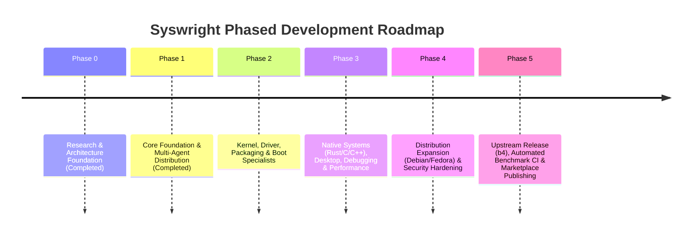

# Syswright

[](https://agentskills.io)
[](https://code.claude.com)
[](https://developers.openai.com)
[-orange?style=flat-square)](docs/phase-0/12-open-decisions.md)

A research-first, evidence-driven engineering intelligence system and specialist skill catalog for AI coding agents (Claude Code, OpenAI Codex, Antigravity CLI, and Agent Skills runtimes).

---

## 1. Core Engineering Philosophy

> **Research before implementation. Evidence before assumptions. Verification before completion.**

Standard AI coding agents frequently fail at Linux systems engineering: they hallucinate deprecated kernel APIs, recommend 10-year-old blog snippets, guess systemd configurations, and declare tasks "fixed" without running compilers or linters.

**Syswright** replaces this guesswork with an uncompromising systems engineering runtime:
1. **Understand the actual task**: Problem decomposition and constraint mapping.
2. **Establish version boundaries**: Never assume kernel or userspace version; probe target environment.
3. **Query authoritative upstream sources**: Research official upstream manuals (`docs.kernel.org`, `freedesktop.org`, `man7.org`, POSIX).
4. **Inspect existing code & git history**: Analyze architectural rationale using `git log -S` and `lore.kernel.org`.
5. **Enforce operational safety tiers**: Autonomous execution for diagnostics and workspace builds; strict human gates for privileged host mutations (`sudo`, kernel loading, partitioning).
6. **Verify with deterministic evidence**: Completion requires passed compilers (`gcc -Wall`, `cargo check`), static linters (`checkpatch.pl`, `namcap`, `systemd-analyze verify`), and test suites.

---

## 2. Multi-Agent Compatibility Architecture

Syswright implements a **Single-Source Canonical Architecture with Platform-Specific Distribution Adapters**:

```text
syswright/
├── .claude-plugin/              # Claude Code native plugin integration
│   ├── plugin.json
│   └── marketplace.json
├── skills/                      # Canonical Agent Skills (100% agentskills.io compliant)
│   ├── linux-engineer/          # Master orchestrator & intent router
│   ├── linux-research/          # Upstream evidence & authority engine
│   ├── linux-environment/       # Safe unprivileged system discovery
│   └── arch-packaging/          # Arch Linux packaging engineering specialist
├── references/                  # Shared authoritative domain references
├── adapters/                    # Platform adapters for Codex, Claude, and other agents
├── scripts/                     # Zero-dependency validation & packaging tools
├── evals/                       # Evaluation benchmark suites & fixtures
├── tests/                       # Automated unit & integration tests
├── docs/                        # Architecture specs & Phase 0/1/2 documentation
└── AGENTS.md                    # Persistent repository guidance for AI coding agents
```

---

## 3. Skill Catalog (Phase 6 Status)

| Skill Name | Directory | Status | Primary Purpose |
|:---|:---|:---:|:---|
| **`linux-engineer`** | [`skills/linux-engineer/`](skills/linux-engineer/SKILL.md) | **ACTIVE** | Master entry-point, task decomposition, workflow sequencing, multi-subsystem orchestration. |
| **`linux-research`** | [`skills/linux-research/`](skills/linux-research/SKILL.md) | **ACTIVE** | 10-step upstream investigation, lore.kernel.org query, evidence ledger creation. |
| **`linux-environment`** | [`skills/linux-environment/`](skills/linux-environment/SKILL.md) | **ACTIVE** | Safe discovery of distro identity, kernel release, toolchains, container/VM status. |
| **`arch-packaging`** | [`skills/arch-packaging/`](skills/arch-packaging/SKILL.md) | **ACTIVE** | Full Arch Linux packaging lifecycle, PKGBUILD authoring, clean chroots, namcap, AUR, and repos. |
| **`debian-packaging`** | [`skills/debian-packaging/`](skills/debian-packaging/SKILL.md) | **ACTIVE** | Debian source/binary packaging, debhelper 13+, DEP-3 quilt patches, sbuild, lintian, autopkgtest, mentors. |
| **`ubuntu-packaging`** | [`skills/ubuntu-packaging/`](skills/ubuntu-packaging/SKILL.md) | **ACTIVE** | Ubuntu delta over Debian, Launchpad PPAs, source-only uploads, LTS vs Interim series, SRU test plans, dput. |
| **`rpm-packaging`** | [`skills/rpm-packaging/`](skills/rpm-packaging/SKILL.md) | **ACTIVE** | Core RPM spec anatomy, directory macros, automatic soname dependencies, scriptlet $1=0 trap, rpmsign. |
| **`fedora-packaging`** | [`skills/fedora-packaging/`](skills/fedora-packaging/SKILL.md) | **ACTIVE** | Fedora packaging guidelines, SPDX licensing, strict unbundling, mock chroots, fedpkg, Koji, Bodhi, EPEL. |
| **`opensuse-packaging`** | [`skills/opensuse-packaging/`](skills/opensuse-packaging/SKILL.md) | **ACTIVE** | openSUSE spec conventions, `%service_add_post`, Open Build Service (OBS), osc CLI, Tumbleweed vs Leap. |
| **`linux-distribution-engineering`** | [`skills/linux-distribution-engineering/`](skills/linux-distribution-engineering/SKILL.md) | **ACTIVE** | APT, DNF repomd, Zypper, Pacman repo architectures; offline GPG signing; package promotion; rollback. |
| **`reproducible-builds`** | [`skills/reproducible-builds/`](skills/reproducible-builds/SKILL.md) | **ACTIVE** | Bit-for-bit determinism, SOURCE_DATE_EPOCH, diffoscope, reprotest, SPDX/CycloneDX SBOMs, SLSA Level 3. |
| **`linux-release-maintenance`** | [`skills/linux-release-maintenance/`](skills/linux-release-maintenance/SKILL.md) | **ACTIVE** | Upstream release tracking (uscan/Anitya), patch queue lifecycle, ABI transitions, CVE backporting. |
| **`kernel-engineering`** | [`skills/kernel-engineering/`](skills/kernel-engineering/SKILL.md) | **ACTIVE** | Subsystem architecture, Kbuild/Kconfig, regression bisect, kernel patching, debugging, and upstream LKML workflow. |
| **`driver-engineering`** | [`skills/driver-engineering/`](skills/driver-engineering/SKILL.md) | **ACTIVE** | Device model, bus subsystems (PCI/USB/I2C/SPI), probe lifecycle, DMA, interrupts, and power management. |
| **`systemd-engineering`** | [`skills/systemd-engineering/`](skills/systemd-engineering/SKILL.md) | **ACTIVE** | Unit architecture, service lifecycle, security sandboxing, cgroups v2 resource limits, and journald troubleshooting. |
| **`boot-engineering`** | [`skills/boot-engineering/`](skills/boot-engineering/SKILL.md) | **ACTIVE** | UEFI/BIOS firmware, bootloaders, initramfs (mkinitcpio/dracut), Unified Kernel Images (UKI), and Secure Boot. |
| **`linux-networking`** | [`skills/linux-networking/`](skills/linux-networking/SKILL.md) | **ACTIVE** | Kernel networking stack, network managers, policy routing, nftables firewalling, and network namespaces. |
| **`linux-storage`** | [`skills/linux-storage/`](skills/linux-storage/SKILL.md) | **ACTIVE** | Block layer (blk-mq), filesystems (ext4/Btrfs/XFS), device-mapper/LVM, LUKS encryption, RAID, and recovery. |
| **`linux-application-engineering`** | [`skills/linux-application-engineering/`](skills/linux-application-engineering/SKILL.md) | **ACTIVE** | Native application architecture, Rust/C/C++, CLI tools, system daemons, XDG Base Directory, security. |
| **`qt-qml-engineering`** | [`skills/qt-qml-engineering/`](skills/qt-qml-engineering/SKILL.md) | **ACTIVE** | Qt 6, QML modules, Qt Quick scene graph, declarative QML/C++ integration, Qt Widgets, QTest. |
| **`gtk-engineering`** | [`skills/gtk-engineering/`](skills/gtk-engineering/SKILL.md) | **ACTIVE** | GTK 4, GLib/GObject/GIO, GtkApplication, composite XML templates, Libadwaita, AT-SPI accessibility. |
| **`desktop-integration`** | [`skills/desktop-integration/`](skills/desktop-integration/SKILL.md) | **ACTIVE** | Wayland protocols, X11/XWayland, D-Bus IPC, XDG Desktop Portals, Freedesktop metadata, and systemd user services. |
| **`linux-build-engineering`** | [`skills/linux-build-engineering/`](skills/linux-build-engineering/SKILL.md) | **ACTIVE** | Modern target-based CMake, Meson, Ninja, Cargo workspaces, compiler toolchains (GCC/Clang), and ABI stability. |
| **`linux-debugging`** | [`skills/linux-debugging/`](skills/linux-debugging/SKILL.md) | **ACTIVE** | GDB/LLDB post-mortem analysis, core dumps, memory leaks, thread deadlocks, kernel panics, hypothesis testing. |
| **`linux-performance`** | [`skills/linux-performance/`](skills/linux-performance/SKILL.md) | **ACTIVE** | perf CPU profiling, memory allocation churn, storage I/O latency, network BDP tuning, statistical benchmarking. |
| **`linux-security`** | [`skills/linux-security/`](skills/linux-security/SKILL.md) | **ACTIVE** | Threat modeling, least privilege, systemd sandboxing, capabilities, seccomp, Landlock, CVE backport verification. |
| **`linux-observability`** | [`skills/linux-observability/`](skills/linux-observability/SKILL.md) | **ACTIVE** | Native tracefs, ftrace, eBPF CO-RE/verifier, metrics cardinality management, and distributed tracing. |
| **`linux-fuzzing`** | [`skills/linux-fuzzing/`](skills/linux-fuzzing/SKILL.md) | **ACTIVE** | In-process libFuzzer targets, AFL++ persistent campaigns, syzkaller QEMU kernel fuzzing, and crash triage. |
| **`linux-regression-engineering`** | [`skills/linux-regression-engineering/`](skills/linux-regression-engineering/SKILL.md) | **ACTIVE** | Automated git bisect predicates (exit 125), kernel/app version regressions, and shared library ABI guards. |

---

## 4. Installation & Setup

### 4.1 Claude Code
Install as a local plugin in Claude Code:
```bash
# In an interactive Claude Code terminal session:
/plugin install ./
```
Or start Claude Code with the plugin directory loaded:
```bash
claude --plugin-dir /path/to/LinuxEngineering
```

### 4.2 OpenAI Codex
Codex automatically indexes [AGENTS.md](AGENTS.md) at the repository root as durable execution instructions. To package standalone skills for Codex:
```bash
python3 scripts/package-skills.py --target codex --output ~/.codex/skills/
```

### 4.3 General Agent Skills Runtimes
Build a standard distributable archive:
```bash
python3 scripts/package-skills.py --target archive --output dist/
```

---

## 5. Usage Examples

### 5.1 Environment Discovery
Run safe, unprivileged reconnaissance of the active Linux system:
```bash
python3 skills/linux-environment/scripts/discover_environment.py --format text
```
*Output*:
```text
Distribution : Arch Linux (ID: arch)
Kernel       : 6.18.64-1-lts (x86_64)
Context      : native (none)
Init System  : systemd 
Compilers    : gcc, clang, rustc
Build Systems: meson, cmake, make, ninja, cargo
Packaging    : makepkg, pacman
```

### 5.2 Researching Upstream Issues
When an agent is asked to investigate an issue or deprecation (e.g., "What replaced `init_timer()` in Linux 4.14?"):
1. The agent invokes `linux-research`.
2. It consults [references/source-authority.md](references/source-authority.md) and [skills/linux-research/references/upstream-sources.md](skills/linux-research/references/upstream-sources.md).
3. It emits a structured evidence card:
   ```markdown
   ### Evidence Record: Kernel Timer API
   - **Claim**: init_timer() was removed in Linux 4.15; replaced by timer_setup().
   - **Source**: https://docs.kernel.org/core-api/kernel-api.html
   - **Authority**: Tier 1 (Official Upstream Kernel Documentation)
   - **Target Version**: Linux 6.18 LTS
   - **Confidence**: Verified
   - **Engineering Implication**: Driver callbacks must use from_timer() to recover private data.
   ```

### 5.3 Arch Linux Packaging Engineering
When an agent is tasked with packaging an upstream software release (e.g., "Create a PKGBUILD for ripgrep-all"):
1. `linux-engineer` routes the request to `arch-packaging`.
2. `arch-packaging` inspects upstream sources, identifies build system conventions (`cargo`, `cmake`, `meson`, etc.), and verifies SPDX licensing.
3. It generates a standards-compliant `PKGBUILD`, performs non-executing static analysis (`bash -n`), and validates metadata with `namcap`.
4. It isolates builds in clean chroots via `pkgctl build --clean`, catching undeclared build dependencies.
5. It runs `evals/arch-packaging/eval_arch_packaging.py` to ensure zero hallucinations or security violations.

### 5.4 Core Linux Systems Engineering
When an agent diagnoses an operating system or hardware issue (e.g., "Why is our NVMe volume failing to mount after an unclean shutdown?"):
1. `linux-engineer` coordinates diagnostics across `linux-storage` and `linux-environment`.
2. `linux-storage` inspects `dmesg` and NVMe SMART telemetry (`nvme smart-log`) to separate media wearout from filesystem corruption.
3. It enforces safety invariants: filesystems must be unmounted before any check (`e2fsck -n`), and autonomous reformatting (`mkfs`, `wipefs`) is strictly refused as a Tier 3 action requiring human sign-off.
4. It provides evidence-backed recovery procedures using backup superblocks or snapshot rollbacks.
5. It runs `evals/eval_systems.py` to ensure compliance across all 28 systems engineering benchmarks.

### 5.5 Native Linux Application & Desktop Engineering
When an agent develops or reviews a native Linux desktop application (e.g., "Develop a Qt 6 desktop utility with Wayland integration"):
1. `linux-engineer` routes the request across `linux-application-engineering`, `qt-qml-engineering`, `desktop-integration`, and `linux-build-engineering`.
2. `linux-application-engineering` designs the process model, signal handling, and XDG Base Directory storage.
3. `qt-qml-engineering` sets up modern Qt 6 CMake modules (`qt_add_qml_module`), separates UI from C++ models, and avoids GUI thread starvation.
4. `desktop-integration` generates and validates the `.desktop` launcher (`desktop-file-validate`), AppStream metadata (`appstreamcli validate`), and mediates file access via XDG Desktop Portals.
5. `linux-build-engineering` applies compiler hardening flags (`-D_FORTIFY_SOURCE=3 -fstack-protector-strong`) and configures reproducible build inputs (`SOURCE_DATE_EPOCH`).
6. It runs `evals/eval_native_apps.py` to ensure compliance across all 34 native application benchmarks.

### 5.6 Cross-Distribution, Release and Supply-Chain Engineering
When an agent maintains a multi-distribution software project (e.g., "Package and release a daemon across Debian, Ubuntu, Fedora, and openSUSE with reproducible builds"):
1. `linux-engineer` routes the task across `linux-release-maintenance`, `debian-packaging`, `ubuntu-packaging`, `fedora-packaging`, `opensuse-packaging`, and `reproducible-builds`.
2. `debian-packaging` and `ubuntu-packaging` author clean source packages using debhelper 13+ and DEP-3 quilt patches, preparing PPA uploads via `dput`.
3. `fedora-packaging` enforces strict unbundling and SPDX licensing, verifying builds in clean chroots via `mock`.
4. `opensuse-packaging` adheres to openSUSE shared library naming policies (`libfoo1`) and prepares OBS builds via `osc`.
5. `reproducible-builds` normalizes build timestamps via `SOURCE_DATE_EPOCH`, maps build paths (`-ffile-prefix-map`), verifies binary identity with `diffoscope`, and generates SPDX 2.3 SBOMs and SLSA Level 3 attestations.
6. `linux-distribution-engineering` verifies repository metadata signatures, promotes packages through dev/staging/production, and enforces atomic metadata updates.
7. It runs `evals/eval_cross_distribution.py` to ensure compliance across all 48 cross-distribution benchmarks.

---

## 6. Development & Quality Assurance

All tooling is implemented using the Python 3 standard library with zero external dependencies.

### 6.1 Validate Skills
Verify that all 29 canonical skills comply with the `agentskills.io` specification:
```bash
python3 scripts/validate-skills.py
```

### 6.2 Check Reference Integrity
Verify that all relative documentation links and cross-references resolve (0 broken links):
```bash
python3 scripts/check-references.py
```

### 6.3 Run the Test Suite
Execute the complete automated test suite (62 unit and integration tests):
```bash
python3 tests/run_all_tests.py
```

### 6.4 Run Cross-Distribution Engineering Evaluations
Run the 48 cross-distribution, release, and supply-chain evaluation scenarios across Debian, Ubuntu, RPM, Fedora, openSUSE, repository engineering, reproducible builds, and release maintenance:
```bash
python3 evals/eval_cross_distribution.py
```

### 6.5 Run Advanced Engineering Evaluations
Run the 36 advanced engineering evaluation scenarios across debugging, performance, security, observability, fuzzing, and regression engineering:
```bash
python3 evals/eval_advanced_engineering.py
```

### 6.6 Run Native Application Engineering Evaluations
Run the 34 native application engineering evaluation scenarios across applications, Qt, GTK, desktop integration, and build systems:
```bash
python3 evals/eval_native_apps.py
```

### 6.7 Run Systems Engineering Evaluations
Run the 28 core systems engineering evaluation scenarios across kernel, drivers, systemd, boot, networking, and storage:
```bash
python3 evals/eval_systems.py
```

### 6.8 Run Packaging Evaluations
Run the 18 Arch Linux packaging evaluation scenarios:
```bash
python3 evals/arch-packaging/eval_arch_packaging.py
```

### 6.9 Run Skill-Routing Evaluations
Run the routing evaluation scenarios:
```bash
python3 evals/routing/eval_router.py
```

### 6.10 Run Research Evaluations
Run the 6 research and evidence evaluation scenarios:
```bash
python3 evals/research/eval_research.py
```

---

## 7. Operational Safety Summary

All operations comply with the **Four-Tier Safety Model**:
- **Tier 0 (Diagnostics)**: Read-only queries $\to$ Fully autonomous.
- **Tier 1 (Workspace Development)**: Compiling/editing within workspace $\to$ Autonomous in declared scope.
- **Tier 2 (Clean Sandboxes)**: Ephemeral clean chroots / QEMU microVMs $\to$ Automated with isolation checks.
- **Tier 3 (Host Mutating / Privileged)**: Operations involving `sudo`, host package modification, kernel module loading, bootloader edits, or disk partitioning $\to$ **STRICT HUMAN GATE REQUIRED**. Prohibited from autonomous execution; requires dry-run and rollback command.

For full safety details, see [references/safety-policy.md](references/safety-policy.md) and [SECURITY.md](SECURITY.md).

---

## 8. Roadmap



For detailed phase specifications, refer to [docs/phase-0/10-roadmap-and-phase-1.md](docs/phase-0/10-roadmap-and-phase-1.md) and [docs/architecture/adr-007-phase-1-foundation-scoping.md](docs/architecture/adr-007-phase-1-foundation-scoping.md).
