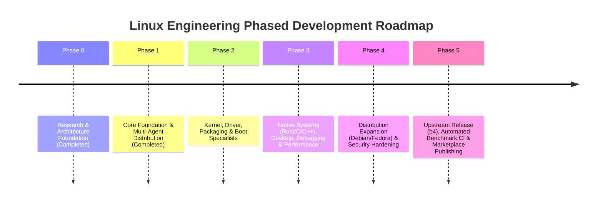

# Linux Engineering

[](https://agentskills.io)
[](https://code.claude.com)
[](https://developers.openai.com)
[-orange?style=flat-square)](docs/phase-0/12-open-decisions.md)

A research-first, evidence-driven engineering intelligence system and specialist skill catalog for AI coding agents (Claude Code, OpenAI Codex, Antigravity CLI, and Agent Skills runtimes).

---

## 1. Core Engineering Philosophy

> **Research before implementation. Evidence before assumptions. Verification before completion.**

Standard AI coding agents frequently fail at Linux systems engineering: they hallucinate deprecated kernel APIs, recommend 10-year-old blog snippets, guess systemd configurations, and declare tasks "fixed" without running compilers or linters.

**Linux Engineering** replaces this guesswork with an uncompromising systems engineering runtime:
1. **Understand the actual task**: Problem decomposition and constraint mapping.
2. **Establish version boundaries**: Never assume kernel or userspace version; probe target environment.
3. **Query authoritative upstream sources**: Research official upstream manuals (`docs.kernel.org`, `freedesktop.org`, `man7.org`, POSIX).
4. **Inspect existing code & git history**: Analyze architectural rationale using `git log -S` and `lore.kernel.org`.
5. **Enforce operational safety tiers**: Autonomous execution for diagnostics and workspace builds; strict human gates for privileged host mutations (`sudo`, kernel loading, partitioning).
6. **Verify with deterministic evidence**: Completion requires passed compilers (`gcc -Wall`, `cargo check`), static linters (`checkpatch.pl`, `namcap`, `systemd-analyze verify`), and test suites.

---

## 2. Multi-Agent Compatibility Architecture

Linux Engineering implements a **Single-Source Canonical Architecture with Platform-Specific Distribution Adapters**:

```text
linux-engineering/
├── .claude-plugin/              # Claude Code native plugin integration
│   ├── plugin.json
│   └── marketplace.json
├── skills/                      # Canonical Agent Skills (100% agentskills.io compliant)
│   ├── linux-engineer/          # Master orchestrator & intent router
│   ├── linux-research/          # Upstream evidence & authority engine
│   ├── linux-environment/       # Safe unprivileged system discovery
│   └── arch-packaging/          # Arch Linux packaging engineering specialist
├── references/                  # Shared authoritative domain references
├── adapters/                    # Platform adapters for Codex, Claude, and other agents
├── scripts/                     # Zero-dependency validation & packaging tools
├── evals/                       # Evaluation benchmark suites & fixtures
├── tests/                       # Automated unit & integration tests
├── docs/                        # Architecture specs & Phase 0/1/2 documentation
└── AGENTS.md                    # Persistent repository guidance for AI coding agents
```

---

## 3. Skill Catalog (Phase 2 Status)

| Skill Name | Directory | Status | Primary Purpose |
|:---|:---|:---:|:---|
| **`linux-engineer`** | [`skills/linux-engineer/`](skills/linux-engineer/SKILL.md) | **ACTIVE** | Master entry-point, task decomposition, workflow sequencing, safety gating. |
| **`linux-research`** | [`skills/linux-research/`](skills/linux-research/SKILL.md) | **ACTIVE** | 10-step upstream investigation, lore.kernel.org query, evidence ledger creation. |
| **`linux-environment`** | [`skills/linux-environment/`](skills/linux-environment/SKILL.md) | **ACTIVE** | Safe discovery of distro identity, kernel release, toolchains, container/VM status. |
| **`arch-packaging`** | [`skills/arch-packaging/`](skills/arch-packaging/SKILL.md) | **ACTIVE** | Full Arch Linux packaging lifecycle, PKGBUILD authoring, clean chroots, namcap, AUR, and repos. |

*Note*: Remaining domain specialists (`kernel-engineering`, `driver-engineering`, `systemd-engineering`, `linux-application-engineering`, `linux-security`, etc.) are scheduled across Phases 2 through 5. The `linux-engineer` orchestrator explicitly identifies them as planned specialists while providing research and diagnostic support.

---

## 4. Installation & Setup

### 4.1 Claude Code
Install as a local plugin in Claude Code:
```bash
# In an interactive Claude Code terminal session:
/plugin install ./
```
Or start Claude Code with the plugin directory loaded:
```bash
claude --plugin-dir /path/to/LinuxEngineering
```

### 4.2 OpenAI Codex
Codex automatically indexes [AGENTS.md](AGENTS.md) at the repository root as durable execution instructions. To package standalone skills for Codex:
```bash
python3 scripts/package-skills.py --target codex --output ~/.codex/skills/
```

### 4.3 General Agent Skills Runtimes
Build a standard distributable archive:
```bash
python3 scripts/package-skills.py --target archive --output dist/
```

---

## 5. Usage Examples

### 5.1 Environment Discovery
Run safe, unprivileged reconnaissance of the active Linux system:
```bash
python3 skills/linux-environment/scripts/discover_environment.py --format text
```
*Output*:
```text
Distribution : Arch Linux (ID: arch)
Kernel       : 6.18.64-1-lts (x86_64)
Context      : native (none)
Init System  : systemd 
Compilers    : gcc, clang, rustc
Build Systems: meson, cmake, make, ninja, cargo
Packaging    : makepkg, pacman
```

### 5.2 Researching Upstream Issues
When an agent is asked to investigate an issue or deprecation (e.g., "What replaced `init_timer()` in Linux 4.14?"):
1. The agent invokes `linux-research`.
2. It consults [references/source-authority.md](references/source-authority.md) and [skills/linux-research/references/upstream-sources.md](skills/linux-research/references/upstream-sources.md).
3. It emits a structured evidence card:
   ```markdown
   ### Evidence Record: Kernel Timer API
   - **Claim**: init_timer() was removed in Linux 4.15; replaced by timer_setup().
   - **Source**: https://docs.kernel.org/core-api/kernel-api.html
   - **Authority**: Tier 1 (Official Upstream Kernel Documentation)
   - **Target Version**: Linux 6.18 LTS
   - **Confidence**: Verified
   - **Engineering Implication**: Driver callbacks must use from_timer() to recover private data.
   ```

### 5.3 Arch Linux Packaging Engineering
When an agent is tasked with packaging an upstream software release (e.g., "Create a PKGBUILD for ripgrep-all"):
1. `linux-engineer` routes the request to `arch-packaging`.
2. `arch-packaging` inspects upstream sources, identifies build system conventions (`cargo`, `cmake`, `meson`, etc.), and verifies SPDX licensing.
3. It generates a standards-compliant `PKGBUILD`, performs non-executing static analysis (`bash -n`), and validates metadata with `namcap`.
4. It isolates builds in clean chroots via `pkgctl build --clean`, catching undeclared build dependencies.
5. It runs `evals/arch-packaging/eval_arch_packaging.py` to ensure zero hallucinations or security violations.

---

## 6. Development & Quality Assurance

All tooling is implemented using the Python 3 standard library with zero external dependencies.

### 6.1 Validate Skills
Verify that all skills comply with the `agentskills.io` specification:
```bash
python3 scripts/validate-skills.py
```

### 6.2 Check Reference Integrity
Verify that all relative documentation links and cross-references resolve:
```bash
python3 scripts/check-references.py
```

### 6.3 Run the Test Suite
Execute the complete automated test suite (26+ unit and integration tests):
```bash
python3 tests/run_all_tests.py
```

### 6.4 Run Skill-Routing Evaluations
Run the 10 real-world routing scenarios:
```bash
python3 evals/routing/eval_router.py
```

### 6.5 Run Research Evaluations
Run the 6 research and evidence evaluation scenarios:
```bash
python3 evals/research/eval_research.py
```

---

## 7. Operational Safety Summary

All operations comply with the **Four-Tier Safety Model**:
- **Tier 0 (Diagnostics)**: Read-only queries $\to$ Fully autonomous.
- **Tier 1 (Workspace Development)**: Compiling/editing within workspace $\to$ Autonomous in declared scope.
- **Tier 2 (Clean Sandboxes)**: Ephemeral clean chroots / QEMU microVMs $\to$ Automated with isolation checks.
- **Tier 3 (Host Mutating / Privileged)**: Operations involving `sudo`, host package modification, kernel module loading, bootloader edits, or disk partitioning $\to$ **STRICT HUMAN GATE REQUIRED**. Prohibited from autonomous execution; requires dry-run and rollback command.

For full safety details, see [references/safety-policy.md](references/safety-policy.md) and [SECURITY.md](SECURITY.md).

---

## 8. Roadmap



For detailed phase specifications, refer to [docs/phase-0/10-roadmap-and-phase-1.md](docs/phase-0/10-roadmap-and-phase-1.md) and [docs/architecture/adr-007-phase-1-foundation-scoping.md](docs/architecture/adr-007-phase-1-foundation-scoping.md).
