# Syswright — Advanced Linux Engineering: Security, Performance, Observability and Reliability

## 1. Executive Summary

This architecture expands **Syswright** from systems implementation into root-cause diagnosis, performance measurement, defensive security hardening, deep kernel observability, automated defect discovery (fuzzing), and regression engineering.

AI coding agents are frequently prone to speculative fixes, premature optimizations, exaggerated vulnerability claims, and untested assumptions. This subsystem equips agents with the tools and discipline of principal Linux engineers:
- **Evidence over Intuition**: Never alter code based on an error message without an isolated hypothesis and proof of invariant violation.
- **Measurement over Speculation**: Never claim a performance optimization without statistically valid, repeated benchmark distributions.
- **Defensive Rigor over Hype**: Distinguish actual distribution backports from naive version mismatches; never exaggerate local crashes into remote vulnerabilities.
- **Safety Boundaries**: Isolate kernel fuzzing into ephemeral virtual machines; prevent destructive disk benchmarks against host partitions; protect private credentials from diagnostic reports.

---

## 2. Specialist Domain Architecture

The advanced engineering subsystem introduces six specialized capabilities that cooperate through the Syswright ecosystem:

```
                                  ┌────────────────────────┐
                                  │     linux-engineer     │
                                  │  (Master Orchestrator) │
                                  └───────────┬────────────┘
         ┌──────────────────┬─────────────────┼──────────────────┬──────────────────┐
         ▼                  ▼                 ▼                  ▼                  ▼
┌─────────────────┐ ┌───────────────┐ ┌───────────────┐ ┌─────────────────┐ ┌────────────────┐
│ linux-debugging │ │linux-perform. │ │linux-security │ │linux-observab.  │ │ linux-fuzzing  │
│ (Find & Explain)│ │(Measure & Opt)│ │(Harden & Def) │ │(Kernel Tracing) │ │(Auto Discovery)│
└────────┬────────┘ └───────┬───────┘ └───────┬───────┘ └────────┬────────┘ └───────┬────────┘
         │                  │                 │                  │                  │
         └──────────────────┴────────────┬────┴──────────────────┴──────────────────┘
                                         ▼
                        ┌─────────────────────────────────┐
                        │  linux-regression-engineering   │
                        │    (git bisect & ABI guards)    │
                        └─────────────────────────────────┘
```

### Responsibility Demarcation:

| Specialist Skill | Primary Responsibility | Distinguishing Boundary |
|---|---|---|
| [`linux-debugging`](../../skills/linux-debugging/SKILL.md) | Finds and explains software and OS defects. | Focuses on active/post-mortem failure analysis (GDB, core dumps, memory corruption, deadlocks, kernel panics). |
| [`linux-performance`](../../skills/linux-performance/SKILL.md) | Measures and improves resource efficiency. | Focuses on empirical metrics (perf, IPC, cache misses, memory bloat, I/O latency, network BDP, statistical benchmarks). |
| [`linux-security`](../../skills/linux-security/SKILL.md) | Evaluates and hardens systems and applications. | Focuses on defense-in-depth, least privilege, systemd sandboxing, capabilities, seccomp, Landlock, and CVE backports. |
| [`linux-observability`](../../skills/linux-observability/SKILL.md) | Provides non-invasive runtime system visibility. | Focuses on native tracefs, ftrace, eBPF CO-RE/verifier, metrics cardinality, and distributed tracing. |
| [`linux-fuzzing`](../../skills/linux-fuzzing/SKILL.md) | Discovers defects through automated input generation. | Focuses on coverage-guided fuzz targets (libFuzzer), mutation campaigns (AFL++), syzkaller VM fuzzing, and sanitizers. |
| [`linux-regression-engineering`](../../skills/linux-regression-engineering/SKILL.md) | Isolates breaking commits and prevents regressions. | Focuses on automated `git bisect` predicates (exit 125), kernel/app version regressions, and shared library ABI stability (`abidiff`). |

---

## 3. Core Architectural Subsystems

### 3.1 Scientific Debugging & Hypothesis Testing
Debugging adheres to a strict 14-step protocol:
1. Distinguish observed symptoms from speculative explanations.
2. Formulate at least two competing technical hypotheses.
3. Trace pointer provenance backwards to the true allocator/caller source rather than applying superficial null checks (`if (!ptr) return;`) that mask underlying state corruption.
4. Resolve debug symbols via ELF `.note.gnu.build-id` and `debuginfod`; refuse to declare root cause from stripped `??` frames.

### 3.2 Statistical Benchmarking & Noise Isolation
Performance claims require statistical verification:
- Single-run measurements are rejected as meaningless due to CPU frequency governors, page cache warm/cold transitions, and background OS scheduling jitter.
- Enforce repeated trials ($N \ge 10-20$), reporting mean, standard deviation ($\sigma$), median (p50), and tail latency (p99).
- Require a multi-sigma difference ($\Delta > 3\sigma$) or Student's t-test before flagging performance regressions in automated CI gates.
- Benchmark storage using non-destructive file targets in `fio`, strictly prohibiting direct operations on raw host block devices (`/dev/sdX`, `/dev/nvmeX`).

### 3.3 Defensive Security & Backport Awareness
Security analysis remains defensive, responsible, and distribution-aware:
- Rejects naive version string matching (`installed < fixed_version`). In enterprise and stable Linux distributions (Debian, RHEL, Ubuntu, Arch), security patches are routinely backported without major/minor version increments. Verification requires consulting distribution changelogs and security trackers.
- Rejects exaggerated vulnerability claims (e.g., labeling local non-setuid CLI buffer overflows as "Remote Code Execution").
- Sandboxes system daemons using systemd directives (`ProtectSystem=strict`, `NoNewPrivileges=yes`, `SystemCallFilter=@system-service`, `CapabilityBoundingSet`).
- Enforces strict redaction of credentials (passwords, bearer tokens, private keys) from all diagnostic reports.

### 3.4 Modern eBPF Architecture & Verifier Invariants
Kernel observability leverages modern eBPF and CO-RE (Compile Once - Run Everywhere):
- Prefers static tracepoints (`tracepoint:syscalls:sys_enter_*`) over dynamic kprobes for ABI stability across kernel updates.
- Executes filtering inside the kernel BPF program to avoid high-volume event copying to user space.
- Streams events via `BPF_MAP_TYPE_RINGBUF` (unified multi-CPU memory, global event ordering) rather than legacy perf buffers.
- Troubleshoots BPF verifier rejections by mathematically proving bounds to the static analyzer (bitwise masking, `BPF_CORE_READ()`).

### 3.5 Fuzzing & Sanitizer Engineering
Fuzzing is treated as rigorous automated engineering:
- In-process `LLVMFuzzerTestOneInput` harnesses must be deterministic, stateless, and deallocate structures to avoid false-positive leak reports.
- Explains compiler sanitizer mutual-exclusion constraints (ASan and TSan cannot be linked into the same binary).
- Enforces disposable QEMU/KVM virtual machine sandboxes for kernel fuzzing (`syzkaller`), strictly refusing to fuzz bare metal host operating systems.
- Minimizes crash artifacts using `afl-tmin` or `libFuzzer -minimize_crash=1` and converts minimized test cases into permanent regression unit tests.

### 3.6 Automated Regression Isolation & ABI Guards
Regression engineering isolates breaking changes with mathematical efficiency:
- Automates `git bisect run` with standalone bash test predicates, isolating culprits across hundreds of commits in $O(\log N)$ steps.
- **The Exit Code 125 Invariant**: Unbuildable intermediate commits must return exit code 125 (`git bisect skip`). Returning 1 falsely attributes the regression to the build failure; returning 0 falsely attributes it to a good commit.
- Upholds Linus's Law: *"We do not break userspace."* Any kernel update that breaks existing user-space software is treated as an upstream kernel bug requiring a revert or fix.
- Detects shared library ABI breaks (struct field shifts, vtable shifts) with `abidiff` (libabigail), enforcing mandatory `SOVERSION` increments.

---

## 4. Cross-Specialist Multi-Subsystem Coordination

The central orchestrator [`linux-engineer`](../../skills/linux-engineer/SKILL.md) coordinates specialists for complex engineering scenarios:

```mermaid
flowchart LR
    subgraph Multi-Specialist Orchestration
        KC["Kernel Crash Investigation"] --> DBG1["linux-debugging"]
        KC --> KERN1["kernel-engineering"]
        KC --> OBS1["linux-observability"]
        KC --> REG1["linux-regression-engineering"]

        ML["Qt Memory Leak Investigation"] --> DBG2["linux-debugging"]
        ML --> QT2["qt-qml-engineering"]
        ML --> PERF2["linux-performance"]
        ML --> REG2["linux-regression-engineering"]

        SD["System Daemon Security Review"] --> SEC3["linux-security"]
        SD --> SYS3["systemd-engineering"]
        SD --> DBG3["linux-debugging"]

        KF["Kernel Fuzzing Campaign"] --> FUZZ4["linux-fuzzing"]
        KF --> KERN4["kernel-engineering"]
        KF --> OBS4["linux-observability"]

        SP["Storage Performance Degradation"] --> PERF5["linux-performance"]
        SP --> OBS5["linux-observability"]
        SP --> STOR5["linux-storage"]
        SP --> REG5["linux-regression-engineering"]
    end
```



---

## 5. Verification & Evaluation Strategy

The advanced engineering evaluation infrastructure consists of 36 deterministic evaluation scenarios across 6 test domains in `evals/`:
- `evals/debugging/scenarios.json`: 6 scenarios.
- `evals/performance/scenarios.json`: 6 scenarios.
- `evals/security/scenarios.json`: 8 scenarios.
- `evals/observability/scenarios.json`: 5 scenarios.
- `evals/fuzzing/scenarios.json`: 6 scenarios.
- `evals/regression/scenarios.json`: 5 scenarios.

Evaluations run through `evals/eval_advanced_engineering.py` and are integrated into the master test suite via `tests/test_advanced_engineering_evals.py`. The suite includes adversarial negative tests verifying that speculative optimizations, unverified CVE alerts, unbuildable bisect handling, and bare metal kernel fuzzing are rejected.

---

## 6. Known Limitations

1. **Bare Metal Virtualization Requirements**: Kernel fuzzing with `syzkaller` and QEMU kernel bisects require hardware virtualization support (`/dev/kvm`). In unprivileged container environments lacking nested KVM, kernel VM booting must fall back to software TCG emulation or pre-captured kernel traces.
2. **debuginfod Network Availability**: Automated symbol resolution depends on distribution `debuginfod` servers or local debuginfo packages. Air-gapped environments require pre-cached DWARF symbol stores.
3. **Hardware Performance Counters**: Micro-architectural counters (LLC misses, branch miss rate) via `perf` require access to physical PMU hardware. Many cloud VMs (hypervisors) do not virtualize performance counters, limiting `perf stat` to software timer events.
