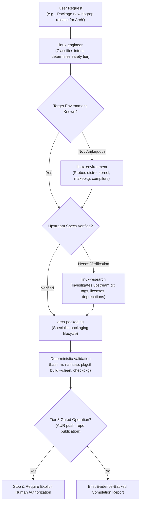

# Arch Linux Packaging Engineering Architecture

## 1. Overview & Context

`arch-packaging` is the first distribution-specific specialist skill in **Linux Engineering**, introduced in Phase 2. While the foundation skills (`linux-engineer`, `linux-research`, `linux-environment`) establish a distribution-agnostic systems engineering baseline, `arch-packaging` equips AI coding agents with deep, authoritative specialization in Arch Linux package engineering.

An agent utilizing this skill operates not as a simplistic template generator, but as an experienced Arch Linux package maintainer adhering to the principles:
> **Research before implementation. Evidence before assumptions. Verification before completion.**

---

## 2. Foundation Skill Integration

The specialist integrates directly with the tri-skill foundation:



### 2.1 Role of `linux-environment`
Before assuming tool availability or target architecture, `linux-environment` probes the active system:
- Verifies host distribution (`arch` vs non-Arch).
- Detects installed compilers (`gcc`, `clang`, `rustc`, `go`) and build generators (`cmake`, `meson`, `ninja`).
- Verifies availability of packaging utilities (`makepkg`, `pacman`, `namcap`, `pkgctl`).
- Determines execution context (`native`, `container`, `vm`, `chroot`).

### 2.2 Role of `linux-research`
Before writing a `PKGBUILD`, `linux-research` investigates upstream sources:
- Queries authoritative upstream endpoints (GitHub releases, GitLab, kernel.org) adhering to the 7-tier source authority hierarchy.
- Audits upstream `LICENSE` files to determine precise SPDX identifiers.
- Inspects upstream commit logs (`git log -S`) to identify removed build flags or breaking ABI changes.

### 2.3 Role of `linux-engineer`
- Acts as master intent classifier and workflow orchestrator.
- Evaluates operational safety tiers (Tier 0 diagnostics vs Tier 3 publishing).
- Halts execution and requests human authorization before any remote push to AUR or package database mutation.

---

## 3. Specialist Architecture & Components

`skills/arch-packaging/` is organized following progressive disclosure:

```text
skills/arch-packaging/
├── SKILL.md                          # Primary orchestrator & lifecycle decision tree
├── references/                       # Authoritative domain reference library
│   ├── package-standards.md          # Packaging philosophy, naming, pkgver/pkgrel, SPDX
│   ├── pkgbuild-reference.md         # Exhaustive variable and lifecycle function reference
│   ├── dependency-management.md      # ELF dynamic analysis, SONAMEs, depends vs makedepends
│   ├── build-systems.md              # CMake, Meson, Cargo, Python PEP 517, Go, Autotools
│   ├── filesystem-layout.md          # Arch FHS conventions, /usr rules, backup=(), sysusers
│   ├── clean-chroot-builds.md        # devtools architecture, pkgctl build, isolation
│   ├── package-validation.md         # 9-stage verification pipeline, namcap, checkpkg
│   ├── security-and-integrity.md     # Checksums, OpenPGP validpgpkeys, supply-chain guards
│   ├── aur-maintenance.md            # AUR conventions, anti-duplication, .SRCINFO
│   ├── official-repository-workflow.md# GitLab packaging workflow, MRs, PM conventions
│   ├── repository-maintenance.md     # Custom repos, repo-add, GPG signing, pacman.conf
│   ├── version-updates.md            # 11-step version bump and patch audit workflow
│   ├── reproducible-builds.md        # Bit-for-bit reproducibility, .BUILDINFO, makerepropkg
│   ├── troubleshooting.md            # Diagnostics and remediation matrix for 20+ failure types
│   └── advanced-packaging.md         # Split packages, VCS -git, DKMS, desktop & systemd
└── templates/                        # Reusable packaging templates with research checklists
    ├── basic-source.PKGBUILD         # GNU Make / Autotools template
    ├── cmake.PKGBUILD                # CMake + Ninja template
    ├── meson.PKGBUILD                # Meson + Ninja template
    ├── cargo.PKGBUILD                # Rust / Cargo template
    ├── python.PKGBUILD               # Python PEP 517 build/installer template
    ├── go.PKGBUILD                   # Go modules hardened binary template
    ├── split-package.PKGBUILD        # Split library and CLI package template
    ├── vcs-git.PKGBUILD              # Dynamic VCS development package template
    ├── binary-repack.PKGBUILD        # Binary distribution repackaging template
    └── systemd-service.PKGBUILD      # Package with systemd unit, patch, and sysusers
```

---

## 4. Target Destination Workflows

The skill enforces strict separation across four distinct target destinations:

| Target Destination | Packaging Artifacts | Push / Publish Rules |
|:---|:---|:---|
| **Official Arch Repositories** | GitLab Merge Requests (`gitlab.archlinux.org/archlinux/packaging/packages/<pkgname>`) | Read-only contributor boundary. An agent never claims official maintainer authority or pushes directly to official Git branches. |
| **Arch User Repository (AUR)** | Source repository (`PKGBUILD`, `.SRCINFO`, local patches). No binary tarballs. | Anti-duplication check mandatory. Pushing to `aur.archlinux.org` is a Tier 3 action requiring explicit human authorization. |
| **Custom Distribution Repositories** | Binary archives (`.pkg.tar.zst`), detached signatures (`.sig`), database (`.db.tar.gz`). | Managed via `repo-add --sign --verify`. GPG keyring management. Client `pacman.conf` configuration. |
| **Local System Builds** | Local workspace packages for developer testing. | Ephemeral staging, version pinning, safe container testing. |

---

## 5. Security & Verification Strategy

### 5.1 Non-Executing Static Analysis of Untrusted PKGBUILDs
A `PKGBUILD` is executable Bash code. Sourcing an untrusted `PKGBUILD` on the host workstation exposes the system to arbitrary shell execution. The skill mandates:
1. Stage 1 static syntax checking via `bash -n PKGBUILD`.
2. AST and regex pattern scanning for suspicious payloads (e.g. `curl ... | bash` in `prepare()`).
3. Execution strictly inside isolated clean chroots (`pkgctl build --clean`) or disposable containers.

### 5.2 Clean-Chroot vs Host Builds
A local build via `makepkg` is considered "dirty" because ambient headers on the developer's workstation can conceal missing `makedepends`. Only a clean-chroot build inside an ephemeral, minimal rootfs (`base` and `base-devel`) provides empirical proof of dependency completeness.

---

## 6. Evaluation Suite

The skill is continuously evaluated via `evals/arch-packaging/`:
- **18 Scenarios** covering CMake, Cargo, PKGBUILD review, dependency classification, missing makedepends diagnosis, architecture declarations, checksum integrity, PGP security, dirty vs clean chroots, AUR submission rules, official duplicate prevention, version updates, FHS paths, bundled libraries, untrusted execution defense, anti-churn preservation, custom repositories, and reproducibility.
- **Deterministic Validator**: `eval_arch_packaging.py` tests candidate solutions and detects hallucinations or shortcuts (e.g., rejecting `SKIP` on release tarballs, rejecting blind `gpg --recv-keys`, rejecting duplicate AUR submissions).

---

## 7. Scope Boundaries & Unsupported Workflows

The following capabilities are deliberately outside the automated scope of `arch-packaging`:
- **Direct publishing without human approval**: All publishing operations to the AUR or package repositories require human gating.
- **Reverse engineering undocumented proprietary binaries**: Addressed by specialized binary analysis workflows, not standard distribution packaging.
- **Replacing system package managers**: The skill generates packaging recipes and runs supported official tools; it never replaces pacman or libalpm.
