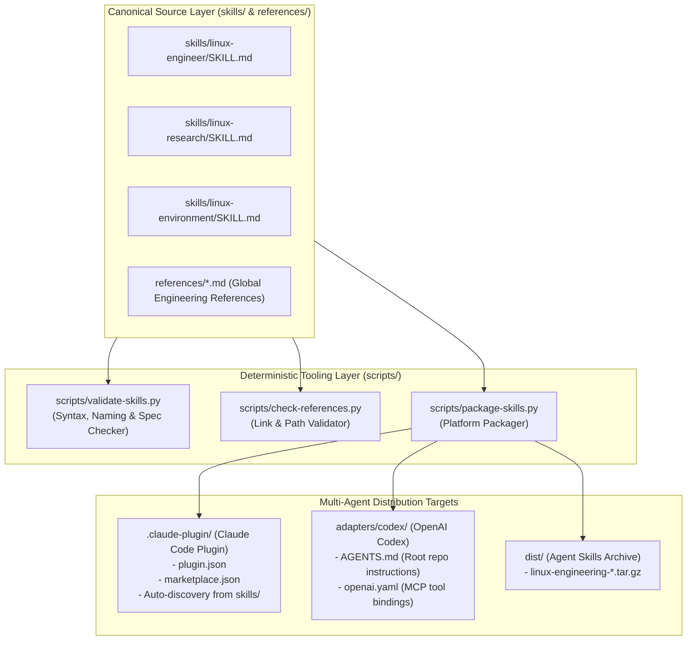

# Canonical Skills & Multi-Agent Adapter Architecture

## 1. Architectural Model

Linux Engineering implements a **Single-Source Canonical Architecture with Platform-Specific Distribution Adapters**.

---

## 2. Canonical Source Layer (`skills/` & `references/`)

### 2.1 Agent Skills Standard Compliance
Every skill in `skills/` adheres strictly to the vendor-neutral **Agent Skills open standard** ([agentskills.io/specification](https://agentskills.io/specification)):
1. **Directory Naming**: Must be lowercase alphanumeric with single hyphens (`a-z`, `0-9`, `-`). Must match the `name` field in `SKILL.md`.
2. **Frontmatter Constraints**:
   - `name`: 1–64 characters, matches directory name.
   - `description`: 1–1024 characters, describing what the skill does and when to activate it.
   - `compatibility`: Max 500 characters, indicating system dependencies.
   - `metadata`: Free-form string-to-string mapping used for platform-specific extension flags.
3. **Progressive Disclosure**:
   - `SKILL.md` body is limited to <500 lines (<5,000 tokens) focusing on procedural steps and routing.
   - Domain references (`references/`), templates (`templates/`), and executable scripts (`scripts/`) are loaded on-demand.

### 2.2 Global References (`references/`)
Shared engineering knowledge (such as research methodology, safety classifications, and testing philosophies) is placed in the top-level `references/` directory. Skills reference these files via standard relative Markdown links (e.g., `../../references/safety-policy.md`).

---

## 3. Platform Distribution Adapters

### 3.1 Claude Code Plugin Architecture
Claude Code discovers skills either from project `.claude/skills/`, user `~/.claude/skills/`, or via the native plugin packaging format:
- `.claude-plugin/plugin.json`: Declares the plugin name (`linux-engineering`), version, description, author, and license.
- `.claude-plugin/marketplace.json`: Declares the marketplace catalog entry pointing to `./` as the plugin source.
- Claude Code natively indexes skills in `skills/` when loaded as a plugin directory (`--plugin-dir .`).

### 3.2 OpenAI Codex Integration
OpenAI Codex uses two mechanisms:
1. **Repository-Level Guidance (`AGENTS.md`)**: A markdown file placed at the repository root that Codex reads as persistent, durable engineering instructions before performing any action.
2. **Skill Catalog Declarations**: Skills are packaged into standard skill directories or invoked via `@skill-name` / `$skill-name`. MCP tool boundaries are declared in `adapters/codex/agents/openai.yaml`.

### 3.3 Zero Knowledge Duplication Rule
- Skills are never copied with divergent wording for different platforms.
- If a platform requires custom metadata (such as Claude Code's `context: fork` or file `paths`), it is stored in the standard `metadata:` mapping in `SKILL.md`. The packaging script extracts and applies it during packaging.
