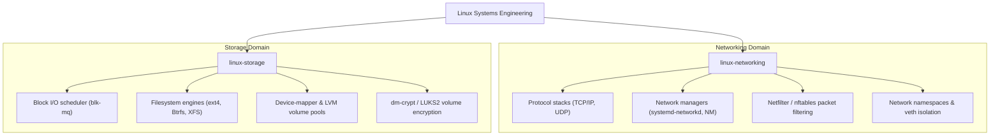
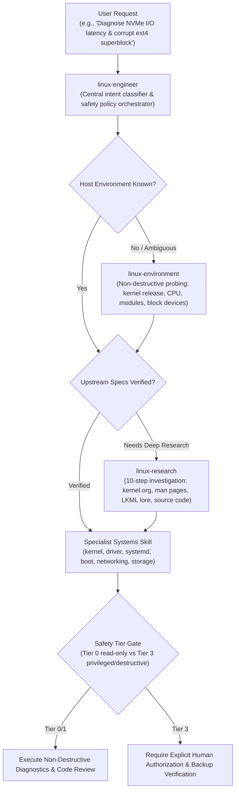

# Linux Systems Engineering Architecture

## 1. Overview & Context

**Linux Systems Engineering** expands the Linux Engineering platform beyond package management into the core operating system. Introduced in Phase 3, this subsystem delivers six deeply specialized, authoritative Agent Skills complying with the canonical `agentskills.io` standard:

1. **`kernel-engineering`**: Kernel source navigation, Kconfig/Kbuild compilation, regression bisecting, patching, debugging, and upstream contribution.
2. **`driver-engineering`**: Linux device model, bus subsystems (PCI, USB, I2C, SPI), probe mechanics, DMA, interrupts, and power management.
3. **`systemd-engineering`**: Unit architecture, service lifecycle, security sandboxing, cgroups v2 resource control, and startup troubleshooting.
4. **`boot-engineering`**: UEFI/BIOS firmware, bootloaders, early userspace/initramfs (`mkinitcpio`/`dracut`), Unified Kernel Images (UKI), and Secure Boot.
5. **`linux-networking`**: Kernel network stack, device managers (`systemd-networkd`, `NetworkManager`), policy routing, nftables firewalling, and network namespaces.
6. **`linux-storage`**: Block layer (`blk-mq`), filesystems (ext4, Btrfs, XFS), device-mapper/LVM, LUKS encryption, RAID, and storage disaster recovery.

These specialist skills operate under the repository's foundational engineering philosophy:
> **Research before implementation. Evidence before assumptions. Verification before completion.**

---

## 2. Architectural Separation: Networking & Storage

A key architectural mandate of Phase 3 is the deliberate separation of networking and storage into independent specialist skills:



### Rationale for Separation:
1. **Disparate Technical Foundations**: Networking operates on packet flows, stream buffers, routing tables, and asynchronous sockets. Storage operates on sector block addressing, dirty page writeback caches, journal transactions, and non-volatile NAND/magnetic media.
2. **Distinct Diagnostic Toolchains**: Networking leverages `iproute2`, `ethtool`, `resolvectl`, `nftables`, and `tcpdump`. Storage relies on `lsblk`, `blkid`, `nvme-cli`, `smartctl`, `cryptsetup`, `e2fsprogs`, and `btrfs-progs`.
3. **Divergent Failure Domains & Risks**: Network misconfigurations risk transient disconnects or SSH lockout. Storage misconfigurations risk catastrophic, irrecoverable data loss and filesystem superblock corruption.
4. **Maintenance & Evaluation Clarity**: Independent skills allow specialized reference libraries, distinct evaluation scenarios, and targeted agent routing without prompt bloat.

---

## 3. Foundation Skill Integration

The six systems specialists do not reinvent research, host reconnaissance, or orchestration; they integrate directly with the existing Phase 1 tri-skill foundation:



### Multi-Subsystem Coordination
Real-world systems engineering problems frequently span multiple domains. When an issue crosses boundaries, `linux-engineer` coordinates specialists in strict dependency order:
- **Encrypted Root Boot Failure**: `storage-engineering` (verifies LUKS header and UUID) $\rightarrow$ `boot-engineering` (configures `sd-encrypt` in `mkinitcpio.conf` and `rd.luks.name` kernel cmdline) $\rightarrow$ `systemd-engineering` (verifies `systemd-cryptsetup@.service` unit ordering).
- **Network Interface Missing After Kernel Update**: `linux-environment` (probes PCI bus and missing driver) $\rightarrow$ `driver-engineering` (matches PCI ID to `rtw88` and identifies missing firmware) $\rightarrow$ `linux-networking` (brings up interface and assigns IP).

---

## 4. Safety Tier Invariants

Systems engineering interacts directly with bare metal, firmware, and kernel memory. Strict safety tier enforcement protects against data loss and system bricks:

| Tier | Category | Allowed Actions | Disallowed Autonomous Actions |
|---|---|---|---|
| **Tier 0** | Diagnostics | `dmesg`, `sysfs` reads, `lspci`, `lsblk`, `blkid`, `ip link`, `resolvectl status`, `smartctl -a`, `faddr2line`, static code review | Running `dmesg -C`, writing to `/proc/sysrq-trigger` |
| **Tier 1** | Workspace Operations | Drafting systemd unit files, writing Kconfig fragments, creating local git patches, staging mock configs | Editing active host files in `/etc` or `/boot` |
| **Tier 2** | Isolated Sandboxes | Unprivileged network namespaces (`ip netns`), ephemeral container builds, rootless testing | Unsandboxed network stack mutations |
| **Tier 3** | Privileged / Destructive | **STRICTLY REQUIRE EXPLICIT HUMAN AUTHORIZATION** | `sudo`, `mkfs.*`, `wipefs`, `dd` to block devices, `nft flush ruleset` over SSH, `efibootmgr` NVRAM modifications, `insmod`/`modprobe` on live host |

---

## 5. Specialist Architecture & Reference Libraries

Each specialist skill is organized under `skills/<name>/` and equipped with a dedicated reference library:

```text
skills/
├── kernel-engineering/
│   ├── SKILL.md
│   └── references/
│       ├── kernel-architecture.md
│       ├── kbuild-kconfig.md
│       ├── kernel-patching.md
│       ├── kernel-testing.md
│       ├── kernel-debugging.md
│       └── upstream-contribution.md
├── driver-engineering/
│   ├── SKILL.md
│   └── references/
│       ├── device-model.md
│       ├── pci-usb.md
│       ├── i2c-spi.md
│       ├── dma-interrupts.md
│       ├── power-management.md
│       ├── driver-debugging.md
│       └── driver-testing.md
├── systemd-engineering/
│   ├── SKILL.md
│   └── references/
│       ├── unit-architecture.md
│       ├── service-engineering.md
│       ├── sandboxing.md
│       ├── resource-control.md
│       └── troubleshooting.md
├── boot-engineering/
│   ├── SKILL.md
│   └── references/
│       ├── firmware-uefi.md
│       ├── bootloaders.md
│       ├── linux-boot-process.md
│       ├── initramfs.md
│       ├── unified-kernel-images.md
│       └── boot-debugging.md
├── linux-networking/
│   ├── SKILL.md
│   └── references/
│       ├── networking-architecture.md
│       ├── network-configuration.md
│       ├── routing-and-policy.md
│       ├── nftables.md
│       ├── namespaces-and-virtualization.md
│       └── troubleshooting.md
└── linux-storage/
    ├── SKILL.md
    └── references/
        ├── storage-architecture.md
        ├── filesystems.md
        ├── device-mapper-lvm.md
        ├── encryption.md
        ├── raid.md
        └── troubleshooting-and-recovery.md
```

---

## 6. Evaluation Framework & Verification

Phase 3 introduces a comprehensive evaluation framework ensuring AI agents make authoritative, evidence-backed decisions and strictly respect safety invariants:

- **28 Deterministic Evaluation Scenarios**:
  - `evals/kernel/scenarios.json`: 5 scenarios (regression bisect, atomic locking review, maintainer routing, module build diagnosis, patch provenance).
  - `evals/drivers/scenarios.json`: 5 scenarios (unsupported PCI device, deferred probing, missing firmware, resource cleanup use-after-free, driver reuse).
  - `evals/systemd/scenarios.json`: 5 scenarios (unit ordering race, Type=notify timeout, sandbox hardening, DynamicUser state directory, cgroups v2 limits).
  - `evals/boot/scenarios.json`: 4 scenarios (missing root blkid recovery, mkinitcpio systemd vs encrypt hook conflict, UEFI NVRAM boot entry recreation, Secure Boot Authenticode verification).
  - `evals/networking/scenarios.json`: 4 scenarios (L3 route vs DNS isolation, conflicting NetworkManager & systemd-networkd, refusal of remote firewall flush over SSH, network namespace veth routing).
  - `evals/storage/scenarios.json`: 5 scenarios (safe unmounted ext4 superblock repair, refusal of autonomous wipefs/mkfs, LVM snapshot invalidation, NVMe SMART wearout analysis, safe Btrfs snapshotting and warning against --repair).
- **Execution Suite**: `python3 evals/eval_systems.py` (100% pass rate across all 28 scenarios).
- **Regression Guard**: `tests/test_systems_evals.py` integrated into `python3 tests/run_all_tests.py` (39 total repository tests passing).
