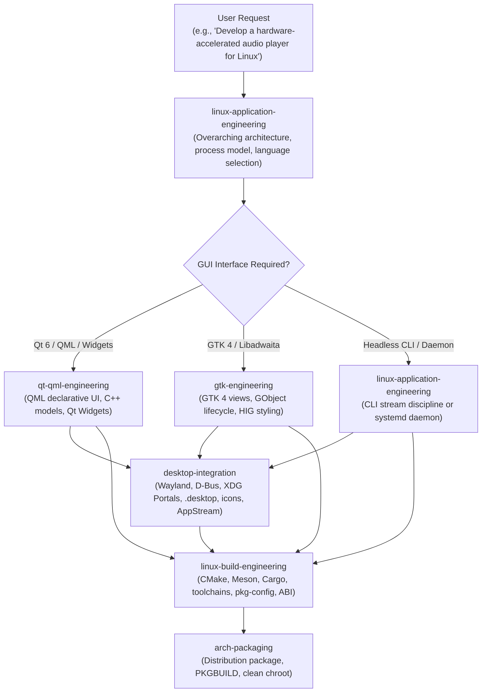

# Native Linux Application Engineering Architecture

## 1. Overview & Context

**Native Linux Application Engineering** expands the Syswright platform into native user-space application development, desktop integration, and build systems engineering. Introduced in Phase 4, this capability delivers five deeply specialized, authoritative Agent Skills complying with the canonical `agentskills.io` standard:

1. **`linux-application-engineering`**: High-level application architecture, language selection (Rust, C, C++), CLI tool engineering, background daemons, process lifecycle management, XDG state management, and application security.
2. **`qt-qml-engineering`**: Qt 6, QML language, Qt Quick scene graph, declarative QML/C++ integration, Qt Widgets, and Qt unit testing.
3. **`gtk-engineering`**: GTK 4, GLib main loop, GObject reference counting, GIO asynchronous operations, GtkApplication, Libadwaita, and AT-SPI accessibility.
4. **`desktop-integration`**: Wayland display protocols (`xdg-shell`), X11/XWayland compatibility, D-Bus IPC, XDG Desktop Portals, and Freedesktop standards (Desktop Entries, Icon Themes, MIME, AppStream, XDG Base Directory).
5. **`linux-build-engineering`**: Compiler toolchains (GCC/Clang), modern target-based CMake, Meson/Ninja, Cargo workspaces, dependency discovery (`pkg-config`), linking/ABI stability, cross-compilation, and reproducible builds.

These specialists operate under the repository's core philosophy:
> **Research before implementation. Evidence before assumptions. Verification before completion.**

---

## 2. Specialist Responsibilities & Architectural Boundaries

### Separation of Concerns:
- **`linux-application-engineering`**: Defines application architecture, concurrency models, process boundaries, and language selection. It does not dictate toolkit-specific widgets or build-system syntax.
- **`qt-qml-engineering` & `gtk-engineering`**: Provide deep toolkit-specific mastery (Qt 6 vs GTK 4). They do not handle distribution packaging or low-level compiler toolchain flags.
- **`desktop-integration`**: Handles cross-desktop and display-server interoperability independently of GUI toolkit. It governs Wayland protocols, D-Bus security, XDG Portals, and Freedesktop metadata.
- **`linux-build-engineering`**: Handles project compilation, dependency discovery, linking, and reproducibility.
- **`arch-packaging`**: Stays focused on PKGBUILD authoring and clean-chroot distribution builds.

---

## 3. Language & Toolkit Selection Frameworks

### 3.1 Programming Language Selection
- **Rust**: Recommended for modern CLI tools, network daemons, high-concurrency services, and security-critical software. Provides memory safety without garbage collection.
- **C (C11 / POSIX.1-2008)**: Core systems software, stable C ABI dynamic library plugins, low-level OS utilities, and embedded resource-constrained environments.
- **Modern C++ (C++20 / C++17)**: High-performance computational systems, Qt desktop applications, complex domain engines, and integration with large existing C++ libraries.

### 3.2 GUI Toolkit Selection
| Criterion | Qt Quick (QML) | Qt Widgets | GTK 4 (Standard) | Libadwaita (`libadwaita-1`) |
|---|---|---|---|---|
| **Primary Interaction** | Fluid animations, touch, media | Traditional mouse/keyboard | Standard desktop controls | GNOME HIG mobile/desktop |
| **Window Layout** | Fluid canvas, dynamic reflow | Complex dockable panels, MDI | Responsive layouts | Adaptive breakpoints (`AdwBreakpoint`) |
| **Target Desktop** | Cross-desktop (KDE, GNOME, etc.) | Cross-desktop (KDE, Xfce, etc.) | Cross-desktop (Xfce, KDE, etc.) | GNOME / Phosh specifically |
| **Implementation** | Declarative QML + C++ | Pure C++ | C / Rust (`gtk4-rs`) | C / Rust (`libadwaita-rs`) |

---

## 4. Desktop Interoperability & Security Model

### 4.1 Wayland Client Isolation
Under Wayland, clients cannot snoop on global keystrokes, capture arbitrary screen buffers, or position windows globally. Applications must use standardized **XDG Desktop Portals**:
- Screen/Window Recording: `org.freedesktop.portal.ScreenCast` with PipeWire.
- Global Hotkeys: `org.freedesktop.portal.GlobalShortcuts`.
- File Dialogs: `org.freedesktop.portal.FileChooser` / `GtkFileChooserNative` / `QFileDialog`.

### 4.2 D-Bus Security & Polkit
- **Session Bus**: Application-to-application communication, single-instance coordination, and desktop notifications.
- **System Bus**: System service queries. Unauthenticated execution of arbitrary commands over D-Bus is strictly forbidden; sensitive methods must be gated behind **polkit** authorization checks.

### 4.3 Freedesktop Metadata Standards
All native applications must package and validate standard metadata:
- Desktop entries in `/usr/share/applications/` validated with `desktop-file-validate`.
- AppStream metadata in `/usr/share/metainfo/` validated with `appstreamcli validate --strict`.
- Hicolor icons in `/usr/share/icons/hicolor/<size>/apps/` including a scalable SVG in `/scalable/apps/`.
- Custom MIME types in `/usr/share/mime/packages/` updated via `update-mime-database`.

---

## 5. Build Systems Engineering & ABI Stability

- **Modern Target-Based CMake (3.20+)**: Enforces target usage requirements (`target_include_directories`, `target_link_libraries`, `target_compile_definitions`) with explicit `PRIVATE`, `PUBLIC`, and `INTERFACE` visibility.
- **Meson & Ninja**: Delivers fast, non-Turing-complete builds with automatic `pkg-config` dependency detection.
- **Cargo Workspaces**: Manages multi-crate dependencies and release profiles (`lto = "thin"`, `codegen-units = 1`, `strip = "debuginfo"`).
- **ABI Invariant**: Modifying C++ virtual function order or changing struct memory layout breaks binary compatibility and strictly requires incrementing the shared library **SOVERSION** (`libfoo.so.1` $\to$ `libfoo.so.2`).
- **Reproducible Builds**: Enforce `SOURCE_DATE_EPOCH` and `-ffile-prefix-map=$PWD=.` to prevent build-host paths and timestamps from contaminating binaries.

---

## 6. Accessibility & Reliability Invariants

- **Accessibility (AT-SPI)**: Every user-facing interactive control must declare an accessible role, name, and description. Icon-only buttons must provide an explicit accessible label (`gtk_accessible_update_property` / QML `Accessible.name`).
- **Filesystem Durability**: Application state updates must use the atomic write-to-temp and `rename(2)` pattern with directory `fsync` to prevent truncation upon sudden power loss.
- **Signal Handling & Process Reaping**: Daemons must handle `SIGTERM` for graceful shutdown, `SIGHUP` for configuration reload, and `SIGCHLD` with non-blocking `waitpid(-1, &status, WNOHANG)` to prevent zombie accumulation.
- **Single-Instance Execution**: Use kernel advisory locking (`flock(2)` on `/run/user/$UID/<app>.lock`) which is automatically released by the kernel upon process termination.

---

## 7. Verification & Evaluation Framework

Phase 4 includes a comprehensive evaluation suite verifying AI agent guidance across 34 realistic scenarios:
- `evals/applications/scenarios.json`: 8 scenarios (Rust CLI, C systems leaks, modern C++ RAII, systemd daemon, local microservices rejection, zombie reaping, path traversal, concurrency deadlock).
- `evals/qt/scenarios.json`: 7 scenarios (QML business logic separation, CMake QML module, synchronous XHR blocking, broken property bindings, setContextProperty modernization, GUI thread blocking, Qt Widgets vs Quick).
- `evals/gtk/scenarios.json`: 5 scenarios (GTK 4 application lifecycle, GObject floating reference leaks, GMainContext blocking, standard GTK 4 vs Libadwaita, AT-SPI accessibility).
- `evals/desktop-integration/scenarios.json`: 7 scenarios (desktop entry validation, D-Bus API design, polkit system bus authorization, XDG portal mediation, Wayland client isolation, MIME registration, AppStream metadata).
- `evals/build-engineering/scenarios.json`: 7 scenarios (modern target-based CMake, Meson pkg-config dependencies, Cargo workspace profiles, C++ vtable ABI break / SOVERSION, RPATH / $ORIGIN, cross-compilation sysroot, unbundling vendored libraries).

**Runner**: `python3 evals/eval_native_apps.py` (100% pass rate across all 34 scenarios).  
**Regression Guard**: `tests/test_native_apps_evals.py` integrated into `python3 tests/run_all_tests.py` (47 total repository tests passing).
