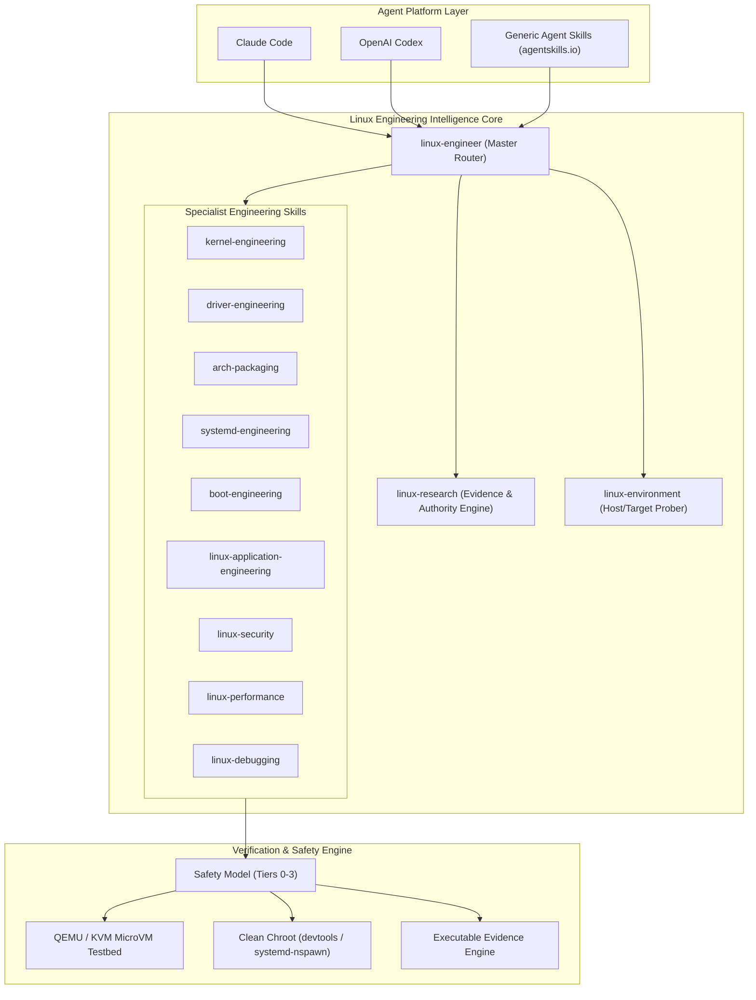

# Executive Summary: Linux Engineering (Phase 0)

## 1. Project Vision & Mission

**Linux Engineering** is a research-first, evidence-driven engineering intelligence system designed for autonomous AI coding agents (including Claude Code, OpenAI Codex, and standards-compliant Agent Skills runtimes). 

Modern AI coding agents frequently suffer from critical operational defects when tasked with Linux systems engineering:
- **Premature mutation**: Modifying source code, kernel trees, or system configuration before diagnosing the runtime environment or identifying root causes.
- **Outdated assumptions**: Generating deprecated kernel APIs (e.g., legacy sysfs attributes, obsolete timer APIs), obsolete `systemd` syntax, or outdated `PKGBUILD` packaging directives.
- **Unverified completion**: Declaring a task "fixed" merely because a prompt completed without checking compiler diagnostics, test suites, sanitizers, or system journals.
- **Host destruction risk**: Blindly invoking privileged commands (`sudo`, destructive partition writes, unsandboxed kernel module loading) without an isolated execution harness or rollback plan.

Linux Engineering solves these failure modes by enforcing a strict engineering lifecycle:
$$\text{Reconnaissance} \longrightarrow \text{Authoritative Research} \longrightarrow \text{Evidence Capture} \longrightarrow \text{Scoped Mutation} \longrightarrow \text{Deterministic Verification}$$

The project is initially targeted at **Arch Linux** due to its rolling-release model, upstream-vanilla packaging, and modern userspace, while retaining a modular, distribution-agnostic architectural abstraction capable of supporting Debian, Ubuntu, Fedora, and openSUSE in subsequent phases.

---

## 2. Core Philosophy

The defining ethos of Linux Engineering is:
> **Research before implementation. Evidence before assumptions. Verification before completion.**

1. **Understand the actual task**: Formulate explicit problem statements, identifying constraints and boundaries.
2. **Identify target environment and versions**: Never assume kernel or userspace version; inspect host release, kernel configuration, and compiler toolchains.
3. **Research authoritative technical sources**: Query official upstream documentation (`docs.kernel.org`, `freedesktop.org`, `archlinux.org`), kernel mailing lists (`lore.kernel.org`), and git commit histories.
4. **Inspect existing implementations**: Analyze codebase conventions, Kbuild infrastructure, unit configurations, and library linkages before touching code.
5. **Identify root causes and constraints**: Distinguish symptoms from root causes using tracing (`perf`, `strace`, `bpftrace`, GDB) and sanitizers (ASan, UBSan, lockdep).
6. **Evaluate alternative approaches**: Document architectural trade-offs, rejecting invasive workarounds when non-intrusive fixes exist.
7. **Establish an implementation strategy**: Outline a bounded, minimally invasive plan with rollback checkpoints.
8. **Implement focused changes**: Maintain exact scoping; touch only declared files within the workspace.
9. **Verify actual results**: Run deterministic validators (compiler passes, unit tests, `namcap`, `systemd-analyze verify`, KUnit). Stale output or agent self-review is not completion evidence.
10. **Report evidence and remaining risks**: Output concrete command logs, pass counts, compiler outputs, and remaining edge cases.

---

## 3. Major Findings from Phase 0 Research

### A. Multi-Agent Standard & Platform Divergence
- **Agent Skills Standard (`agentskills.io`)**: Defines the canonical skill structure (`SKILL.md` with strict frontmatter: `name`, `description`, `license`, `compatibility`, `metadata`, `allowed-tools`).
- **Claude Code Compatibility**: Implements Agent Skills but introduces rich extensions (`when_to_use`, `context: fork`, `hooks`, `paths`, `arguments`, `disable-model-invocation`). Furthermore, Claude Code packages multi-skill systems as plugins (`.claude-plugin/plugin.json`).
- **OpenAI Codex Compatibility**: Adopts `SKILL.md` within skill folders, leverages `AGENTS.md` for persistent repository-level instructions, and integrates with MCP servers via plugin configurations.
- **Architectural Conclusion**: We must not maintain separate, diverging skill bodies for different platforms. The canonical intelligence must reside in standards-compliant Agent Skills in `skills/` and `references/`. Platform-specific adapters and manifests (`.claude-plugin/`, `adapters/codex/`) are built deterministically from canonical sources.

### B. Linux Engineering Specialization & Progressive Disclosure
- Linux systems engineering requires deep domain knowledge (e.g., kernel synchronization primitives, zero-copy socket buffers, systemd sandbox directives, PKGBUILD split packaging).
- Dumping all guidance into a monolithic prompt or single `SKILL.md` causes severe context exhaustion and instruction drift.
- **Progressive Disclosure Pattern**:
  - **Level 1 (Discovery)**: Metadata (~100 tokens: `name`, `description`) loaded into agent context at startup.
  - **Level 2 (Activation)**: Core workflow (<500 lines / <5,000 tokens in `SKILL.md`) loaded upon skill invocation.
  - **Level 3 (Execution)**: Deep domain references (`references/*.md`) and deterministic validation scripts (`scripts/*`) read on demand.

### C. Arch Linux First Strategy
- Arch Linux provides an optimal baseline for modern Linux engineering:
  - Upstream-near, vanilla packages without invasive distribution patching.
  - Rolling-release model tracking latest kernel releases (Linux 6.18+ LTS/mainline), latest GCC/Clang, LLVM, and systemd.
  - World-class documentation in the Arch Wiki and clean build infrastructure (`devtools`, `pkgctl`, `mkarchroot`, `namcap`).
- The packaging and distribution layer is strictly isolated from core system and application engineering. Moving to Debian, Fedora, or openSUSE requires updating only packaging recipes and package-manager abstractions; upstream Meson/Cargo/CMake builds, D-Bus interfaces, and systemd units remain universal.

### D. Safety and Isolation
- AI agents must never be granted unrestricted `sudo` access or allowed to modify the host kernel or bootloader directly.
- **Container Limitation**: Containers share the host kernel. An agent attempting to test kernel modules (`insmod`), eBPF programs, or low-level block devices inside standard containers can crash or compromise the host kernel.
- **Isolation Mandate**:
  - Packaging builds run inside unprivileged clean chroots (`devtools` / `systemd-nspawn`).
  - Kernel and driver testing must execute within isolated QEMU / KVM microVMs with dedicated virtual disks and serial consoles.

---

## 4. Key Architectural Decisions (ADR Summary)

| ID | Title | Status | Decision Summary |
|:---|:---|:---|:---|
| **ADR-01** | Canonical Skill Architecture | **Accepted** | Follow `agentskills.io` standard with progressive disclosure; keep main `SKILL.md` files <500 lines. |
| **ADR-02** | Multi-Agent Build & Distribution | **Accepted** | Single canonical source in `skills/` + deterministic generator for Claude Code plugin and Codex configurations. |
| **ADR-03** | Arch-First Distribution Abstraction | **Accepted** | Target Arch Linux first; enforce strict boundary between upstream software and distribution packaging. |
| **ADR-04** | Execution Safety & Isolation Tiers | **Accepted** | Four-tier safety model (Tiers 0–3). Automated read/build; isolated chroot/VM for testing; human gate for host mutations. |
| **ADR-05** | Evidence-Based Evaluation Engine | **Accepted** | No prompt passes without observable, deterministic validation (compiler output, test suites, static analysis). |
| **ADR-06** | License Recommendation | **Pending Approval** | Dual-license model: Apache-2.0 for code/scripts and CC-BY-4.0 for engineering documentation/references. |

---

## 5. Outstanding Risks & Open Decisions

1. **Licensing Finalization**: MIT vs. Apache-2.0 vs. Dual licensing (Apache-2.0 / MIT) requires formal approval by the project owner (see `12-open-decisions.md`).
2. **Subagent Execution Model**: Claude Code supports `context: fork` for isolated background subagents, whereas OpenAI Codex relies on sequential tool invocation and `AGENTS.md`. The orchestration layer must handle both models without behavior divergence.
3. **QEMU Testbed Overhead**: Automated testing of kernel patches requires local QEMU/KVM acceleration. The system must support headless, fast-booting microVMs (e.g., via `virtme-ng` or lightweight BusyBox initramfs).
4. **Third-Party Package Security (AUR)**: Packaging workflows must enforce strict PGP signature checking and source checksum verification before parsing or building AUR recipes.

---

## 6. Phase 1 Readiness

With the completion of Phase 0 research, the technical foundation, taxonomy, safety constraints, and multi-agent distribution strategy are fully established.

Phase 1 implementation can commence upon project owner review and acceptance of this research package. Phase 1 will focus on delivering the Foundation layer (`linux-engineer`, `linux-research`, `linux-environment`), Core Arch Packaging (`arch-packaging`), and the deterministic validation harness.
