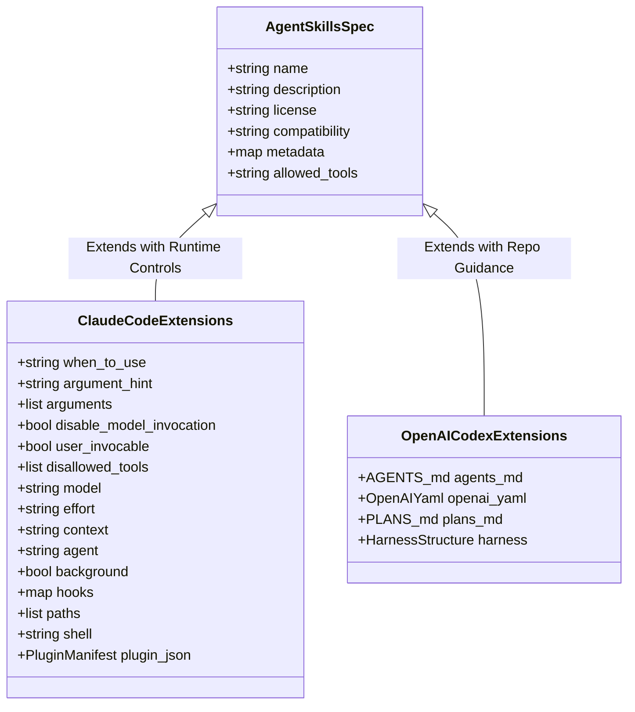

# Platform Compatibility & Multi-Agent Architecture: Syswright

## 1. Executive Problem Statement

A central challenge in building modern AI coding agent skill systems is platform fragmentation. Different agent runtimes (Claude Code, OpenAI Codex, Antigravity CLI, Cursor, Windsurf) have emerged with varying degrees of standards compliance, custom frontmatter extensions, subagent delegation models, and plugin manifest formats.

If an engineering system maintains separate instruction sets for each platform, the documentation inevitably diverges, test matrices explode, and maintenance costs become unsustainable. Conversely, if a system restricts itself strictly to the lowest common denominator, it sacrifices powerful platform-native capabilities such as Claude Code's background subagents (`context: fork`) or Codex's repository-level persistent execution guidance (`AGENTS.md`).

This document analyzes the official specifications of the **Agent Skills open standard**, **Claude Code**, and **OpenAI Codex**, compares three architectural models, and presents a zero-duplication hybrid distribution architecture for Syswright.

---

## 2. The Agent Skills Standard (`agentskills.io`)

The **Agent Skills specification** ([agentskills.io/specification](https://agentskills.io/specification)) represents the vendor-neutral open standard for structuring reusable agent capabilities.

### 2.1 Directory Structure
A skill is a self-contained directory with a mandatory `SKILL.md` entry point:
```text
skill-name/
├── SKILL.md          # Required: YAML frontmatter + markdown instructions
├── scripts/          # Optional: executable code (Python, Bash, JS)
├── references/       # Optional: focused domain reference documentation
├── assets/           # Optional: templates, schemas, static data
└── ...               # Additional supporting files
```

### 2.2 SKILL.md Frontmatter Specification
The top of `SKILL.md` must begin with YAML frontmatter enclosed by `---` markers:

| Field | Required | Constraints / Semantics |
|:---|:---:|:---|
| `name` | **Yes** | 1–64 characters. Unicode lowercase alphanumeric (`a-z`, `0-9`) and single hyphens (`-`). Must not start or end with a hyphen; no consecutive hyphens (`--`). **Must match the parent directory name**. |
| `description` | **Yes** | 1–1024 characters. Non-empty. Succinctly defines what the skill does and when the agent should trigger it. |
| `license` | No | Short SPDX license name or path to a bundled license file. |
| `compatibility` | No | Max 500 characters. Environment prerequisites (e.g., `Requires Linux, pacman, systemd`). |
| `metadata` | No | Arbitrary string-to-string mapping for custom metadata. |
| `allowed-tools` | No | Space-separated list of pre-approved tools (Experimental). |

### 2.3 Progressive Disclosure Model
The specification mandates a three-tier token economics model:
1. **Tier 1 — Catalog Metadata (~100 tokens)**: `name` and `description` are loaded into the agent's system prompt at session initialization.
2. **Tier 2 — Instruction Body (<5,000 tokens / <500 lines)**: The full content of `SKILL.md` is loaded into context only when the skill is explicitly or automatically invoked.
3. **Tier 3 — Deep References & Assets (On-Demand)**: Supporting files (`references/*.md`, `scripts/*`) are read into context only when the agent specifically navigates to them during execution.

### 2.4 Reference Validation
The standard provides the `skills-ref` validation tool:
```bash
skills-ref validate ./skills/arch-packaging
```
This strictly verifies directory naming, YAML frontmatter validity, field length constraints, and regex rules.

---

## 3. Platform-Specific Implementations



### 3.1 Claude Code Platform Analysis
*Reference: [code.claude.com/docs/en/skills](https://code.claude.com/docs/en/skills) & [code.claude.com/docs/en/plugins](https://code.claude.com/docs/en/plugins)*

#### Discovery Locations
- Personal: `~/.claude/skills/<name>/SKILL.md`
- Project: `.claude/skills/<name>/SKILL.md`
- Plugins: Loaded from installed plugin directories or local `--plugin-dir`.

#### Extended Frontmatter
Claude Code respects the standard fields but introduces rich operational controls:
- `when_to_use`: Additional activation phrases and triggers (combined with `description`, capped at 1,536 chars).
- `paths`: File globs (e.g., `["PKGBUILD", "**/PKGBUILD"]`) that automatically activate the skill when matching files are edited or accessed.
- `context: fork`: Spawns an isolated background subagent to execute the skill, isolating the main conversation from tool spam and token exhaustion.
- `agent`: Specifies the subagent persona (e.g., `Explore`, `Plan`, or custom defined in `agents/*.md`).
- `model` / `effort`: Overrides the AI model (e.g., Sonnet vs. Haiku) and reasoning effort level (`low`, `medium`, `high`, `max`) for the duration of the skill invocation.
- `hooks`: Registers lifecycle hooks (PreToolUse, PostToolUse) scoped to the skill session.
- `disable-model-invocation`: Restricts execution to manual slash command `/name`.

#### Plugin Architecture
Multi-skill packages in Claude Code are bundled into plugins defined by `.claude-plugin/plugin.json`:
```json
{
  "name": "syswright",
  "description": "Comprehensive engineering intelligence for Linux systems development",
  "author": { "name": "Eshan Roy" },
  "version": "0.1.0",
  "license": "Apache-2.0"
}
```
Plugins can bundle `skills/`, `agents/`, `hooks/`, and `.mcp.json` servers.

### 3.2 OpenAI Codex Platform Analysis
*Reference: [developers.openai.com/plugins/concepts/skills](https://developers.openai.com/plugins/concepts/skills) & [developers.openai.com/cookbook](https://developers.openai.com/cookbook/examples/codex/iterating-development-workflows-with-codex)*

#### Discovery & Invocations
- Skills reside in individual folders under `skills/<name>/SKILL.md`.
- Invoked interactively via `@skill-name` or `$skill-name`.
- Metadata (`name`, `description`) is indexed at session start; instruction bodies load upon match.

#### Repository Guidance: `AGENTS.md`
Unlike Claude Code’s `CLAUDE.md`, Codex officially indexes `AGENTS.md` at the repository root and subdirectories. Codex reads `AGENTS.md` as durable execution guidance before performing any tool action. It establishes:
- Repository goal and boundaries.
- Coding conventions and testing standards.
- Scoped write permissions and prohibited commands.

#### Plugin Integration & MCP
- In Codex plugins, external tools and environment capabilities are exposed via Model Context Protocol (MCP) servers declared in `agents/openai.yaml` or plugin manifests.
- Codex skills provide the workflow instructions (the "how"), while MCP servers provide the live tools and execution environments (the "what").

### 3.3 Other Agent Environments (Gemini / Antigravity CLI, Cursor, Windsurf)
- **Gemini / Antigravity CLI**: Uses local skill directories with `SKILL.md` (as demonstrated in this very workspace: `.agents/skills/gravitas/SKILL.md`), supporting YAML frontmatter and native agent delegation.
- **Cursor / Windsurf**: Support rules (`.cursorrules`, `.windsurfrules`) and workspace instruction files, which can ingest generated summaries from the canonical skill catalog.

---

## 4. Architectural Comparison of Integration Approaches

We evaluated three architectural approaches for Syswright:

```text
APPROACH A: Separate Native Implementations
├── .claude/skills/kernel-engineering/SKILL.md  (Claude-specific syntax)
├── .codex/skills/kernel-engineering/SKILL.md   (Codex-specific syntax)
└── skills/kernel-engineering/SKILL.md          (Standard syntax)
--> Severe duplication, inevitable drift, 3x testing surface.

APPROACH B: Canonical Spec + Static In-Repo Adapters
├── skills/                     (Canonical Agent Skills standard)
│   └── kernel-engineering/SKILL.md
├── adapters/
│   ├── claude-code/            (Claude plugin wrapper pointing to ../../skills)
│   └── codex/                  (AGENTS.md + Codex wrappers)
--> Good, but requires manual sync if platform configs change.

APPROACH C (Recommended): Canonical Source + Deterministic Distribution Generator
├── skills/                     (100% Agent Skills standard compliant)
│   ├── linux-engineer/
│   └── arch-packaging/
├── references/                 (Shared authoritative engineering references)
├── adapters/                   (Platform-specific adapter templates)
└── scripts/
    └── build_distribution.py   (Deterministic build compiler: generates .claude-plugin/ and AGENTS.md)
--> Zero duplication, single source of truth, automated compliance verification.
```

### Detailed Evaluation Matrix

| Architectural Criterion | Approach A (Separate Native) | Approach B (Static Adapters) | Approach C (Hybrid Generator) |
|:---|:---:|:---:|:---:|
| **Single Source of Truth** | ❌ No (3+ copies) | ⚠️ Partial | ✅ **Yes (Canonical `skills/`)** |
| **Maintainability** | ❌ Very Low (high drift) | ⚠️ Moderate | ✅ **Maximum** |
| **Agent Skills Standard Compliance** | ⚠️ Fragmented | ✅ High | ✅ **100% (Verified via `skills-ref`)** |
| **Claude Code Feature Utilization** | ✅ Full | ⚠️ Limited | ✅ **Full (via generated plugin manifest)** |
| **OpenAI Codex Feature Utilization** | ✅ Full | ⚠️ Limited | ✅ **Full (via generated `AGENTS.md`)** |
| **Testing / CI Complexity** | ❌ $O(N \times M)$ | ⚠️ Manual checks | ✅ **$O(N)$ canonical tests + build check** |
| **Distribution Ergonomics** | ⚠️ Complex | ⚠️ Multiple paths | ✅ **Turnkey single-command package** |

---

## 5. Recommended Architecture: The Hybrid Distribution Model

We recommend **Approach C**: Canonical Agent Skills with a Deterministic Platform Build Generator.

### 5.1 The Canonical Core (`skills/`)
1. Every skill resides in `skills/<name>/SKILL.md` and strictly adheres to the `agentskills.io` standard:
   ```yaml
   ---
   name: arch-packaging
   description: Authoritative packaging, clean chroot building, and namcap validation for Arch Linux. Use when creating PKGBUILDs or packaging software.
   license: Apache-2.0
   compatibility: Requires Linux, pacman, makepkg, namcap
   metadata:
     author: Eshan Roy
     version: 0.1.0
     claude_paths: "PKGBUILD,*/PKGBUILD"
     claude_context: "fork"
     claude_agent: "general"
   ---
   ```
2. Any platform-specific execution metadata is stored cleanly inside the standard `metadata:` mapping using prefixed keys (`claude_*`, `codex_*`). The Agent Skills standard explicitly permits arbitrary string-to-string mappings in `metadata`. Standard parsers ignore it; our platform generator extracts it!

### 5.2 Deep References (`references/`)
Shared technical references (such as `references/kernel-kconfig.md`, `references/arch-chroot-build.md`, `references/systemd-sandboxing.md`) reside in a central `references/` directory and are linked by relative markdown references. This ensures knowledge is authored once and shared across all skills and platforms.

### 5.3 Platform Adapters & Artifact Generator (`scripts/build_distribution.py`)
In Phase 1, a deterministic build script (`scripts/build_distribution.py`) will compile the distribution artifacts:
1. **For Claude Code**:
   - Generates `.claude-plugin/plugin.json` and `.claude-plugin/marketplace.json`.
   - Generates Claude-optimized skill wrappers in `.claude/skills/` (extracting `claude_*` metadata into top-level frontmatter fields such as `paths:` and `context: fork`).
2. **For OpenAI Codex**:
   - Generates the unified `AGENTS.md` at repository root, summarizing the active skills, boundaries, and validation requirements.
   - Generates `adapters/codex/agents/openai.yaml` declaring MCP tool interfaces.
3. **For Standalone Agent Skills**:
   - Validates the entire `skills/` tree against `skills-ref validate`.
   - Bundles distributable `.tar.gz` packages for standard agent runtimes.

This architecture completely eliminates duplication, preserves 100% open-standards compliance, and unleashes the full native power of each target platform.
