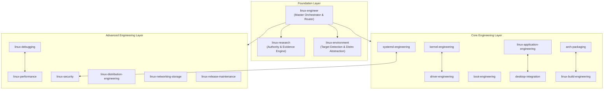

# Specialist Skill Taxonomy: Syswright

## 1. Overview & Architectural Hierarchy

The Syswright system organizes specialized Linux engineering capabilities into a structured, modular catalog of **17 specialist skills**. Rather than forcing all domain knowledge into a single unmaintainable monolithic prompt, the system employs a three-tier hierarchy:

1. **Foundation Layer (3 Skills)**: The central orchestration, authoritative research, and environment detection tier.
2. **Core Engineering Layer (8 Skills)**: Foundational Linux development disciplines (kernel, drivers, packaging, systemd, boot, applications, desktop, build systems).
3. **Advanced Engineering Layer (6 Skills)**: High-assurance disciplines (debugging, performance, security, distribution engineering, networking/storage, upstream release maintenance).

---

## 2. Foundation Skills Catalog

### 2.1 `linux-engineer` (Master Orchestrator)
- **Purpose**: Central routing, task decomposition, workflow sequencing, and inter-skill coordination.
- **Responsibilities**:
  - Classify incoming requests and identify required engineering domains.
  - Coordinate multi-step tasks across specialist skills (e.g., compile driver $\to$ write PKGBUILD $\to$ write systemd unit $\to$ harden with seccomp).
  - Enforce the 6 Gravitas invariants and safety tiers.
- **Activation Conditions**: Default entry point for high-level Linux engineering requests; triggered when multiple disciplines intersect or intent is ambiguous.
- **Required References**: `references/orchestration-patterns.md`, `references/safety-policy.md`.
- **Expected Workflow**:
  1. *Decompose*: Formulate sub-tasks and dependency graph.
  2. *Probe*: Delegate to `linux-environment` to identify host/target versions.
  3. *Route*: Dispatch focused sub-tasks to specialist skills.
  4. *Synthesize*: Aggregate outputs, verify overall contract satisfaction, and report.
- **Dependencies**: `linux-environment`, `linux-research`.
- **Evaluation Scenario**: Complex full-stack task: Develop an unprivileged hardware monitor daemon in Rust, package it with PKGBUILD, provide a hardened systemd service, and write a desktop D-Bus notification client.

---

### 2.2 `linux-research` (Authoritative Research Engine)
- **Purpose**: Authoritative technical investigation, source authority ranking, and evidence capture.
- **Responsibilities**:
  - Research official documentation (`docs.kernel.org`, `freedesktop.org`, `archlinux.org`, `man7.org`).
  - Search public-inbox archives (`lore.kernel.org`) for commit discussions, regressions, and patches.
  - Record structured evidence records (`Claim`, `Source`, `Authority`, `Version`, `Date`, `Confidence`).
- **Activation Conditions**: User asks "How does X work in the kernel?", "Has this been fixed upstream?", or whenever another skill encounters undocumented behavior.
- **Required References**: `references/source-authority-index.md`, `references/lore-query-guide.md`.
- **Expected Workflow**:
  1. Formulate exact technical search queries.
  2. Query Tier 1 upstream sources; disqualify unverified blog posts or AI forum summaries.
  3. Compare against target version; verify deprecation status.
  4. Emit structured citation record.
- **Dependencies**: None (self-contained research engine).
- **Evaluation Scenario**: Investigate whether `timer_setup()` replaced `init_timer()` in kernel 4.14 and what calling conventions changed for timer callbacks.

---

### 2.3 `linux-environment` (Target Detection & Environment Abstraction)
- **Purpose**: Unprivileged host and target environment reconnaissance.
- **Responsibilities**:
  - Inspect `/etc/os-release`, `uname -r`, `/proc/version`, and CPU architecture.
  - Detect installed toolchains (GCC, Clang, Rustc, Meson, CMake, Makepkg).
  - Detect init system and sandbox capabilities (`systemd --version`, cgroups v2, namespaces).
- **Activation Conditions**: Automatically invoked at session start or when cross-compiling/targeting remote environments.
- **Required References**: `references/distro-signatures.md`, `references/toolchain-matrices.md`.
- **Expected Workflow**:
  1. Execute safe Tier 0 diagnostic queries (`cat /etc/os-release`, `uname -m`, etc.).
  2. Probe available build systems and linters.
  3. Output normalized JSON environment descriptor for downstream skills.
- **Dependencies**: None.
- **Evaluation Scenario**: Run on an Arch Linux host and successfully detect rolling release version, LTS kernel 6.18, presence of `makepkg` and `systemd-analyze`, and absence of Debian `dpkg`.

---

## 3. Core Engineering Skills Catalog

### 3.1 `kernel-engineering`
- **Purpose**: Linux kernel subsystem development, Kbuild/Kconfig configuration, patch generation, and KUnit testing.
- **Responsibilities**:
  - Inspect kernel source trees, maintainer trees (`linux-next`, subsystem trees), and `MAINTAINERS`.
  - Author and review patches following kernel coding style (`scripts/checkpatch.pl`).
  - Configure kernels (`make menuconfig`, defconfigs, localmodconfig).
  - Write and execute KUnit unit tests.
- **Activation Conditions**: Working in kernel trees, editing `.c`/`.h` in `linux/`, authoring patches, or user mentions "kernel patch", "Kbuild", "KUnit".
- **Required References**: `references/kernel-coding-style.md`, `references/kbuild-reference.md`, `references/submitting-patches.md`.
- **Expected Workflow**:
  1. Inspect subsystem `MAINTAINERS` and relevant `Makefile`/`Kconfig`.
  2. Implement minimally scoped C code following kernel lock and memory rules.
  3. Run `scripts/checkpatch.pl --strict` and `make C=1` (sparse).
  4. Format patch series with proper imperative commit log and `Signed-off-by`.
- **Dependencies**: `linux-research`, `linux-environment`.
- **Evaluation Scenario**: Author a clean patch that adds a sysfs attribute to an existing subsystem, verified with `checkpatch.pl` with 0 errors and 0 warnings.

---

### 3.2 `driver-engineering`
- **Purpose**: Linux device driver authoring, hardware bus protocols, interrupt handling, and device tree integration.
- **Responsibilities**:
  - Implement Linux device model drivers (`probe`, `remove`, `suspend`, `resume`).
  - Handle hardware interfaces: Platform buses, PCI, USB, I2C, SPI.
  - Manage kernel memory: DMA mapping (`dma_alloc_coherent`), `ioremap`, spinlocks, mutexes.
  - Parse Device Tree source (`.dts`/`.dtsi`) bindings.
- **Activation Conditions**: Modifying or creating drivers under `drivers/`, working with GPIO/I2C/SPI, or debugging kernel hardware interfaces.
- **Required References**: `references/device-model.md`, `references/dma-apis.md`, `references/device-tree-bindings.md`.
- **Expected Workflow**:
  1. Identify hardware bus type and match table (`of_device_id`, `pci_device_id`).
  2. Implement lifecycle methods ensuring no memory leaks or lock inversions.
  3. Validate concurrency safety (bottom-half tasklets/threaded IRQs).
  4. Verify module build with standard out-of-tree `Makefile`.
- **Dependencies**: `kernel-engineering`, `linux-debugging`.
- **Evaluation Scenario**: Identify and fix a race condition between an interrupt handler and the driver's `remove` callback during module unloading.

---

### 3.3 `systemd-engineering`
- **Purpose**: System and service architecture, unit file authoring, service dependencies, sandboxing, and journald observability.
- **Responsibilities**:
  - Author `.service`, `.socket`, `.timer`, and `.path` unit files.
  - Configure service dependencies (`Wants=`, `Requires=`, `After=`, `Before=`).
  - Implement systemd sandboxing (`ProtectSystem=strict`, `ProtectHome=yes`, `NoNewPrivileges=yes`, `CapabilityBoundingSet=`).
  - Validate unit syntax via `systemd-analyze verify`.
- **Activation Conditions**: Files ending in `.service`, `.socket`, `.timer`, editing `/etc/systemd/`, or user asks for systemd services.
- **Required References**: `references/systemd-unit-directives.md`, `references/systemd-sandboxing.md`, `references/socket-activation.md`.
- **Expected Workflow**:
  1. Determine execution requirements (Type=notify, simple, oneshot, dbus).
  2. Configure minimal privileges (User/Group, capabilities).
  3. Apply strict sandboxing directives.
  4. Run `systemd-analyze verify <unit>` and audit exposure with `systemd-analyze security <unit>`.
- **Dependencies**: `linux-security`, `linux-environment`.
- **Evaluation Scenario**: Create a hardened systemd service for a network daemon achieving a security exposure score under 2.5 ("OK/Safe") in `systemd-analyze security`.

---

### 3.4 `boot-engineering`
- **Purpose**: UEFI, bootloader configuration (systemd-boot, GRUB), initramfs generation (mkinitcpio, dracut), and early userspace recovery.
- **Responsibilities**:
  - Configure UEFI boot entries (`bootctl`, `efibootmgr`).
  - Author and maintain `mkinitcpio.conf` hooks and `dracut` modules.
  - Troubleshoot early userspace boot hangs, root UUID misconfigurations, and LUKS decryption failures.
- **Activation Conditions**: Modifying `/boot/`, `mkinitcpio.conf`, `grub.cfg`, or troubleshooting boot failures.
- **Required References**: `references/uefi-boot-specs.md`, `references/mkinitcpio-hooks.md`, `references/early-userspace.md`.
- **Expected Workflow**:
  1. Statically parse bootloader configuration without mutating EFI NVRAM.
  2. Inspect initramfs image contents using `lsinitcpio` or `lsinitrd`.
  3. Formulate recovery plans with clear fallback kernel entries.
- **Dependencies**: `linux-environment`, `systemd-engineering`.
- **Evaluation Scenario**: Diagnose a simulated boot failure where rootfs fails to mount due to a missing storage controller hook in `mkinitcpio.conf`.

---

### 3.5 `arch-packaging`
- **Purpose**: Arch Linux packaging, `PKGBUILD` authoring, clean chroot building, and `namcap` static verification.
- **Responsibilities**:
  - Author standards-compliant `PKGBUILD` files following official Arch package guidelines.
  - Configure dependencies correctly (`depends`, `makedepends`, `checkdepends`, `optdepends`).
  - Manage build functions (`prepare()`, `build()`, `check()`, `package()`).
  - Enforce package reproducibility, SHA256 checksums, and PGP signature verification.
  - Build packages inside clean chroots (`pkgctl build --clean` / `mkarchroot`).
  - Run `namcap` and resolve all warnings and errors.
- **Activation Conditions**: Editing `PKGBUILD`, `.SRCINFO`, user mentions "makepkg", "pacman", "AUR", or packaging an application for Arch.
- **Required References**: `references/pkgbuild-syntax.md`, `references/arch-package-guidelines.md`, `references/namcap-rules.md`.
- **Expected Workflow**:
  1. Author `PKGBUILD` with exact upstream source URL, architecture, and checksums.
  2. Implement build lifecycle adhering to Arch directory hierarchy (`/usr/bin`, `/usr/lib`, `/usr/share`).
  3. Generate `.SRCINFO` with `makepkg --printsrcinfo`.
  4. Run `namcap PKGBUILD` and `namcap <package>.pkg.tar.zst`; fix all defects.
- **Dependencies**: `linux-build-engineering`, `linux-environment`.
- **Evaluation Scenario**: Author a complete `PKGBUILD` for a native C/Meson library, build it, and achieve a 100% clean `namcap` report.

---

### 3.6 `linux-application-engineering`
- **Purpose**: Native Linux systems and application development in Rust, C, and C++.
- **Responsibilities**:
  - Implement Linux system programming concepts: POSIX/Linux APIs (`epoll`, `signalfd`, `timerfd`, `io_uring`, `eventfd`).
  - Manage process lifecycle, daemonization, IPC (pipes, Unix domain sockets), and thread pools.
  - Architect robust error handling and unprivileged execution models.
- **Activation Conditions**: Authoring native Linux applications or daemons in Rust/C/C++.
- **Required References**: `references/linux-system-apis.md`, `references/async-io-uring.md`, `references/unix-domain-sockets.md`.
- **Expected Workflow**:
  1. Select appropriate system primitives (`epoll` vs `io_uring`).
  2. Enforce RAII / memory safety rules.
  3. Implement clean SIGTERM/SIGINT signal handling via `signalfd` or signal channels.
  4. Compile with full optimization, debug symbols, and sanitizers enabled.
- **Dependencies**: `linux-build-engineering`, `linux-debugging`.
- **Evaluation Scenario**: Implement a high-performance event loop in C using `epoll` and `signalfd` that handles 1,000 concurrent client connections without memory leaks.

---

### 3.7 `desktop-integration`
- **Purpose**: Linux desktop ecosystem integration, Wayland protocols, X11 fallback, D-Bus services, and FreeDesktop specifications.
- **Responsibilities**:
  - Implement FreeDesktop standards: `.desktop` files, Icon Theme Spec, XDG Base Directory Spec, AppStream metadata (`.metainfo.xml`).
  - Integrate with D-Bus IPC (system and session buses, D-Bus service activation).
  - Handle Wayland client architecture (`xdg-shell`, layer-shell, subsurfaces) and Qt/GTK windowing backends.
- **Activation Conditions**: Working with GUI toolkits (Qt/QML, GTK4), D-Bus APIs, `.desktop` files, or Wayland compositors.
- **Required References**: `references/freedesktop-specs.md`, `references/dbus-interface-design.md`, `references/wayland-protocols.md`.
- **Expected Workflow**:
  1. Author valid `.desktop` and AppStream metadata; validate via `desktop-file-validate` and `appstreamcli validate`.
  2. Design clean D-Bus XML interfaces with proper introspection.
  3. Ensure Wayland-native rendering with fallback support for X11/XWayland.
- **Dependencies**: `linux-application-engineering`.
- **Evaluation Scenario**: Create a FreeDesktop-compliant desktop entry and D-Bus session activation configuration for a Qt6/QML utility application.

---

### 3.8 `linux-build-engineering`
- **Purpose**: Build automation, cross-compilation, compiler flag hardening, and reproducible builds.
- **Responsibilities**:
  - Author and debug build systems: Meson, CMake, Cargo, GNU Autotools, Kbuild.
  - Configure modern hardening flags (`-D_FORTIFY_SOURCE=3`, `-fstack-protector-strong`, `-fPIE`, `-Wl,-z,relro,-z,now`).
  - Configure package configurations (`pkg-config` / `.pc` files).
- **Activation Conditions**: Editing `meson.build`, `CMakeLists.txt`, `Cargo.toml`, `Makefile`, or troubleshooting build failures.
- **Required References**: `references/meson-cmake-guide.md`, `references/compiler-hardening-flags.md`, `references/pkg-config-standards.md`.
- **Expected Workflow**:
  1. Inspect dependency graph and external library linkages.
  2. Implement build targets respecting standard install prefix variables (`$DESTDIR`, `$PREFIX`).
  3. Verify hardening flags via `hardening-check` or readelf inspection.
- **Dependencies**: `linux-environment`.
- **Evaluation Scenario**: Convert a legacy ad-hoc Makefile into a modern `meson.build` file with unit test definitions and pkg-config generation.

---

## 4. Advanced Engineering Skills Catalog

### 4.1 `linux-debugging`
- **Purpose**: Interactive and post-mortem system debugging, core dump analysis, and sanitizer instrumentation.
- **Responsibilities**:
  - Analyze core dumps and crash logs using GDB and LLDB.
  - Trace syscalls and library calls with `strace` and `ltrace` without polluting outputs.
  - Compile and diagnose memory errors with sanitizers: ASan, LSan, UBSan, TSan.
  - Analyze kernel oopses and backtraces.
- **Activation Conditions**: User asks to debug crashes, segfaults, memory leaks, or hangs.
- **Required References**: `references/gdb-automation.md`, `references/sanitizer-flags.md`, `references/strace-filters.md`.
- **Expected Workflow**:
  1. Reproduce defect deterministically with minimal inputs.
  2. Inspect stack trace, register states, and memory addresses.
  3. Isolate exact faulting instruction and variable bounds.
  4. Verify proposed fix with active sanitizers.
- **Dependencies**: `linux-application-engineering`, `linux-build-engineering`.
- **Evaluation Scenario**: Analyze a GDB core dump from a multithreaded C application to identify an off-by-one buffer overflow causing a segmentation fault.

---

### 4.2 `linux-performance`
- **Purpose**: CPU, memory, I/O, and latency profiling, flamegraph generation, and eBPF observability.
- **Responsibilities**:
  - Sample CPU performance using `perf record` and generate interactive flamegraphs.
  - Profile block I/O latency using `biolatency` and `perf trace`.
  - Author focused `bpftrace` scripts for kernel probe points (`kprobe`, `tracepoint`, `uprobe`).
  - Measure lock contention and context switches.
- **Activation Conditions**: User mentions "slow", "high CPU", "optimize", "profile", "perf", "flamegraph", or "latency".
- **Required References**: `references/perf-workflows.md`, `references/bpftrace-cookbook.md`, `references/flamegraph-guide.md`.
- **Expected Workflow**:
  1. *Measure Baseline*: Collect quantitative metrics before any modification.
  2. *Profile*: Locate hot functions using `perf report` or eBPF histograms.
  3. *Hypothesize & Optimize*: Target the top bottleneck with minimal changes.
  4. *Verify Delta*: Re-measure metrics; reject changes that do not show statistically significant improvement.
- **Dependencies**: `linux-debugging`, `linux-environment`.
- **Evaluation Scenario**: Write an unprivileged `perf` profiling workflow to identify a cache-miss bottleneck in a database sorting algorithm.

---

### 4.3 `linux-security`
- **Purpose**: Mandatory Access Control (MAC), Linux capabilities, seccomp filters, and supply-chain verification.
- **Responsibilities**:
  - Restrict process capabilities using `libcap` and `setpriv`.
  - Author strict BPF seccomp filters (`seccomp_rule_add`).
  - Inspect and configure AppArmor profiles and SELinux contexts.
  - Audit supply-chain dependencies and cryptographic signatures (minisign, GPG, cosign).
- **Activation Conditions**: Hardening daemons, configuring MAC policies, or security audits.
- **Required References**: `references/capabilities-guide.md`, `references/seccomp-bpf.md`, `references/apparmor-profiles.md`.
- **Expected Workflow**:
  1. Audit minimum required syscalls and privileges.
  2. Implement least-privilege boundary (drop root immediately after port bind).
  3. Attach seccomp filter denying dangerous syscalls (`ptrace`, `kexec_load`).
  4. Verify enforcement with test payloads.
- **Dependencies**: `systemd-engineering`, `linux-application-engineering`.
- **Evaluation Scenario**: Design and test a minimal seccomp-BPF filter for a background worker daemon that drops all unneeded syscalls.

---

### 4.4 `linux-distribution-engineering`
- **Purpose**: Distribution-agnostic abstraction, multi-distro portability, and repository management.
- **Responsibilities**:
  - Abstract distro differences across package managers (`pacman`, `apt`, `dnf`, `zypper`).
  - Map library package names across Arch, Debian, Fedora, and openSUSE.
  - Maintain packaging parity without altering upstream codebases.
- **Activation Conditions**: Porting software between distributions, or configuring cross-distribution packaging.
- **Required References**: `references/distro-package-matrix.md`, `references/init-system-differences.md`.
- **Expected Workflow**:
  1. Consult cross-distribution package translation matrix.
  2. Decouple upstream build instructions from distro-specific manifest syntax.
  3. Validate syntax for target distribution format (PKGBUILD, `debian/rules`, `.spec`).
- **Dependencies**: `arch-packaging`, `linux-build-engineering`.
- **Evaluation Scenario**: Translate an Arch Linux PKGBUILD with 5 dependencies into equivalent Debian packaging files (`control`, `rules`) and Fedora `.spec`.

---

### 4.5 `linux-networking-storage`
- **Purpose**: Network interface configuration, firewall rules, and Linux storage subsystems.
- **Responsibilities**:
  - Configure network interfaces, routes, and bridges via `iproute2` and `systemd-networkd`.
  - Author packet filtering and NAT rules using `nftables`.
  - Manage Linux storage technologies: LVM, dm-crypt/LUKS, Btrfs subvolumes, ext4 parameters, ZFS.
- **Activation Conditions**: Working with network interfaces, routing tables, firewalls, or disk layouts.
- **Required References**: `references/iproute2-cookbook.md`, `references/nftables-syntax.md`, `references/btrfs-lvm-storage.md`.
- **Expected Workflow**:
  1. Perform read-only query of existing network/storage topology (`ip -br a`, `lsblk -f`).
  2. Formulate declarative configuration files (e.g., `/etc/systemd/network/*.network`, `/etc/nftables.conf`).
  3. Verify syntax with dry-run tools (`nft -c -f`).
- **Dependencies**: `systemd-engineering`, `linux-security`.
- **Evaluation Scenario**: Create a declarative `nftables` firewall configuration for a workstation that allows only established outbound traffic and SSH with rate-limiting.

---

### 4.6 `linux-release-maintenance`
- **Purpose**: Upstream contribution workflows, patch lifecycle management, Git conventions, and stable tree backports.
- **Responsibilities**:
  - Manage patch series using `b4` and `git format-patch`.
  - Handle review trailers (`Reviewed-by`, `Acked-by`, `Reported-by`).
  - Execute git bisections (`git bisect run`) to pinpoint regressions.
  - Prepare clean backports to stable/LTS branches.
- **Activation Conditions**: Preparing upstream patch submissions, running bisections, or backporting fixes.
- **Required References**: `references/b4-patch-workflows.md`, `references/git-bisect-automation.md`, `references/stable-backport-rules.md`.
- **Expected Workflow**:
  1. Inspect upstream branch topology (`git merge-base`).
  2. Format patch series with proper versioning (`v2`, `v3`) and change changelog.
  3. Run `b4 prep --check` to ensure maintainer requirements are satisfied.
  4. Generate clear cover letter summarizing motivation and testing evidence.
- **Dependencies**: `kernel-engineering`, `linux-research`.
- **Evaluation Scenario**: Formulate a complete `b4`-compatible 2-patch series with cover letter, addressing maintainer review comments from a previous revision.
