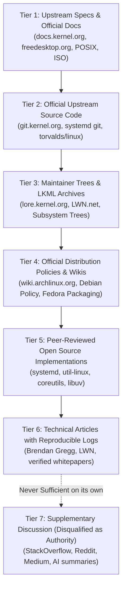

# Research Methodology & Evidence Standard: Syswright

## 1. The Core Research Mandate

AI coding agents frequently fail in systems engineering because they **assume instead of verify**. When faced with a Linux systems problem, a typical agent:
1. Hallucinates an obsolete or non-existent API (e.g., calling `init_timer()` in a modern 6.x kernel, or using deprecated `StandardOutput=syslog` in systemd).
2. Quotes informal blog posts or StackOverflow snippets that apply to 10-year-old distributions.
3. Modifies working production code without verifying whether the problem is actually a configuration, permission, or environmental issue.

Syswright enforces a strict engineering mandate:
> **No code or configuration change may be proposed or executed without prior authoritative evidence.**

Every technical claim must be grounded in an authoritative source, verified against the active target version, and documented in a structured evidence ledger.

---

## 2. Source Authority Hierarchy

When conducting research, AI agents must query and cite sources strictly according to the following **7-Tier Authority Hierarchy**:



### Detailed Authority Tiers

| Tier | Source Category | Authoritative Examples | Permitted Use in Syswright |
|:---:|:---|:---|:---|
| **Tier 1** | **Upstream Documentation & Specifications** | `docs.kernel.org`, `freedesktop.org/software/systemd/man/`, `man7.org` (Linux man-pages project), POSIX.1-2024, ISO C23 / C++23. | **Primary Authority**. Establishes intended API contracts, calling conventions, and lifecycle. |
| **Tier 2** | **Upstream Source Repositories** | `git.kernel.org/pub/scm/linux/kernel/git/torvalds/linux.git`, `github.com/systemd/systemd`, GNU C Library git. | **Ground Truth**. Overrides all documentation when documentation is ambiguous or outdated. |
| **Tier 3** | **Maintainer Discussions & Mailing Lists** | `lore.kernel.org` (LKML, netdev, linux-btrfs), `lwn.net` maintainer articles, maintainer PGP release notes. | **Intent & Evolution**. Explains *why* an architectural change or deprecation occurred. |
| **Tier 4** | **Distribution Manuals & Guidelines** | Arch Wiki (`wiki.archlinux.org`), Arch Package Guidelines, Debian Policy Manual, Fedora Packaging Guidelines. | **Packaging & Integration Authority**. Governs distribution-specific packaging and filesystem paths. |
| **Tier 5** | **Established Reference Implementations** | Linux Foundation projects, `systemd`, `util-linux`, `iproute2`, `meson`. | **Idiomatic Examples**. Used to verify standard implementation patterns and edge-case handling. |
| **Tier 6** | **Empirical Technical Research** | Brendan Gregg's blog, kernel performance conference papers (LPC, Netdev), vendor whitepapers with logs. | **Performance & Diagnostic Patterns**. Must contain verifiable, reproducible test setups. |
| **Tier 7** | **Community Discussions & Anecdotes** | StackOverflow, Reddit r/linux, Medium blogs, ChatGPT/Claude forum pastes. | **Disqualified as Proof**. May provide initial search keywords, but claims must be verified in Tiers 1–4. |

---

## 3. Version Awareness & Lifecycle Verification

Linux APIs undergo continuous evolution. A technique that was valid in Linux 4.19 may be deprecated in 5.15 and completely removed in 6.18.

### 3.1 Mandatory Version Probing
Before consulting documentation, every engineering workflow must establish:
1. **Target Kernel Version**: LTS (e.g., 6.6, 6.12, 6.18) vs. Mainline.
2. **Userspace Versions**: `systemd --version`, `gcc --version`, `glibc` version.
3. **Distribution Target**: Arch Linux rolling vs. Debian 12 (Bookworm) vs. Ubuntu 24.04 LTS.

### 3.2 The API Lifecycle Check
When an agent considers using a kernel function, systemd directive, or library call, it must verify:
- **Introduction**: In which version was this introduced? (Does the target environment satisfy this?).
- **Deprecation**: Has this been flagged as deprecated (`__deprecated`, `systemd-analyze` warning)?
- **Alternative Replacement**: If deprecated, what is the canonical upstream replacement?

*Example Case*:
- *Obsolete*: `init_timer(&my_timer); my_timer.data = data; my_timer.function = callback;` (Removed in Linux 4.15).
- *Modern (Linux 4.15+)*: `timer_setup(&my_timer, callback, 0);` using `from_timer(priv, t, timer_member)`.
An agent relying on Tier 7 snippets will frequently output the 4.14 API and fail compilation. Tier 1 research prevents this immediately.

---

## 4. Upstream Code & Git History Analysis

When documentation is incomplete, agents must inspect the code directly using Git history analysis.

### 4.1 Tracing Root Causes via Git
```bash
# Locate when a function was added, modified, or deleted:
git log -S "symbol_name" --oneline path/to/subsystem/

# Find the exact patch and rationale for a change:
git log -n 1 -p <commit-hash>

# Trace line evolution without whitespace noise:
git blame -w -L 120,160 path/to/file.c
```

### 4.2 Reading Commit Messages for Engineering Rationale
Linux kernel commit messages are renowned for extensive technical explanations. Agents must read the commit body to extract:
- The problem statement.
- The hardware or synchronization race condition being resolved.
- Why alternative fixes were rejected.
- Affected subsystem maintainers.

---

## 5. Structured Evidence Register Schema

Every research finding used to justify an architectural decision, patch, or configuration change must be recorded using this standard schema:

```markdown
| Field | Value / Description |
|:---|:---|
| **Claim** | Concise technical assertion (e.g., `ProtectSystem=strict mounts /usr, /boot, /efi, and /etc read-only for the service`). |
| **Source Title** | systemd.exec — Execution environment configuration |
| **Source URL** | https://www.freedesktop.org/software/systemd/man/latest/systemd.exec.html |
| **Authority** | Tier 1 (Official Upstream freedesktop.org Manual) |
| **Applicable Version** | systemd v231+ (Target host runs v256.7) |
| **Date Accessed** | 2026-11-23 |
| **Confidence** | High (Confirmed in upstream documentation and man page) |
| **Implication** | Any files that need write access under `/etc` must be explicitly allowlisted using `ReadWritePaths=/etc/myservice/config`. |
```

---

## 6. Contradiction Resolution Protocol

When technical sources conflict, agents must apply the following resolution rules:

1. **Upstream Source Code vs. Upstream Documentation**:
   *The source code wins*. If `docs.kernel.org` claims a return value is `0` on success, but `fs/ioctl.c` returns `1` or `size`, the code is ground truth. Flag the documentation discrepancy in the report.
2. **Upstream Documentation vs. Distribution Wiki**:
   *Depends on the domain*:
   - For **Linux kernel, systemd, or language semantics**: Upstream documentation wins.
   - For **Packaging policies, filesystem paths, and distribution defaults**: The Distribution manual (e.g., Arch Wiki) wins.
3. **Newer Documentation vs. Older Documentation**:
   The documentation matching the **exact running target version** wins. Do not adopt next-generation bleeding-edge APIs if the target system runs an LTS kernel.

---

## 7. Progressive Disclosure in Skill Design

To prevent context exhaustion and instruction drift, research knowledge is partitioned following the **Progressive Disclosure Pattern**:

```text
Level 1: SKILL.md Frontmatter (~100 tokens)
   └─ "description" triggers skill when research keywords match.

Level 2: SKILL.md Body (<500 lines / <5,000 tokens)
   └─ Step-by-step workflow: Query -> Authority Check -> Record Evidence -> Execute.

Level 3: references/*.md (Loaded on demand, 1,000–3,000 tokens each)
   ├─ references/kernel-authority.md (Kernel trees, LKML, MAINTAINERS)
   ├─ references/systemd-authority.md (Unit specs, Freedesktop standards)
   └─ references/arch-authority.md (Arch packaging guidelines, devtools)
```

By keeping `SKILL.md` strictly procedural and offloading deep reference indexes to separate files, the agent consumes tokens only for the exact subsystem under active investigation.
