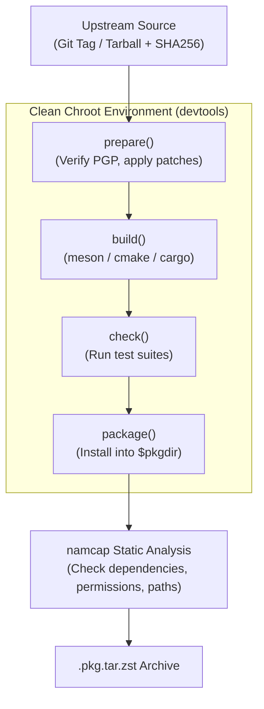
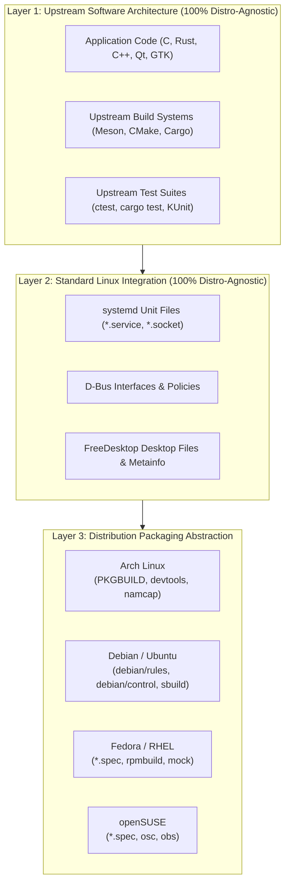

# Arch-First Engineering & Distribution Strategy: Syswright

## 1. Rationale for the Arch-First Baseline

Linux distributions differ in packaging formats, init system policies, filesystem hierarchies, and patch philosophies. To establish an engineering intelligence system without getting bogged down in distribution-specific quirks, Syswright adopts an **Arch-First baseline**.

### 1.1 Why Arch Linux?
1. **Upstream-Vanilla Packaging**:
   Unlike distributions that apply extensive custom downstream patches (e.g., Debian or Ubuntu branding, custom AppArmor patches, custom patch queues), Arch Linux packages software as close to upstream release as possible. When code or packaging works on Arch, it represents standard upstream behavior.
2. **Rolling Release & Modern Userspace**:
   Arch Linux tracks the latest stable Linux kernels (mainline and LTS, e.g., 6.18+), latest systemd releases, and modern compiler toolchains (GCC 14+, Clang/LLVM 18+, Rust 1.80+). This allows agents to work against current APIs without backwards-compatibility debt.
3. **World-Class Documentation**:
   The Arch Wiki (`wiki.archlinux.org`) is universally recognized as the most detailed, technically rigorous distribution documentation in the Linux ecosystem.
4. **State-of-the-Art Clean Chroot Infrastructure**:
   Arch provides `devtools` (`pkgctl`, `mkarchroot`, `arch-nspawn`), allowing completely isolated, reproducible clean builds without requiring heavy virtual machines.

---

## 2. Arch Linux Packaging Architecture

### 2.1 The `PKGBUILD` Specification
Every package is defined by a declarative bash script named `PKGBUILD`. The mandatory and optional variables include:

| Variable | Description & Arch Standards |
|:---|:---|
| `pkgname` | Lowercase alphanumeric package name. Must match directory or provide subpackages. |
| `pkgver` | Upstream version. For VCS packages (`-git`), updated dynamically via `pkgver()`. |
| `pkgrel` | Package release count. Resets to `1` on version bump; incremented on packaging fixes. |
| `pkgdesc` | Plaintext description under 80 characters. No trailing period. No package name repetition. |
| `arch` | Target architectures: `('x86_64')` or `('any')` for architecture-independent packages. |
| `url` | Official upstream homepage. |
| `license` | SPDX license identifier: `('Apache-2.0')`, `('GPL-2.0-or-later')`, `('MIT')`. Custom licenses require installing license file to `/usr/share/licenses/$pkgname/`. |
| `depends` | Runtime package dependencies. Must include only direct library/runtime dependencies. |
| `makedepends`| Build-time dependencies (e.g., `meson`, `ninja`, `rust`, `git`). |
| `checkdepends`| Dependencies required exclusively for running the test suite in `check()`. |
| `source` | Array of source URLs, patches, and desktop files. Remote files must specify filename: `source=("$pkgname-$pkgver.tar.gz::$url/archive/v$pkgver.tar.gz")`. |
| `sha256sums` | SHA-256 cryptographic checksums corresponding 1-to-1 with `source`. `SKIP` is permitted only for VCS git branches with PGP verification. |
| `validpgpkeys`| Array of maintainer PGP key fingerprints used for verifying git commits or detached signatures. |

### 2.2 Standard Build Lifecycle Functions
- **`prepare()`**: Extracts source, applies patches, configures build parameters. Never runs network downloads (all sources must be declared in `source=`).
- **`build()`**: Compiles the software using standard build systems (`meson compile`, `cmake --build`, `cargo build --release`).
- **`check()`**: Executes unit and integration tests (`meson test`, `ctest`, `cargo test`). Crucial for automated validation!
- **`package()`**: Installs build artifacts into the staging directory `$pkgdir`. Must strictly respect standard paths (`/usr/bin`, `/usr/lib`, `/usr/share`). Never write outside `$pkgdir`.

### 2.3 Dependency Hygiene & Namcap Analysis
A package is never complete until validated with `namcap`.
Common packaging flaws caught by `namcap`:
1. **Implicit / Missing Dependencies**: Linking against a shared library (`libsqlite3.so`) that happens to be installed on the host, but is missing from `depends=()`.
2. **Redundant Dependencies**: Listing `glibc` when it is already pulled in transitively.
3. **Improper File Permissions**: Files in `/usr/bin` without executable bits, or configuration files with world-writable bits.
4. **FHS Violations**: Installing files into `/usr/local` or `/opt` instead of `/usr`.

---

## 3. Clean Chroot Builds (`devtools` vs. Host `makepkg`)

Building packages directly on the host system (`makepkg -s`) is an **anti-pattern** for reliable engineering:
- The build may succeed because the developer's workstation has development headers installed that are omitted from `makedepends`.
- Malicious or broken `Makefile` scripts can mutate host files outside `$pkgdir`.

### 3.1 The `devtools` Clean Chroot Pattern
Arch Linux provides `pkgctl build --clean` (backed by `mkarchroot` and `arch-nspawn`):
1. **Base Rootfs**: Creates a minimal, clean Arch Linux chroot containing only the `base` and `base-devel` meta-packages.
2. **Ephemeral Copy-on-Write**: Mounts the chroot using a temporary Btrfs snapshot or overlayfs.
3. **Dependency Injection**: Installs *only* the packages declared in `makedepends` and `depends`.
4. **Unprivileged Compilation**: Drops root privileges to build the package as a dedicated `builduser`.
5. **Artifact Extraction**: Copies the finished `.pkg.tar.zst` back to the host and destroys the ephemeral chroot.

If a package builds in a clean chroot, it is guaranteed to be reproducible and deployable on any Arch system.

---

## 4. Kernel & System Engineering on Arch

### 4.1 Arch Kernel Package Ecosystem
Arch Linux maintains distinct official kernel variants:
- `linux`: Standard upstream stable rolling kernel.
- `linux-lts`: Long-Term Support kernel (e.g., 6.18 LTS), ideal for mission-critical stability.
- `linux-zen`: Tuned for desktop responsiveness, low-latency audio, and gaming (Zen patchset).
- `linux-hardened`: Security-hardened kernel with PaX/Grsecurity-inspired mitigations and lockdown enabled.
- `linux-headers`: Subsystem header packages required to build out-of-tree kernel modules.

### 4.2 Module Development & DKMS
When authoring kernel modules:
- Out-of-tree modules must be built against `/usr/lib/modules/$(uname -r)/build`.
- Packaging for end-users should provide a DKMS (Dynamic Kernel Module Support) package (`dkms.conf`), ensuring the module automatically recompiles when the user upgrades their kernel.

### 4.3 Initramfs & Boot Engineering
Arch uses **`mkinitcpio`** as its primary initramfs generator:
- Configuration resides in `/etc/mkinitcpio.conf`.
- **Hook Architecture**: Modular bash scripts (`/usr/lib/initcpio/hooks/`) that copy binaries and configure early userspace mount targets.
- Standard hook order: `base udev autodetect microcode modconf kms block filesystems fsck`.
- Systemd-based early userspace alternative: `base systemd autodetect ... sd-vconsole sd-encrypt sd-lvm2 filesystems fsck`.

---

## 5. Distribution-Agnostic Portability Architecture

While Arch Linux is our initial target, the technical architecture of Syswright is strictly **distribution-agnostic**.

We enforce a 3-layer decoupled architecture:

### 5.1 The Portability Contract
1. **Never hardcode distribution paths**: Use standard variables (`$PREFIX`, `/usr`, `/etc`, `/var`).
2. **Never bundle distribution-specific patches into upstream code**: Upstream code must remain clean.
3. **Decouple unit files**: `systemd` unit files, `tmpfiles.d` configs, and `sysusers.d` definitions must be identical across all systemd-based distributions.
4. **Porting to Phase 2+ Distributions**:
   When expanding to Debian or Fedora:
   - Layers 1 and 2 remain 100% untouched.
   - Only Layer 3 (the packaging recipe: `PKGBUILD` $\to$ `debian/rules` or `.spec`) is adapted.
