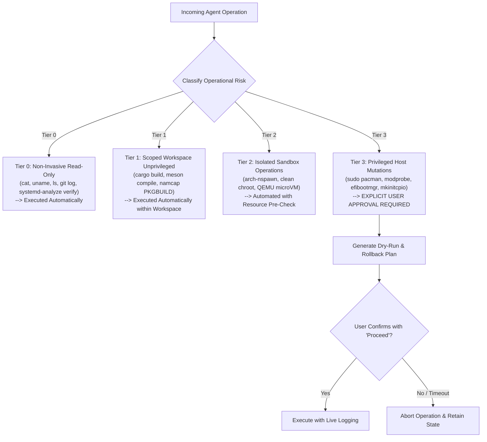
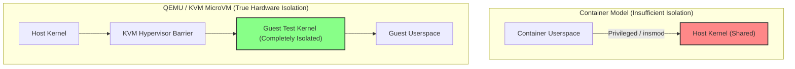

# Safety Model & Verification Architecture: Syswright

## 1. The Systems Engineering Safety Mandate

Operating at the Linux systems, kernel, driver, and packaging levels carries severe operational risks. Unlike high-level web or application development where errors typically result in uncaught exceptions, systems engineering errors can cause:
- **Host Unbootability**: Corrupted EFI boot variables, broken initramfs images, or missing root UUIDs.
- **Kernel Panics & Host Freezes**: Loading faulty kernel modules (`insmod`) or kernel oopses in interrupt context.
- **Data Loss**: Erroneous block device writes (`dd`, `mkfs`, raw partition manipulation).
- **System Service Outages**: Accidental interruption of core host services (`NetworkManager`, `systemd-resolved`, `sshd`).
- **Host Compromise**: Running untrusted build scripts or installing malicious packages from the AUR.

Syswright enforces an uncompromising safety architecture:
> **Automate safe diagnostics and isolated builds; strictly gate destructive or privileged operations behind human checkpoints and deterministic rollback plans.**

---

## 2. Four-Tier Operational Risk Model

Every command, tool invocation, and action proposed by Syswright skills is classified into one of four operational risk tiers:



### Risk Tier Definitions & Boundaries

| Tier | Category | Scope & Examples | Execution Policy |
|:---:|:---|:---|:---|
| **Tier 0** | **Non-Invasive Diagnostics** | `uname -a`, `cat /etc/os-release`, `systemd-analyze verify`, `lsinitcpio`, `git status`, `readelf`, `nm`, `objdump`, `ldd`. | **Fully Autonomous**. No state changes; zero host side-effects. |
| **Tier 1** | **Scoped Unprivileged Builds** | `cargo build`, `meson compile`, `makepkg --nobuild`, `namcap PKGBUILD`, `gcc -Wall`, running local unit tests in repo. | **Fully Autonomous within `allowed_write_scope`**. Restricted strictly to workspace directory. |
| **Tier 2** | **Isolated Sandbox Execution** | `pkgctl build --clean`, `arch-nspawn` ephemeral chroot, QEMU/KVM microVM boot, rootless container testing. | **Autonomous with Pre-Checks**. Verified that sandbox is ephemeral and cannot touch host rootfs. |
| **Tier 3** | **Privileged / Host Mutating** | `sudo pacman -S`, `modprobe`, `insmod`, `efibootmgr`, `mkinitcpio -P`, `systemctl restart`, `fdisk`, `dd`, `reboot`. | **STRICT HUMAN GATE**. Prohibited from executing autonomously. Requires explicit user confirmation, dry-run, and rollback plan. |

---

## 3. Explicit Evaluation of Critical Host Hazards

### 3.1 Unapproved `sudo` Operations
- **Hazard**: Unsupervised privilege escalation can overwrite `/etc`, `/usr`, or system binaries.
- **Rule**: Agents are **never permitted** to run commands prefixed with `sudo` autonomously. When root privileges are necessary, the agent must output the exact proposed command, explain why it is required, and ask the user to review and execute it.

### 3.2 Host Package Installation & Removal
- **Hazard**: Running `pacman -S` or `pacman -R` on the host can remove critical dependencies, trigger system upgrade conflicts, or install untested packages.
- **Rule**: Host packages must never be altered during testing. Packages must be built and tested inside clean chroots (`devtools`) or ephemeral virtual machines.

### 3.3 Boot Configuration & EFI Changes
- **Hazard**: Corrupting NVRAM boot entries (`efibootmgr`), `/boot/loader/entries/`, or `grub.cfg` renders the machine unbootable.
- **Rule**: The agent must treat `/boot/` and EFI variables as read-only. Boot testing must occur exclusively on virtual disk images inside QEMU.

### 3.4 Kernel Replacement & Module Loading
- **Hazard**: Loading an unverified kernel module (`insmod my_driver.ko`) on the host can trigger a kernel panic, memory corruption, or hardware freeze.
- **Rule**: Custom kernel modules must **never be loaded into the host kernel**. Module testing must be conducted inside a QEMU microVM using `virtme-ng` or a dedicated test kernel.

### 3.5 Disk Partitioning & Raw Block Devices
- **Hazard**: Running `fdisk`, `parted`, `mkfs`, or `dd` with incorrect device names (e.g., target `/dev/sda` instead of `/dev/sdb`) causes catastrophic data loss.
- **Rule**: Raw block device mutations on host drives are strictly prohibited. Agents may only operate on loopback images (`losetup`) or virtual disk images (`qemu-img create`).

### 3.6 Remote Script Execution (`curl | sh`)
- **Hazard**: Piping remote scripts (`curl -s https://example.com/install.sh | bash`) bypasses package verification, checksums, and auditability.
- **Rule**: **Strictly forbidden**. All third-party tools and source code must be fetched to disk, inspected, and verified against SHA-256 checksums or PGP signatures before execution.

---

## 4. Container Isolation Limitations & The Virtual Machine Mandate

A common misconception among AI agents is that Docker or Podman containers provide sufficient isolation for Linux systems and kernel development. This assumption is dangerously flawed:

1. **Shared Kernel**:
   Containers share the host Linux kernel. A kernel module compiled inside a container cannot be loaded into the container without mutating the host kernel (`CAP_SYS_MODULE`).
2. **Container Breakout Hazards**:
   If an agent runs containers with `--privileged` to access hardware or systemd, it grants root access to host devices, defeating isolation.
3. **eBPF & Tracing Interference**:
   Loading eBPF programs or attaching kprobes inside containers attaches to the host kernel's unified tracing subsystem.



### The MicroVM Mandate for Kernel & Driver Work
For all tasks involving:
- Kernel compilation and boot testing.
- Custom driver loading and hardware emulation.
- eBPF probe testing on unstable kernels.
- Initramfs boot failure reproduction.

The system mandates **QEMU / KVM microVM isolation**. If the guest kernel crashes, the host remains completely unaffected.

---

## 5. Verification Hierarchy & Evidence Requirements

Following Gravitas Invariant 3: **Completion Needs Evidence**. A task is never marked complete based on agent self-review or conversational prose.

### The 7-Level Verification Hierarchy
Evidence must be established using the highest possible level in this hierarchy:

```text
Level 1: Deterministic acceptance validator (Passed after the last code edit)
         ├── Compiler / Typechecker: gcc -Wall -Werror, cargo check (Pass = 0 errors)
         ├── Packaging Static Analyzer: namcap PKGBUILD (Pass = 0 errors)
         ├── Systemd Linter: systemd-analyze verify (Pass = 0 syntax errors)
         └── Kernel Checker: scripts/checkpatch.pl --strict (Pass = 0 errors)

Level 2: Automated test suite pass
         ├── Unit / Integration tests: meson test, ctest, cargo test (Pass = 100%)
         └── Kernel Unit Tests: kunit.py run (Pass = 100%)

Level 3: Clean chroot build verification
         └── pkgctl build --clean inside ephemeral arch-nspawn chroot

Level 4: Isolated runtime execution in QEMU microVM
         └── Successful boot log and clean exit code from guest test harness

Level 5: Quantitative performance delta
         └── perf / eBPF latency histogram proving measured optimization

Level 6: Structural & diff invariant validation
         └── git diff inspection confirming zero unauthorized file modifications

Level 7: Disqualified as completion evidence (Never sufficient on its own)
         ├── Agent self-explanation ("I have fixed the bug")
         └── Stale test results generated before the last file edit
```

---

## 6. Rollback & Recovery Protocols

Before proposing any Tier 3 action or invasive system configuration change, the agent must formulate and output a **Recovery Contract**:

1. **Pre-Mutation State Backup**:
   Create a timestamped backup of any modified configuration file:
   ```bash
   cp -p /path/to/config.conf /path/to/config.conf.bak.$(date +%Y%m%d%H%M%S)
   ```
2. **Explicit Rollback Command**:
   Provide the exact single command needed to restore the original state if the change fails:
   ```bash
   mv /path/to/config.conf.bak.TIMESTAMP /path/to/config.conf && systemctl reload myservice
   ```
3. **Emergency Fallback Route**:
   For boot or kernel changes, specify the alternate bootloader entry (e.g., fallback initramfs or LTS kernel) that remains bootable if the primary entry fails.
