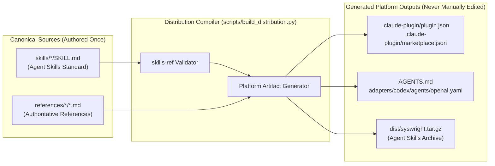

# Technical Architecture & Repository Blueprint: Syswright

## 1. Architectural Philosophy & Design Principles

The technical architecture of **Syswright** is founded on five uncompromising engineering principles:

1. **Strict Separation of Canonical Intelligence and Platform Distribution**:
   Domain engineering knowledge must exist in exactly one place. Platform-specific artifacts (Claude Code plugins, Codex `AGENTS.md`, marketplace manifests) are compiled deterministically from canonical sources.
2. **Open Standards Compliance**:
   All skills strictly adhere to the vendor-neutral **Agent Skills specification** (`agentskills.io`), guaranteeing portability across current and future AI agent runtimes.
3. **Progressive Disclosure & Low Token Footprint**:
   Main `SKILL.md` entry points are kept under 500 lines. Exhaustive technical references, register maps, and syntax guides reside in modular `references/` files loaded strictly on demand.
4. **Deterministic Scripting for Non-LLM Workflows**:
   Tasks that require deterministic computation (chroot setup, patch formatting, QEMU boot orchestration, package static analysis) are delegated to Python and Bash scripts rather than unconstrained agent generation.
5. **Contract-Gated Verification**:
   No operation is deemed complete without verifiable evidence output by deterministic linters, compilers, or test suites.

---

## 2. Target Repository Blueprint

The complete target directory layout for Syswright is structured as follows:

```text
syswright/
├── .claude-plugin/                  # Generated Claude Code plugin packaging
│   ├── plugin.json                  # Plugin manifest and metadata
│   └── marketplace.json             # Marketplace catalogue declaration
├── skills/                          # Canonical Agent Skills (100% agentskills.io compliant)
│   ├── linux-engineer/              # Master orchestrator & router
│   │   └── SKILL.md
│   ├── linux-research/              # Upstream evidence & authority engine
│   │   └── SKILL.md
│   ├── linux-environment/           # Host/target environment detection
│   │   └── SKILL.md
│   ├── kernel-engineering/          # Subsystems, Kbuild, KUnit, checkpatch
│   │   └── SKILL.md
│   ├── driver-engineering/          # Device model, DMA, interrupts, platform drivers
│   │   └── SKILL.md
│   ├── systemd-engineering/         # Units, sandboxing, socket activation
│   │   └── SKILL.md
│   ├── boot-engineering/            # UEFI, systemd-boot, initramfs, mkinitcpio
│   │   └── SKILL.md
│   ├── arch-packaging/              # PKGBUILD, clean chroot, namcap, pkgctl
│   │   └── SKILL.md
│   ├── linux-application-engineering/ # Rust/C/C++ native system engineering
│   │   └── SKILL.md
│   ├── desktop-integration/         # Wayland, X11, D-Bus, FreeDesktop specs
│   │   └── SKILL.md
│   ├── linux-build-engineering/     # Meson, CMake, Cargo, hardening flags
│   │   └── SKILL.md
│   ├── linux-debugging/             # GDB, core dumps, strace, sanitizers
│   │   └── SKILL.md
│   ├── linux-performance/           # perf, eBPF, bpftrace, flamegraphs
│   │   └── SKILL.md
│   ├── linux-security/              # Capabilities, seccomp, AppArmor, MAC
│   │   └── SKILL.md
│   ├── linux-distribution-engineering/ # Multi-distro abstraction (Debian/Fedora)
│   │   └── SKILL.md
│   ├── linux-networking-storage/    # iproute2, nftables, Btrfs, LVM, ext4
│   │   └── SKILL.md
│   └── linux-release-maintenance/   # Upstream patches, b4, git bisect
│       └── SKILL.md
├── references/                      # Shared authoritative reference library
│   ├── kernel/                      # Kernel coding style, Kbuild, KUnit, sysfs
│   ├── systemd/                     # Directives, security scoring, sandboxing
│   ├── packaging/                   # Arch guidelines, namcap rules, clean chroots
│   ├── security/                    # Capabilities tables, seccomp BPF filters
│   ├── desktop/                     # D-Bus interfaces, FreeDesktop specs, Wayland
│   └── toolchains/                  # Hardening flags, sanitizers, cross-compilers
├── adapters/                        # Platform-specific templates and bridge configs
│   ├── claude-code/                 # Subagent definitions and hooks templates
│   ├── codex/                       # AGENTS.md templates and openai.yaml configs
│   └── other-agents/                # Antigravity CLI and standard runner bridges
├── scripts/                         # Deterministic verification and build scripts
│   ├── build_distribution.py        # Compiles canonical skills into platform artifacts
│   ├── validate_skills.py           # Validates YAML frontmatter via skills-ref
│   ├── qemu_microvm.py              # Headless QEMU runner for kernel/driver testing
│   └── namcap_gate.sh               # Unprivileged packaging verification gate
├── evals/                           # Evaluation benchmark harness
│   ├── scenarios/                   # 15+ comprehensive real-world eval scenarios
│   ├── fixtures/                    # Mock broken units, buggy drivers, invalid PKGBUILDs
│   └── run_evals.py                 # Multi-turn evaluation runner and scorer
├── tests/                           # Project test suite
│   ├── unit/                        # Tests for build scripts and generators
│   └── integration/                 # End-to-end skill routing and validation tests
├── docs/                            # Comprehensive documentation
│   ├── phase-0/                     # Authoritative research and architecture foundation
│   └── architecture/                # Ongoing design specs and developer guides
├── AGENTS.md                        # Generated root guidance for Codex and coding agents
├── README.md                        # Project introduction, quickstart, and catalog
├── CONTRIBUTING.md                  # Guidelines for contributing skills and references
├── SECURITY.md                      # Security policies, isolation rules, disclosure
└── LICENSE                          # Open source license (Apache-2.0 recommended)
```

---

## 3. Component Deep Dive & Ownership



### 3.1 Canonical Sources (`skills/` & `references/`)
- **`skills/`**: Contains the 17 specialist skills. Each skill is 100% compliant with `agentskills.io`. The frontmatter contains only standard fields (`name`, `description`, `license`, `compatibility`, `metadata`). Platform-specific settings are embedded inside the `metadata:` map using clean namespaces:
  ```yaml
  metadata:
    claude_paths: "PKGBUILD,*/PKGBUILD"
    claude_context: "fork"
    claude_agent: "general"
    codex_role: "package-maintainer"
  ```
- **`references/`**: Houses deep technical knowledge organized by subsystem. Centralizing references eliminates knowledge duplication. For instance, `references/packaging/arch-guidelines.md` is referenced by both `arch-packaging` and `linux-distribution-engineering`.

### 3.2 Platform Packaging (`adapters/` & `scripts/build_distribution.py`)
The generator script (`scripts/build_distribution.py`):
1. **Parses Canonical Skills**: Reads `skills/*/SKILL.md` and validates syntax against the `agentskills.io` JSON schema.
2. **Generates Claude Code Artifacts**:
   - Creates `.claude-plugin/plugin.json` registering the skills and components.
   - Generates `.claude-plugin/marketplace.json` for catalog indexing.
   - Extracts `claude_*` metadata into top-level Claude Code skill wrappers if needed.
3. **Generates OpenAI Codex Artifacts**:
   - Synthesizes the master `AGENTS.md` at the repository root, detailing overall project boundaries, the 6 Gravitas invariants, and skill activation cues.
   - Outputs `adapters/codex/agents/openai.yaml` declaring tool bindings.
4. **Builds Release Packages**: Packages a standalone distribution tarball (`dist/syswright.tar.gz`) for vanilla Agent Skills platforms.

### 3.3 Verification & Safety Automation (`scripts/`)
- `scripts/validate_skills.py`: Invokes `skills-ref validate` across all skill folders during CI.
- `scripts/qemu_microvm.py`: Launches an ephemeral microVM using QEMU/KVM with virtio console and 9p filesystem sharing, enabling safe kernel and driver testing.
- `scripts/namcap_gate.sh`: Automates packaging linting, returning structured error/warning tallies.

---

## 4. Architectural Decisions, Alternatives & Trade-Offs

### ADR-101: Unified References Directory vs. Co-Located Skill References
- **Option A**: Co-locate references inside each skill folder (`skills/arch-packaging/references/`).
- **Option B**: Centralize all references in a root `references/` directory.
- **Decision**: **Option B (Root `references/`) with symlink/relative linking**. Multiple skills share foundational knowledge (e.g., Kbuild syntax is needed by both `kernel-engineering` and `driver-engineering`). Centralizing references prevents data divergence and keeps individual skill packages compact.

### ADR-102: Python vs. Rust for Distribution Tooling
- **Option A**: Implement `build_distribution.py` and evaluation runners in Rust.
- **Option B**: Implement in standard Python 3.
- **Decision**: **Option B (Python 3)**. Python is universally available across Linux distributions without pre-compilation, integrates natively with existing packaging tools (`namcap`, `b4`, `meson`), and has zero compilation barrier for contributors.

### ADR-103: Dynamic Subagents vs. In-Turn Execution
- **Option A**: Force all multi-step tasks into a single agent conversation turn.
- **Option B**: Leverage background subagent forks (`context: fork` on Claude Code, subagent workers on Antigravity/Codex).
- **Decision**: **Option B for exploratory/heavy tasks; Option A for direct edits**. For research, broad reconnaissance, and compilation runs, spawning a subagent prevents context pollution and runaway token burn in the primary conversation. Direct, single-file edits remain in-turn.
