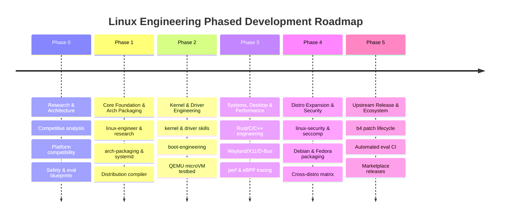

# Project Roadmap & Phase 1 Implementation Specification: Linux Engineering

## 1. Overall Project Roadmap (Phases 0–5)

The development of **Linux Engineering** is structured across six sequential, milestone-driven phases. Each phase builds upon the verified architectural foundation of the preceding phase.



### Phase Summary

- **Phase 0 (Current)**: *Deep Research, Architecture, and Technical Foundation*. Research-only; zero code; complete architectural blueprint and technical decision records.
- **Phase 1**: *Core Foundation & Arch-First Packaging*. Delivery of foundation orchestrators (`linux-engineer`, `linux-research`, `linux-environment`), `arch-packaging`, `systemd-engineering`, and the deterministic platform build compiler (`build_distribution.py`).
- **Phase 2**: *Kernel, Driver, and Boot Engineering*. Implementation of `kernel-engineering`, `driver-engineering`, `boot-engineering`, and the isolated QEMU/KVM microVM testbed.
- **Phase 3**: *Application, Desktop, and Performance*. Implementation of `linux-application-engineering` (Rust/C/C++), `desktop-integration` (Wayland/D-Bus), `linux-debugging`, and `linux-performance` (perf/eBPF).
- **Phase 4**: *Distribution Expansion and Security*. Implementation of `linux-security` (capabilities/seccomp/AppArmor), `linux-distribution-engineering` (Debian `sbuild` and Fedora `mock` adapters), and `linux-networking-storage`.
- **Phase 5**: *Upstream Contribution & Release Ecosystem*. Implementation of `linux-release-maintenance` (`b4`, git bisection), automated continuous benchmarking, and publication to Anthropic, OpenAI, and open-source marketplaces.

---

## 2. Phase 1 Implementation Specification

Phase 1 focuses on establishing the working core: the foundational orchestration layer, authoritative research engine, Arch Linux packaging pipeline, and systemd service engineering.

### 2.1 Scope & Deliverables

#### A. Specialist Skills to Implement
The following five canonical skills will be authored strictly compliant with the `agentskills.io` standard:
1. `skills/linux-engineer/SKILL.md`: Master intent router, task decomposition, and workflow supervisor.
2. `skills/linux-research/SKILL.md`: Authoritative source research, tier ranking, and citation record builder.
3. `skills/linux-environment/SKILL.md`: Safe host and target environment reconnaissance prober.
4. `skills/arch-packaging/SKILL.md`: Authoritative `PKGBUILD` creation, clean chroot builds, and `namcap` linting.
5. `skills/systemd-engineering/SKILL.md`: Declarative `.service`/`.socket` unit design, dependency management, and sandboxing.

#### B. Shared Authoritative References to Author
Exhaustive reference documents will be authored under `references/`:
- `references/packaging/arch-guidelines.md`: Official Arch Linux packaging standards and filesystem rules.
- `references/packaging/pkgbuild-syntax.md`: Exhaustive variable and function reference for `PKGBUILD`.
- `references/packaging/namcap-rules.md`: Rule directory and resolution patterns for all `namcap` tags.
- `references/systemd/unit-directives.md`: Core unit directives (`Service`, `Unit`, `Install`).
- `references/systemd/sandboxing.md`: Complete sandboxing guide (`ProtectSystem`, `ProtectHome`, `PrivateTmp`, etc.).
- `references/systemd/security-scoring.md`: Methodology for auditing and reducing `systemd-analyze security` scores.
- `references/research/source-authority-index.md`: Directory of authoritative upstream endpoints and citation formats.

#### C. Deterministic Scripts & Tooling
- `scripts/build_distribution.py`: Python compiler that parses `skills/`, verifies schema compliance, and generates:
  - `.claude-plugin/plugin.json` and `.claude-plugin/marketplace.json` for Claude Code.
  - Root `AGENTS.md` and `adapters/codex/agents/openai.yaml` for OpenAI Codex.
  - Distribution archive `dist/linux-engineering-0.1.0.tar.gz`.
- `scripts/validate_skills.py`: CI script wrapping `skills-ref validate` to verify 100% standard compliance.
- `scripts/namcap_gate.sh`: Deterministic wrapper running `namcap` on PKGBUILDs and package archives, emitting machine-readable JSON pass/fail reports.

#### D. Phase 1 Evaluation Scenarios
Four concrete evaluation scenarios from the benchmark suite will be fully wired and verified:
- **Scenario 3**: Creation of a clean C/Meson `PKGBUILD` passing `namcap` with 0 warnings.
- **Scenario 4**: Diagnosis and repair of missing dynamic library dependencies in a `PKGBUILD`.
- **Scenario 5**: Repair of a broken `Type=notify` systemd service unit.
- **Scenario 10**: Hardening an unprivileged web service unit to achieve `systemd-analyze security` score <2.5.

---

## 3. Measurable Acceptance Criteria for Phase 1 Completion

Phase 1 will be considered complete **only when all of the following empirical criteria are satisfied**:

| Acceptance Criterion | Verification Command / Target | Pass Condition |
|:---|:---|:---:|
| **1. Agent Skills Standard Compliance** | `python3 scripts/validate_skills.py` | **100% Pass** on all 5 skills via `skills-ref` |
| **2. Clean Platform Build Compilation** | `python3 scripts/build_distribution.py` | Exits `0`; generates `.claude-plugin/` and `AGENTS.md` without errors |
| **3. Zero Source Knowledge Duplication**| `diff` / static content audit | **Zero duplicated markdown bodies** between skills and adapters |
| **4. Packaging Eval Pass (Scenario 3)** | `python3 evals/run_evals.py --scenario 03` | `namcap` output = **0 errors, 0 warnings** |
| **5. Packaging Fix Eval Pass (Scenario 4)**| `python3 evals/run_evals.py --scenario 04` | Missing dependency resolved; `pkgrel` bumped |
| **6. Systemd Unit Verification (Scenario 5)**| `python3 evals/run_evals.py --scenario 05` | `systemd-analyze verify` = **0 errors** |
| **7. Systemd Security Hardening (Scenario 10)**| `python3 evals/run_evals.py --scenario 10` | Exposure score drops from **>8.0 to <2.5** |
| **8. Host System Protection Invariant** | Host filesystem check (`git status`, package DB) | **Zero unauthorized host changes** outside workspace |

---

## 4. Phase 1 Implementation Workflow & Step Sequence

```text
Step 1: Setup Repository Framework
        ├── Create directories: skills/, references/, adapters/, scripts/, evals/, tests/
        └── Implement scripts/validate_skills.py and scripts/build_distribution.py

Step 2: Author Authoritative References
        ├── Author references/packaging/*.md
        ├── Author references/systemd/*.md
        └── Author references/research/*.md

Step 3: Author Canonical Skills
        ├── skills/linux-engineer/SKILL.md
        ├── skills/linux-research/SKILL.md
        ├── skills/linux-environment/SKILL.md
        ├── skills/arch-packaging/SKILL.md
        └── skills/systemd-engineering/SKILL.md

Step 4: Execute Platform Compiler
        └── Run build_distribution.py to generate .claude-plugin/ and AGENTS.md

Step 5: Implement Eval Fixtures & Harness
        └── Implement evals/scenarios 3, 4, 5, 10 and scripts/namcap_gate.sh

Step 6: Execute Benchmark Runs & Capture Evidence
        └── Verify 100% pass across Claude Code and Codex targets
```
