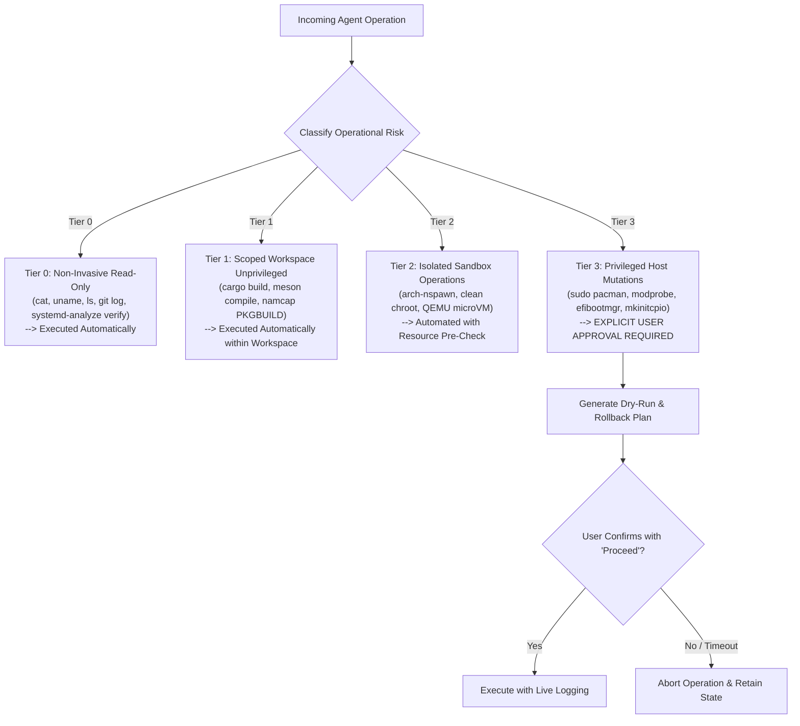

# Global Engineering Reference: Operational Safety Policy

## 1. Core Safety Policy

Systems engineering operations carry high operational blast radiuses. Unlike application development where errors typically cause caught exceptions, systems errors can freeze the kernel, brick bootloaders, or destroy filesystem metadata.

Linux Engineering enforces an uncompromising safety invariant:
> **Autonomous execution is permitted exclusively for safe diagnostics, scoped workspace mutations, and isolated sandboxes. Privileged, destructive, or host-mutating actions strictly require explicit human authorization.**

---

## 2. Four-Tier Risk Classification

### Tier 0: Non-Invasive Read-Only Diagnostics
- **Permitted Operations**: `uname`, `cat /etc/os-release`, `readelf`, `systemd-analyze verify`, `git status`, `git log`, `ldd`, `lsblk -f`.
- **Policy**: Autonomous execution permitted. Zero host state change.

### Tier 1: Scoped Workspace Development
- **Permitted Operations**: `cargo build`, `meson compile`, `gcc -Wall`, running local unit tests, editing files strictly within the declared workspace.
- **Policy**: Autonomous execution permitted within `allowed_write_scope`. Writing outside declared workspace boundaries is blocked.

### Tier 2: Isolated Sandbox Operations
- **Permitted Operations**: Clean chroot package builds (`pkgctl build --clean`), ephemeral `systemd-nspawn` builds, headless QEMU/KVM microVM boots.
- **Policy**: Autonomous execution permitted after verifying the sandbox is ephemeral, copy-on-write, and completely isolated from the host rootfs.

### Tier 3: Privileged & Host-Mutating Operations
- **Prohibited without Explicit Human Approval**:
  - `sudo` commands of any kind.
  - Package installation, removal, or upgrades on the host (`pacman -S`, `pacman -R`, `apt install`).
  - Kernel module loading or unloading (`modprobe`, `insmod`, `rmmod`).
  - Bootloader mutations (`bootctl`, `efibootmgr`, editing `/boot/loader/`).
  - Initramfs generation (`mkinitcpio -P`, `dracut --force`).
  - Raw disk partitioning or formatting (`fdisk`, `parted`, `mkfs`, `dd`).
  - System service restarting or reloading on PID 1 (`systemctl restart`, `systemctl stop`).
  - Rebooting or halting the host (`reboot`, `systemctl poweroff`).
  - Executing remotely downloaded shell scripts (`curl ... | sh` anti-pattern).
- **Policy**: **Mandatory Human Gate**. The agent must present:
  1. The exact command string proposed.
  2. The technical justification.
  3. A dry-run where available.
  4. A concrete rollback/recovery procedure.
  5. Wait for explicit user confirmation.

---

## 3. Container vs. Hardware MicroVM Isolation

Containers share the host kernel:
- An agent cannot test kernel modules (`insmod`) or custom kernel builds inside Docker/Podman without mutating the host kernel or failing due to missing capabilities (`CAP_SYS_MODULE`).
- Privileged containers bypass isolation and expose host block devices to data loss.

**Rule**: All kernel, driver, and early userspace testing must run inside **QEMU / KVM microVMs**, providing genuine hardware virtualization and guaranteeing host immunity from guest kernel panics.
