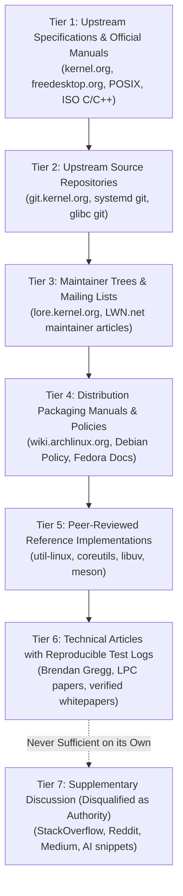

# Global Engineering Reference: Source Authority Hierarchy

## 1. The 7-Tier Authority Framework

Linux systems engineering encompasses multiple layers: hardware interfaces, the Linux kernel, the GNU C Library (glibc), the init system (`systemd`), desktop compositors (Wayland/X11), and distribution package managers (`pacman`, `dpkg`, `rpm`).

To prevent reliance on outdated or inaccurate third-party information, all technical claims must be validated against the **7-Tier Authority Hierarchy**:

---

## 2. Authority Tier Definitions & Applications

### Tier 1: Upstream Specifications & Official Manuals (Primary Authority)
- **Sources**: `docs.kernel.org`, `freedesktop.org/software/systemd/man/latest/`, `man7.org` (Linux man-pages project), POSIX.1-2024, ISO C23, ISO C++23.
- **Application**: Establishes API contracts, parameter boundaries, memory ownership, and standardized lifecycle behaviors.
- **Rule**: Overrules all lower tiers regarding intended software behavior.

### Tier 2: Upstream Source Repositories (Ground Truth)
- **Sources**: `git.kernel.org/pub/scm/linux/kernel/git/torvalds/linux.git`, `github.com/systemd/systemd`, GNU C Library source.
- **Application**: Ground truth when documentation is ambiguous, incomplete, or lagging behind implementation.
- **Rule**: If source code conflicts with Tier 1 documentation, the source code represents reality; document the discrepancy.

### Tier 3: Maintainer Trees, Commit Logs & LKML (Intent & Evolution)
- **Sources**: `lore.kernel.org`, maintainer git branches (`linux-next`), LWN.net in-depth maintainer series.
- **Application**: Explains *why* an architectural change or deprecation occurred, identifying race conditions or hardware constraints that motivated the design.

### Tier 4: Distribution Packaging Manuals & Policies (Packaging Authority)
- **Sources**: Arch Wiki (`wiki.archlinux.org`), Arch Package Guidelines, Debian Policy Manual, Fedora Packaging Guidelines.
- **Application**: Governs distribution-specific filesystem layouts, packaging syntax (`PKGBUILD`, `debian/rules`), dependency resolution, and service enablements.
- **Rule**: Governs packaging and integration; does *not* override Tier 1/2 for upstream application code.

### Tier 5: Peer-Reviewed Open Source Implementations (Idiomatic Patterns)
- **Sources**: Linux Foundation projects, `systemd`, `util-linux`, `iproute2`, `meson`.
- **Application**: Real-world references for complex system programming (e.g., proper signalfd loops, zero-copy buffer handoffs, netlink socket parsing).

### Tier 6: Technical Articles with Verifiable Evidence (Performance & Diagnostics)
- **Sources**: Brendan Gregg's systems performance research, Linux Plumbers Conference (LPC) technical presentations.
- **Application**: Advanced performance analysis methodologies, eBPF tracing recipes, and hardware profiling patterns.
- **Rule**: Must contain reproducible command logs and environment details.

### Tier 7: Supplementary Discussion (Disqualified as Authority)
- **Sources**: StackOverflow answers, Reddit threads, personal blogs, AI forum summaries.
- **Application**: Permitted *only* as initial search keyword hints.
- **Rule**: **Never cite as authoritative proof.** Every claim derived from Tier 7 must be independently verified in Tiers 1–4 before implementation.
