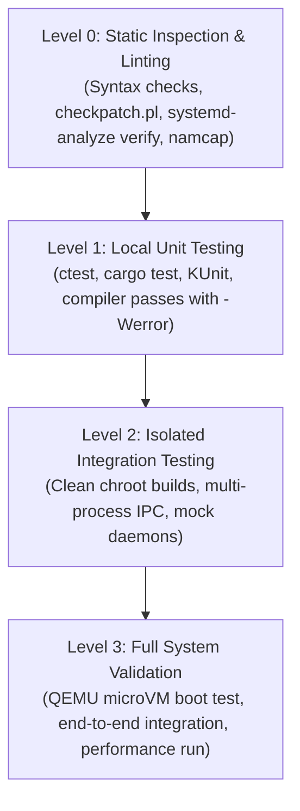

# Global Engineering Reference: Testing & Verification Philosophy

## 1. The Verification Hierarchy: Evidence Over Assertion

In systems engineering, a task is **never complete** simply because an agent states that it has fixed a defect or generated valid syntax.

Following Gravitas Invariant 3: **Completion Needs Evidence**, an acceptance criterion is satisfied only when a deterministic validator passes *after* the last relevant mutation. Stale evidence or same-model conversational self-review is disqualified.

---

## 2. The Four Verification Levels (L0–L3)

### L0: Static Inspection & Linting
- **Scope**: Syntax, style, type correctness, and declarative linting before execution.
- **Validators**:
  - `scripts/checkpatch.pl --strict` for kernel patches.
  - `systemd-analyze verify <unit>` for systemd service units.
  - `namcap PKGBUILD` for Arch Linux packaging recipes.
  - `sparse` (`make C=1`) for kernel semantic type checking.
  - `cargo check --all-targets` / `gcc -Wall -Wextra -Werror`.

### L1: Local Unit Testing
- **Scope**: Fast, deterministic execution of localized test suites within the workspace.
- **Validators**:
  - `cargo test` (Rust).
  - `meson test` / `ctest` (C/C++).
  - `kunit.py run` (Kernel unit tests).
  - Python `unittest` test suites.

### L2: Isolated Integration Testing
- **Scope**: Multi-component interaction within an isolated ephemeral sandbox.
- **Validators**:
  - Clean chroot package compilation (`pkgctl build --clean` via `arch-nspawn`).
  - D-Bus service activation inside a private `dbus-run-session`.
  - Process isolation tests verifying seccomp filter blocking.

### L3: Full System Validation
- **Scope**: End-to-end runtime execution in a virtualized hardware environment.
- **Validators**:
  - Headless QEMU / KVM microVM boot log verifying zero kernel panics.
  - Performance profiling (`perf report`, eBPF histograms) proving quantitative latency reduction.

---

## 3. Disqualified Evidence Types

The following will **never be accepted as completion proof**:
1. **Agent Self-Review**: Claims such as "I have carefully checked the code and it looks correct."
2. **Stale Test Results**: Citing a test that passed prior to the last file edit.
3. **Conversational Plausibility**: Convincing explanations that lack executable command output logs.
4. **Third-Party Forum Snippets**: "This is confirmed to work on StackOverflow."
