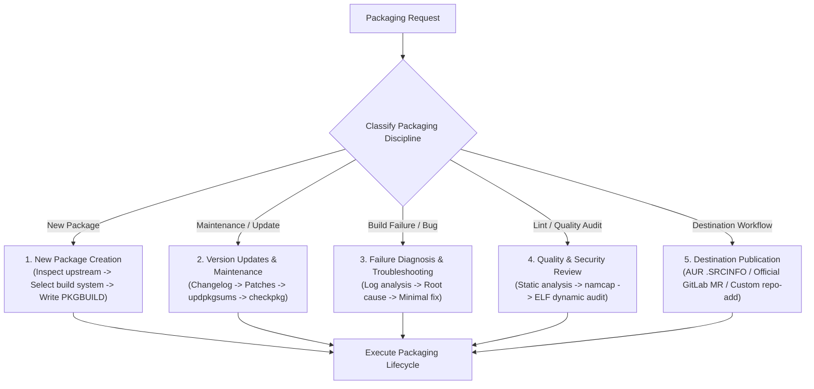
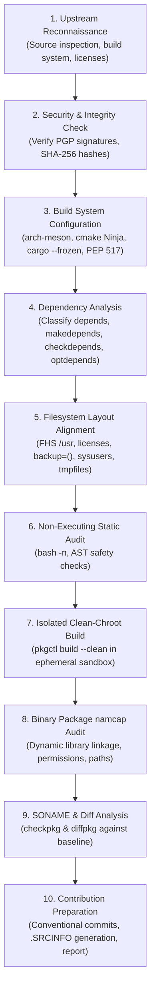

# Arch Linux Packaging Engineering

The `arch-packaging` skill implements production-grade Arch Linux package engineering across the complete package lifecycle. An AI agent using this skill works like an experienced Arch Linux package maintainer: researching upstream projects, selecting appropriate build configurations, enforcing supply-chain security, analyzing ELF dynamic dependencies, performing clean-chroot builds, and validating packages with deterministic linting tools.

---

## 1. Operating Principles & Anti-Patterns

1. **Research Before Writing**: Never generate a `PKGBUILD` from memory or generic templates. Always inspect the actual upstream repository, build system definitions (`CMakeLists.txt`, `meson.build`, `Cargo.toml`, `pyproject.toml`), and license files.
2. **Never Execute Untrusted PKGBUILDs**: A `PKGBUILD` is executable Bash code. Never `source` or execute an untrusted `PKGBUILD` on the host workstation to inspect its contents. Use non-executing static analysis (`bash -n`, AST inspection, regex).
3. **No Dirty Build Assumptions**: A successful local `makepkg` build does not prove packaging correctness; ambient development headers on the host workstation conceal missing dependencies. Verification requires isolated clean-chroot builds (`pkgctl build --clean`) or container validation.
4. **No Synthesized Package Metadata**: Never fabricate upstream URLs, fake cryptographic checksums, invented dependency names, or unverified PGP key fingerprints.
5. **Enforce Safety Tier Gating**: Never automatically push to the AUR, never publish to distribution repositories, and never execute `sudo` or host package database modifications without explicit human authorization.

---

## 2. Intent Classification & Routing

When activated, classify the user request into one of the core packaging disciplines:

---

## 3. Package Destination Awareness

Before drafting or modifying any packaging recipe, establish its target destination:

| Destination | Scope & Permissions | Key Invariants | Detailed Reference |
|:---|:---|:---|:---:|
| **Official Arch Repositories** (`core`, `extra`, `multilib`) | Read-only contribution via GitLab Merge Requests. Never claim direct push access. | Upstream-vanilla, conventional commits (`upgpkg:`), clean-chroot mandatory. | [Official Workflow](references/official-repository-workflow.md) |
| **Arch User Repository** (AUR) | Community build scripts (`PKGBUILD` + `.SRCINFO`). No binary packages. | No duplication of official packages, `.SRCINFO` synchronized, human gating on push. | [AUR Maintenance](references/aur-maintenance.md) |
| **Custom / Distribution Repositories** | Private or distribution binary repositories (`.pkg.tar.zst` + `.db.tar.gz`). | Database management via `repo-add`, GPG signing, client `pacman.conf` config. | [Repo Maintenance](references/repository-maintenance.md) |
| **Local System Packages** | Custom local builds for the developer's machine. | Version pinning, local patches, isolated directory testing. | [Package Standards](references/package-standards.md) |

---

## 4. The 10-Step Packaging Lifecycle

### Step 1: Upstream Reconnaissance
- Inspect the upstream codebase to identify the build system, version tags, configuration options, and license files.
- Consult [Upstream Build Systems](references/build-systems.md).

### Step 2: Security & Integrity Verification
- Obtain source archives via HTTPS. Verify detached OpenPGP signatures when available using full 40-character fingerprints in `validpgpkeys`.
- Calculate SHA-256 or BLAKE2b checksums. Never use `SKIP` on release tarballs.
- Consult [Security & Integrity](references/security-and-integrity.md).

### Step 3: Build System Configuration
- Configure the build using official Arch conventions (`-DCMAKE_BUILD_TYPE=None`, `arch-meson`, `cargo --frozen`, `python -m build --no-isolation`).
- Select or adapt a packaging template from [Templates](templates/).

### Step 4: Dependency Engineering & ELF Analysis
- Strictly classify dependencies into `depends`, `makedepends`, `checkdepends`, and `optdepends`.
- Inspect compiled binaries with `readelf -d` or `objdump -p` to verify direct `DT_NEEDED` library requirements.
- Consult [Dependency Management](references/dependency-management.md).

### Step 5: Filesystem Layout & System Integration
- Install exclusively into standard paths (`/usr/bin`, `/usr/lib`, `/usr/share`).
- For non-standard licenses (MIT, BSD, custom), install license text to `/usr/share/licenses/$pkgname/`.
- Declare `/etc` files in `backup=()`. Use `sysusers.d` and `tmpfiles.d` for declarative integration.
- Consult [Filesystem Layout](references/filesystem-layout.md).

### Step 6: Non-Executing Static Audit
- Validate syntax using `bash -n PKGBUILD`.
- Generate source metadata via `makepkg --printsrcinfo`.
- Run static linting with `namcap PKGBUILD`.
- Consult [Package Validation](references/package-validation.md).

### Step 7: Isolated Clean-Chroot Build
- Build in a pristine clean chroot using `pkgctl build --clean` or an isolated container.
- If dependencies are missing from `makedepends`, the chroot build will fail immediately, exposing the gap.
- Consult [Clean Chroot Builds](references/clean-chroot-builds.md).

### Step 8: Binary Package `namcap` Audit
- Run `namcap` on the resulting `.pkg.tar.zst` archive to detect undeclared dynamic dependencies, permission errors, or misplaced files.
- Consult [Package Validation](references/package-validation.md).

### Step 9: SONAME & Diff Analysis
- Check for broken ABI linkages or library version shifts using `checkpkg`.
- Compare file contents against existing packages using `diffpkg`.
- Consult [Version Updates](references/version-updates.md) and [Reproducible Builds](references/reproducible-builds.md).

### Step 10: Contribution & Release Preparation
- For AUR: generate `.SRCINFO` (`makepkg --printsrcinfo > .SRCINFO`).
- For official repos: format commit message (`upgpkg: <pkgname> <pkgver>-<pkgrel>: 
`).
- Consult [AUR Maintenance](references/aur-maintenance.md) and [Official Workflow](references/official-repository-workflow.md).

---

## 5. Diagnostic & Troubleshooting Index

When encountering packaging failures, consult [Troubleshooting Reference](references/troubleshooting.md) for root-cause diagnosis and remediations:
- **Checksum Failures**: Diagnose upstream archive changes vs corrupted downloads.
- **PGP Key Errors**: Verify 40-character fingerprints out-of-band; avoid blind key imports.
- **Missing Headers / Configs**: Query pacman database via `pacman -F <file.h>` to resolve `makedepends`.
- **Missing Dynamic Libraries**: Query pacman database via `pacman -F <lib.so>` to resolve `depends`.
- **Clean-Chroot vs Host Discrepancies**: Expose and eliminate workstation leakage.

---

## 6. Safety Tier Enforcement & Human Gating

Packaging operations interact with system compilers, package databases, and public distribution infrastructure. Follow [Safety Policy](../../references/safety-policy.md):

| Safety Tier | Operation | Autonomous / Gated |
|:---:|:---|:---:|
| **Tier 0** | Static syntax checks (`bash -n`), `namcap PKGBUILD`, `readelf`, inspecting logs. | Autonomous |
| **Tier 1** | Local workspace builds in isolated build directory, `updpkgsums`. | Autonomous |
| **Tier 2** | Clean-chroot builds (`pkgctl build --clean`), ephemeral container testing. | Autonomous if sandbox ready |
| **Tier 3** | Pushing to AUR (`git push aur master`), publishing to custom repos (`repo-add`), host package installation (`pacman -U`), modifying `/etc/pacman.conf`. | **Strictly Gated: Stop & Require Human Approval** |

---

## 7. Reporting Output Standard

Every completion report delivered by `arch-packaging` must include:

1. **What Changed**: Exact packaging files created or modified (`PKGBUILD`, `.SRCINFO`, patches).
2. **Evidence**:
   - `bash -n` syntax check outcome.
   - `makepkg --printsrcinfo` output.
   - `namcap` results (errors, warnings).
   - Clean-chroot build result or static validation summary.
   - ELF dynamic dependency audit results (`readelf -d`).
3. **Why**: Technical rationale for dependencies, compiler flags, and packaging choices grounded in official Arch guidelines.
4. **Remaining Uncertainties**: Explicit disclosure of unverified upstream aspects or gated distribution steps.

---

## 8. Authoritative References Directory

- [Package Standards & Philosophy](references/package-standards.md)
- [PKGBUILD Reference](references/pkgbuild-reference.md)
- [Dependency Management](references/dependency-management.md)
- [Build Systems](references/build-systems.md)
- [Filesystem Layout](references/filesystem-layout.md)
- [Clean Chroot Builds](references/clean-chroot-builds.md)
- [Package Validation](references/package-validation.md)
- [Security & Integrity](references/security-and-integrity.md)
- [AUR Maintenance](references/aur-maintenance.md)
- [Official Repository Workflow](references/official-repository-workflow.md)
- [Repository Maintenance](references/repository-maintenance.md)
- [Version Updates](references/version-updates.md)
- [Reproducible Builds](references/reproducible-builds.md)
- [Troubleshooting Reference](references/troubleshooting.md)
- [Advanced Packaging](references/advanced-packaging.md)
- [Packaging Templates](templates/)
