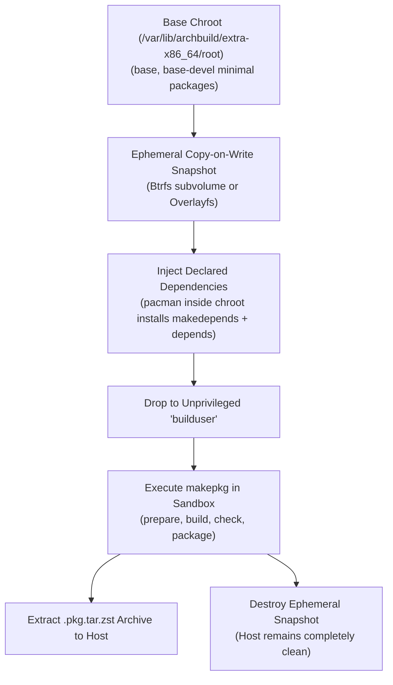

# Clean Chroot Engineering & Devtools Reference

## 1. Scope

This document details the architecture, procedures, and safety invariants for building Arch Linux packages inside pristine, isolated clean chroots using official Arch Linux `devtools`.

---

## 2. Rationale: The Dirty Build Anti-Pattern

Building packages directly on the host system (`makepkg -s`) is an engineering anti-pattern that violates Syswright standards:

| Hazard | Host `makepkg` (Dirty Build) | `devtools` (Clean Chroot) |
|:---|:---|:---|
| **Hidden Build Dependencies** | Succeeds because compiler headers (`libseccomp`, `gtest`) happen to be installed on the developer's host, but are omitted from `makedepends`. Fails on other machines. | **Exposed immediately**: Chroot installs *only* declared `makedepends` and `depends`. Missing dependencies trigger instant compilation failure. |
| **Hidden Runtime Dependencies** | Binaries silently link against optional host libraries, resulting in undeclared dynamic dependencies that break for end-users. | Clean environment guarantees binaries only link against explicitly declared dependencies. |
| **Host Filesystem Contamination** | Broken upstream `Makefile` or `install` scripts can overwrite host files in `/usr/bin`, `/etc`, or `/lib`. | Completely contained within an ephemeral root filesystem snapshot. Host system is untouchable. |
| **Security Risks** | Upstream build scripts execute arbitrary shell code with the developer's permissions on the host system. | Unprivileged build user (`builduser`) runs inside an isolated container namespace (`systemd-nspawn`). |

---

## 3. Clean Chroot Architecture



---

## 4. Modern Tooling: `pkgctl build`

The primary frontend for building packages in clean chroots is `pkgctl build` from `devtools`:

### 4.1 Common Invocations

```bash
# 1. Standard clean chroot build against the auto-detected repository
pkgctl build

# 2. Recreate the chroot before building (guarantees zero cached state)
pkgctl build --clean

# 3. Build against testing or staging repositories
pkgctl build --testing
pkgctl build --staging

# 4. Debugging build failures interactively
# Spawns a shell inside the container chroot if the build fails
pkgctl build --inspect=failure

# 5. Skip check() execution during rapid compilation testing
pkgctl build --nocheck

# 6. Install an unreleased local dependency into the chroot for split or chained builds
pkgctl build -I ../libfoo/libfoo-1.0.0-1-x86_64.pkg.tar.zst
```

### 4.2 Legacy Tooling: `archbuild` & `makechrootpkg`
Underneath `pkgctl build`, `devtools` provides repository-specific scripts:
- `extra-x86_64-build`: Symlink to `archbuild` configured for the `extra` repo.
- `makechrootpkg`: Low-level tool managing the chroot lifecycle:
  ```bash
  # Low-level manual clean build:
  makechrootpkg -c -r /var/lib/archbuild/extra-x86_64
  ```

---

## 5. Build Environment Verification Hierarchy

When evaluating or claiming package status, an agent must clearly distinguish between four distinct levels of verification:

1. **Static Validation**: Parsed with `makepkg --printsrcinfo` and checked with `namcap PKGBUILD`. No code has been executed.
2. **Local Host Build**: Built with `makepkg`. Proves code compiles, but does NOT prove dependency completeness or lack of host leakage.
3. **Clean Chroot Build**: Built with `pkgctl build --clean`. Proves complete dependency declarations and isolation.
4. **Reproducible Build**: Rebuilt via `makerepropkg` and verified bit-for-bit identical with `.BUILDINFO` matching.

**Strict Mandate**: Never claim a package is "ready for distribution" or "fully verified" based solely on a dirty local build.

---

## 6. Safety & Operational Constraints

1. **Tier Gating**: Creating and managing chroots (`/var/lib/archbuild`) typically requires root permissions (via `sudo` or polkit) for loop mounts and namespaces.
   - Per [Safety Policy](../../../references/safety-policy.md), AI agents must **never execute `sudo` autonomously**.
   - If `pkgctl build` is unavailable or requires unapproved privileges, perform static validation and report:
     > "Static validation passed. Clean-chroot build deferred to human-authorized environment."
2. **Untrusted Code Execution**: Upstream source archives may contain malicious build scripts.
   - Do NOT run `makepkg` directly on host for unverified packages.
   - Use containers, virtual machines, or clean-chroot sandboxes.

---

## 7. Authoritative References

- [Arch devtools(7) Manual](https://man.archlinux.org/man/extra/devtools/devtools.7)
- [pkgctl-build(1) Manual](https://man.archlinux.org/man/extra/devtools/pkgctl-build.1.en)
- [makechrootpkg(1) Manual](https://man.archlinux.org/man/extra/devtools/makechrootpkg.1.en)
- [Arch Developer Manual: Building in a clean chroot](https://wiki.archlinux.org/title/DeveloperWiki:Building_in_a_clean_chroot)
