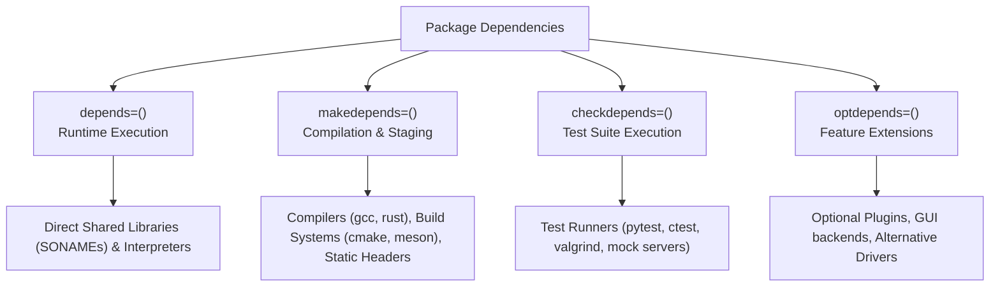

# Dependency Engineering & ELF Analysis Reference

## 1. Scope

This document establishes the methodology for analyzing, declaring, and verifying dependencies in Arch Linux packages. Dependency hygiene is critical: missing dependencies cause runtime failures, while redundant or improperly classified dependencies cause package bloat and upgrade deadlocks.

---

## 2. Dependency Taxonomy

Arch Linux classifies dependencies into four distinct arrays:



### 2.1 Runtime Dependencies (`depends`)
- Essential binaries, shared libraries, data files, or system services required for the software to run.
- **Rule of Direct Linkage**: Only list packages that provide libraries or tools *directly linked* or *directly invoked* by the package binaries.
- Do NOT list transitive dependencies (e.g., if package `A` links against `libssl.so` provided by `openssl`, and `openssl` depends on `glibc`, list `openssl` and `glibc`, but do not list libraries that `openssl` uses internally without direct linkage from `A`).
- **Base Meta-Package Rule**: `glibc` is the baseline C library on Arch Linux. If a native binary links against `libc.so`, explicitly list `'glibc'` in `depends` (modern Arch convention requires explicit `glibc` listing).

### 2.2 Build Dependencies (`makedepends`)
- Compilers, code generators, build systems, and header files required only to build the package.
- Examples: `meson`, `ninja`, `cmake`, `rust`, `cargo`, `go`, `git`, `python-build`, `python-installer`.
- In clean-chroot environments, the minimal base environment (`base` and `base-devel`) is installed, but `makedepends` must declare all additional tools required by the build.

### 2.3 Test Dependencies (`checkdepends`)
- Packages required exclusively during the execution of the `check()` function.
- Examples: `python-pytest`, `gtest`, `xorg-server-xvfb` (for headless graphical tests).
- Kept separate from `makedepends` so users building with `--nocheck` do not pull in heavy test frameworks.

### 2.4 Optional Dependencies (`optdepends`)
- Packages that provide extra functionality without being strictly required for core operation.
- Formatting must follow: `'package-name: Description of capability provided'`
- Example:
  ```bash
  optdepends=(
    'bash-completion: tab completion in Bash'
    'zsh-completions: tab completion in Zsh'
    'libnotify: desktop notifications'
  )
  ```

---

## 3. ELF Shared Object & SONAME Analysis

To determine dynamic library dependencies with technical precision, inspect compiled ELF binaries using non-executing inspection tools:

### 3.1 Inspecting Dynamic Link Sections with `readelf` and `objdump`

```bash
# 1. List required dynamic shared objects (DT_NEEDED entries)
readelf -d "$pkgdir/usr/bin/mybinary" | grep NEEDED

# Sample Output:
#  0x0000000000000001 (NEEDED)             Shared library: [libsqlite3.so.0]
#  0x0000000000000001 (NEEDED)             Shared library: [libssl.so.3]
#  0x0000000000000001 (NEEDED)             Shared library: [libc.so.6]
```

Using `objdump`:
```bash
objdump -p "$pkgdir/usr/bin/mybinary" | grep NEEDED
```

### 3.2 Finding the Arch Package Providing a Library

To find which official Arch package owns a given library:
```bash
pacman -F libsqlite3.so.0
# Output:
# extra/sqlite 3.46.0-1
#     usr/lib/libsqlite3.so.0
```

### 3.3 Security Invariant: Caution with `ldd`
- **Warning**: Never run `ldd` directly on an untrusted third-party ELF binary! On glibc systems, `ldd` invokes the dynamic loader (`/lib64/ld-linux-x86-64.so.2`) directly on the binary. Some ELF headers or malformed binaries can trick the dynamic linker into executing binary initialization code.
- **Safe Alternative**: Use `readelf -d <binary>`, `objdump -p <binary>`, or `find-libdeps` from the `devtools` package.

---

## 4. SONAME Dependencies & Version Tracking

When a package relies on a shared library whose ABI changes across major versions:
- Standard Arch packages declare the supplying package name: `depends=('sqlite' 'openssl')`.
- For packages that track specific library ABIs, Arch supports explicit SONAME dependency declarations:
  ```bash
  depends=('libssl.so=3-64' 'libcrypto.so=3-64')
  ```
- Package maintainers use `checkpkg` (from `devtools`) to compare a built package's SONAME dependencies against the current repository version before releasing.

---

## 5. Script Interpreters & Shebang Analysis

For non-compiled scripts (Python, Perl, Bash, Node.js), check the executable shebang:
```bash
head -n 1 "$pkgdir/usr/bin/script"
```
- `#!/bin/bash` or `#!/usr/bin/bash` $\to$ requires `bash` in `depends`.
- `#!/usr/bin/env python3` $\to$ requires `python` in `depends` (and replace `/usr/bin/env python3` with `/usr/bin/python` during packaging for standard Arch compliance).
- Ensure all Python libraries imported by the script are added to `depends` as `python-<modulename>`.

---

## 6. Policy on Vendored & Bundled Dependencies

Arch Linux strongly favors **system-provided dynamic libraries** over bundled/vendored copies:

| Upstream Practice | Arch Packaging Standard | Rationale |
|:---|:---|:---|
| **Bundled C/C++ libraries** (e.g., in `vendor/` or submodules) | Unbundle using upstream build flags (e.g., `-DUSE_SYSTEM_SQLITE=ON`, `--with-system-zlib`), or patch to link against system libraries. | Security vulnerabilities in bundled libraries do not receive distro patches; memory duplication. |
| **Rust / Cargo crates** | Allowed to be fetched and compiled statically via Cargo, but must use `--frozen` or `--locked` with a pinned `Cargo.lock`. | Standard Rust ecosystem distribution model. |
| **Go modules** | Allowed to be fetched during `prepare()`, but build must run with `GOFLAGS="-mod=readonly"`. | Go ecosystem conventions. |
| **Electron apps** | Prefer running with system `electron` when feasible (`/usr/lib/electron/electron /usr/lib/$pkgname/app.asar`), rather than shipping a full bundled Chromium runtime. | Massive disk and memory savings; central security updates for Chromium vulnerabilities. |

---

## 7. Common Mistakes

1. **Adding dependencies found on the host machine**: Adding a package because compilation failed without investigating whether upstream made it optional or required.
2. **Missing `glibc` in native packages**: Omission of `glibc` in packages producing ELF binaries.
3. **Omitting runtime dependencies of Python packages**: Forgetting dependencies declared in `pyproject.toml` (`dependencies = [...]`).
4. **Listing build tools in `depends`**: Putting `cmake`, `ninja`, or `gcc` in `depends` instead of `makedepends`.
5. **Over-specifying exact versions**: Writing `depends=('openssl=3.3.1')` instead of `depends=('openssl')` unless an upstream ABI break strictly necessitates version constraints.

---

## 8. Verification Guidance

```bash
# 1. Run namcap on the PKGBUILD to detect missing/redundant depends declarations
namcap PKGBUILD

# 2. Build the package in a clean chroot (missing makedepends will immediately fail)
pkgctl build --clean

# 3. Run namcap on the resulting .pkg.tar.zst archive to detect unlinked or undeclared libraries
namcap "$pkgname-$pkgver-$pkgrel-x86_64.pkg.tar.zst"
```

---

## 9. Authoritative References

- [Arch package guidelines: Dependencies](https://wiki.archlinux.org/title/Arch_package_guidelines#Dependencies)
- [readelf(1) Manual](https://man.archlinux.org/man/readelf.1)
- [checkpkg(1) Manual](https://man.archlinux.org/man/extra/devtools/checkpkg.1.en)
