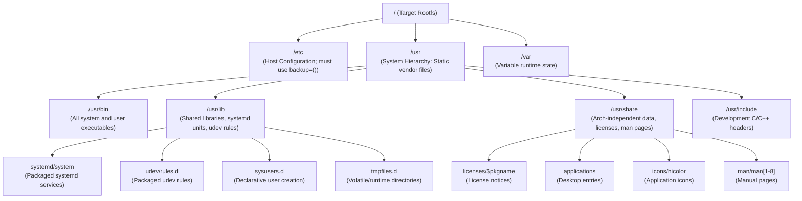

# Arch Linux Filesystem Hierarchy & Installation Layout

## 1. Scope

This document specifies the standard filesystem directory layout, file placement rules, ownership, and permission policies for Arch Linux packages. Arch Linux adheres strictly to the Filesystem Hierarchy Standard (FHS) with specific Arch-native simplifications (e.g., the unified `/usr` hierarchy).

---

## 2. Directory Hierarchy Reference



### 2.1 Complete Path Placement Directory

| Content Type | Authorized Path | Prohibited / Legacy Alternatives |
|:---|:---|:---|
| **Executables** | `/usr/bin/` | `/bin`, `/sbin`, `/usr/sbin`, `/usr/local/bin` |
| **Shared Libraries** | `/usr/lib/` | `/lib`, `/lib64`, `/usr/lib64`, `/usr/local/lib` |
| **Header Files** | `/usr/include/` | `/usr/local/include` |
| **Systemd Services (System)** | `/usr/lib/systemd/system/` | `/etc/systemd/system/` (Reserved for sysadmin overrides) |
| **Systemd Services (User)** | `/usr/lib/systemd/user/` | `/etc/systemd/user/` |
| **Udev Device Rules** | `/usr/lib/udev/rules.d/` | `/etc/udev/rules.d/` (Reserved for sysadmin overrides) |
| **Declarative System Users** | `/usr/lib/sysusers.d/` | Legacy `.install` scripts running `useradd` |
| **Volatile / Runtime Paths** | `/usr/lib/tmpfiles.d/` | Packaging directories directly in `/run` or `/var/run` |
| **Configuration Files** | `/etc/<pkgname>/` | `/usr/etc`, `/usr/share/<pkgname>/config` |
| **Runtime State Storage** | `/var/lib/<pkgname>/` | `/usr/var`, `/etc/<pkgname>/state` |
| **Desktop Entries** | `/usr/share/applications/` | `/usr/share/app-install`, `/etc/xdg/autostart` (unless service) |
| **Application Icons** | `/usr/share/icons/hicolor/<size>/apps/` | `/usr/share/pixmaps/` (Acceptable only for legacy single-size) |
| **Manual Pages** | `/usr/share/man/man[1-8]/` | `/usr/man`, `/usr/local/man` |
| **Package License** | `/usr/share/licenses/$pkgname/` | Root of package, `/usr/share/doc/$pkgname/LICENSE` |
| **Documentation** | `/usr/share/doc/$pkgname/` | `/usr/doc` |
| **Bash Completions** | `/usr/share/bash-completion/completions/` | `/etc/bash_completion.d/` |
| **Zsh Completions** | `/usr/share/zsh/site-functions/` | `/usr/share/zsh/vendor-completions/` |
| **Fish Completions** | `/usr/share/fish/vendor_completions.d/` | `/etc/fish/completions/` |

---

## 3. Strict Arch Boundary Rules

### 3.1 The `/usr/local` Prohibition
Arch Linux packages must **NEVER** install files into `/usr/local`. `/usr/local` is strictly reserved for the local system administrator installing software manually outside pacman.

### 3.2 The `/opt` Boundary
- `/opt` is reserved strictly for self-contained, monolithic, proprietary or third-party binary applications that bundle their own internal directory trees and cannot be unpacked into `/usr` (e.g., `google-chrome`, `visual-studio-code-bin`).
- Open-source software built from source must ALWAYS install into `/usr`.

### 3.3 The Configuration & `backup=()` Array
- Any editable configuration file installed into `/etc` must be listed in the `backup` array in `PKGBUILD`.
- Format: `backup=('etc/mydaemon/mydaemon.conf')` (Notice: **no leading slash**).
- When a user updates the package, pacman compares hashes: if the user modified the file, pacman saves the new version as `.pacnew` rather than overwriting user customizations.

---

## 4. Package Permissions & Ownership

1. **Standard Ownership**:
   - All packaged files must be owned by `root:root` (UID 0, GID 0). `makepkg` handles this automatically during archive creation.
2. **File Permissions**:
   - Executables and scripts: `0755` (`rwxr-xr-x`).
   - Libraries (`.so`): `0755`.
   - Data files, configs, documentation, licenses: `0644` (`rw-r--r--`).
   - Shared directories: `0755`.
   - **Strict Rule**: No file or directory in a package may have world-writable permissions (`0777`, `0666`).
3. **Using `install`**:
   - Always prefer `install -D` over raw `cp` or `mkdir -p` followed by `cp`:
   ```bash
   install -Dm755 mybinary "$pkgdir/usr/bin/mybinary"
   install -Dm644 myconfig "$pkgdir/etc/myproject/myconfig.conf"
   install -Dm644 LICENSE "$pkgdir/usr/share/licenses/$pkgname/LICENSE"
   ```

---

## 5. Declarative System Integration (`sysusers` & `tmpfiles`)

Modern Arch packages avoid imperative `.install` scripts running `useradd` or `mkdir /run/...`. Instead, use declarative systemd configuration files:

### 5.1 System Users (`sysusers.d`)
Install to `/usr/lib/sysusers.d/$pkgname.conf`:
```text
# Type Name ID GECOS Home Shell
u mydaemon - "My Daemon User" /var/lib/mydaemon /usr/bin/nologin
```

### 5.2 Volatile Directories (`tmpfiles.d`)
Install to `/usr/lib/tmpfiles.d/$pkgname.conf`:
```text
# Type Path Mode User Group Age Argument
d /run/mydaemon 0755 mydaemon mydaemon -
d /var/lib/mydaemon 0750 mydaemon mydaemon -
```

---

## 6. Verification Guidance

```bash
# 1. Inspect package file list for FHS violations or forbidden paths
bsdtar -tf "$pkgname-$pkgver-$pkgrel-x86_64.pkg.tar.zst" | grep -E '^usr/local|^etc/systemd|^var/run'

# 2. Run namcap to detect permission errors and FHS layout flaws
namcap "$pkgname-$pkgver-$pkgrel-x86_64.pkg.tar.zst"
```

---

## 7. Authoritative References

- [Arch package guidelines](https://wiki.archlinux.org/title/Arch_package_guidelines)
- [systemd-sysusers(8) Manual](https://man.archlinux.org/man/systemd-sysusers.8)
- [systemd-tmpfiles(8) Manual](https://man.archlinux.org/man/systemd-tmpfiles.8)
