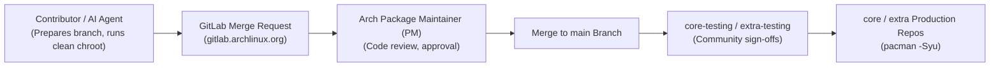

# Arch Linux Official Packaging Workflow Reference

## 1. Scope

This document details the architecture, tooling, and workflow conventions for contributing to and maintaining packages in the official Arch Linux repositories (`core`, `extra`, `multilib`).

---

## 2. Infrastructure & Modern Git Layout

In May 2023, Arch Linux completed its migration from legacy Subversion (SVN) to a modern, unified GitLab infrastructure:
- **Packaging Repositories**: Hosted at `https://gitlab.archlinux.org/archlinux/packaging/packages/<pkgname>`
- **Repository Structure**: Each package is an independent Git repository containing:
  - `PKGBUILD`: Package build script.
  - Auxiliary files: `*.patch`, systemd units, custom configs.
  - No binary packages or upstream archives.

---

## 3. Contribution Boundaries & Persona Invariants



### Critical Persona Boundary
- **Never Claim Maintainer Authority**: An AI agent operates as a systems engineer or packaging contributor. It must NEVER claim to have direct commit, push, or release rights to `archlinux.org` infrastructure.
- All contributions targeting official packages must be prepared as **contribution-ready Merge Requests (MRs)** or patch sets formatted for Arch maintainer review.

---

## 4. Modern Official Tooling: `pkgctl`

Official Arch packaging is orchestrated via `pkgctl` (from `devtools`):

### 4.1 Cloning Official Repositories
```bash
# Clone a package repository from official GitLab
pkgctl repo clone ripgrep
cd ripgrep
```

### 4.2 Branch & Repository Navigation
Official packages track branches corresponding to target repositories:
- `main`: Default branch for packages in `extra` and `core`.
- Staging / Testing branches: used during toolchain rebuilds.
```bash
# Switch to a target branch
pkgctl repo switch main
```

### 4.3 Clean-Chroot Build Validation
```bash
# Build cleanly against the official repository chroot
pkgctl build --clean
```

### 4.4 Automated Version Checking & Upgrading
```bash
# Check upstream for newer releases
pkgctl version check

# Automatically update PKGBUILD to a new upstream version
pkgctl version upgrade --version 14.1.0
```

### 4.5 Inspecting Differences with `diffpkg` & `checkpkg`
```bash
# Check SONAME ABI breakage against current repository release
checkpkg

# Compare file contents of built package against official package
diffpkg
```

### 4.6 Release (Maintainers Only)
For authorized maintainers with GitLab credentials and GPG signing keys:
```bash
# Commits, tags, and uploads to Arch build infrastructure
pkgctl release
```

---

## 5. Official Commit Message Standards

Arch Linux enforces conventional commit formatting for packaging repositories:

```text
upgpkg: <pkgname> <pkgver>-<pkgrel>: <concise description of changes>

- Detailed bullet point explaining patch addition or removal
- Upstream changelog reference or bug report link
```

### Examples:
- Version Bump:
  `upgpkg: ripgrep 14.1.0-1: upstream release`
- Rebuild for SONAME bump:
  `upgpkg: curl 8.8.0-2: rebuild against openssl 3.3.0`
- Packaging Fix:
  `upgpkg: neovim 0.10.0-2: fix desktop entry icon path`

---

## 6. Official Repository Lifecycle

1. **Staging (`core-staging`, `extra-staging`)**:
   - Used for mass rebuilds, compiler upgrades (GCC, LLVM), or major library ABI changes (Python, OpenSSL).
2. **Testing (`core-testing`, `extra-testing`)**:
   - New versions sit in testing repositories for maintainer and community sign-offs (`arch-signoff`).
3. **Production (`core`, `extra`, `multilib`)**:
   - Promoted to production mirrors after sign-offs are satisfied.

---

## 7. Authoritative References

- [Arch GitLab Packaging Group](https://gitlab.archlinux.org/archlinux/packaging/packages)
- [Arch devtools(7) Manual](https://man.archlinux.org/man/extra/devtools/devtools.7)
- [pkgctl(1) Manual](https://man.archlinux.org/man/extra/devtools/pkgctl.1.en)
- [Arch Developer Manual: Packaging Standards](https://wiki.archlinux.org/title/DeveloperWiki:Packaging_Standards)
