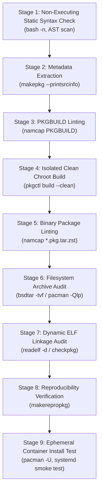

# Package Validation & Quality Assurance Reference

## 1. Scope

This document defines the 9-stage verification methodology required to validate Arch Linux packages. Sourcing or executing an untrusted `PKGBUILD` directly on the host to inspect its metadata is strictly prohibited.

---

## 2. The 9-Stage Validation Pipeline



---

## 3. Detailed Stage Execution

### Stage 1: Non-Executing Static Syntax Check
Before executing any tool that sources the `PKGBUILD`, verify Bash syntax without execution:
```bash
bash -n PKGBUILD
```
- **Security Check**: Scan for unquoted shell expansion vulnerabilities, suspicious `curl`/`wget` invocations in `build()` or `prepare()`, attempts to mutate paths outside `$srcdir`/`$pkgdir`, or hardcoded `sudo`.

### Stage 2: Metadata Extraction & `.SRCINFO` Consistency
```bash
makepkg --printsrcinfo > .SRCINFO.tmp
diff -u .SRCINFO .SRCINFO.tmp
rm .SRCINFO.tmp
```
- Verifies that all variables are validly declared and that `.SRCINFO` (for AUR packages) is perfectly synchronized with `PKGBUILD`.

### Stage 3: Static PKGBUILD Linting with `namcap`
```bash
namcap PKGBUILD
```
- Flags common authoring errors:
  - `pkgdesc` ending in a period or exceeding 80 characters.
  - Deprecated variable usage.
  - Invalid license names or missing licenses.
  - Duplicate dependencies across `depends` and `makedepends`.
  - Non-standard variable casing or unrecognized options.

### Stage 4: Isolated Clean Chroot Build
```bash
# In an authorized clean-chroot or container environment:
pkgctl build --clean
```
- Verifies that `makedepends` and `depends` are fully declared.
- Guarantees the build executes strictly offline without downloading undeclared artifacts.

### Stage 5: Binary Package Linting with `namcap`
```bash
namcap "$pkgname-$pkgver-$pkgrel-x86_64.pkg.tar.zst"
```
- Inspects the finished binary archive:
  - **Undeclared dependencies**: Identifies dynamic ELF libraries linked by packaged binaries that are missing from `depends`.
  - **Redundant dependencies**: Identifies dependencies that are already satisfied transitively.
  - **Permissions**: Warns on world-writable files, non-executable binaries in `/usr/bin`, or incorrect owner/group IDs.
  - **Missing licenses**: Warns if custom or MIT/BSD licenses are not placed in `/usr/share/licenses/$pkgname/`.

### Stage 6: Filesystem Archive Audit
```bash
bsdtar -tvf "$pkgname-$pkgver-$pkgrel-x86_64.pkg.tar.zst"
```
Verify:
1. No files in `/usr/local/`, `/opt/` (unless permitted binary repack), or `/var/run/`.
2. Systemd service files reside in `/usr/lib/systemd/system/`, NOT `/etc/systemd/system/`.
3. Configuration files in `/etc/` are declared in `backup=()`.
4. No temporary editor files (`.swp`, `~`), VCS directories (`.git`), or build cache leftovers.

### Stage 7: Dynamic ELF Linkage Audit
```bash
# Inspect all packaged binaries
for bin in $(bsdtar -tf "$pkgname-$pkgver-$pkgrel-x86_64.pkg.tar.zst" | grep -E '^usr/bin/|^usr/lib/.*\.so'); do
  echo "=== ELF audit for $bin ==="
  readelf -d "$bin" | grep NEEDED
done
```
- For official package updates: run `checkpkg` to detect broken SONAME links against current repo packages.

### Stage 8: Reproducibility Verification
```bash
makerepropkg "$pkgname-$pkgver-$pkgrel-x86_64.pkg.tar.zst"
```
- Verifies that rebuilding the package in an identical environment produces a bit-for-bit identical checksum.

### Stage 9: Ephemeral Container Installation Test
Test actual installation inside an ephemeral system container:
```bash
# In an ephemeral disposable container:
pacman -U --noconfirm "$pkgname-$pkgver-$pkgrel-x86_64.pkg.tar.zst"
# Smoke test binary execution
mybinary --version
# Test service validity if applicable
systemd-analyze verify /usr/lib/systemd/system/mybinary.service
```

---

## 4. Distinguishing Validation from Parsing

An AI agent must never confuse *parsing* with *verification*:
- Sourcing a `PKGBUILD` only proves the syntax is valid Bash.
- A local build only proves the software compiles against ambient host headers.
- Only stages 4 through 9 provide empirical proof of packaging correctness.

---

## 5. Authoritative References

- [Arch package guidelines: Namcap](https://wiki.archlinux.org/title/Namcap)
- [namcap(1) Manual](https://man.archlinux.org/man/namcap.1)
- [checkpkg(1) Manual](https://man.archlinux.org/man/extra/devtools/checkpkg.1.en)
- [makerepropkg(1) Manual](https://man.archlinux.org/man/extra/devtools/makerepropkg.1.en)
