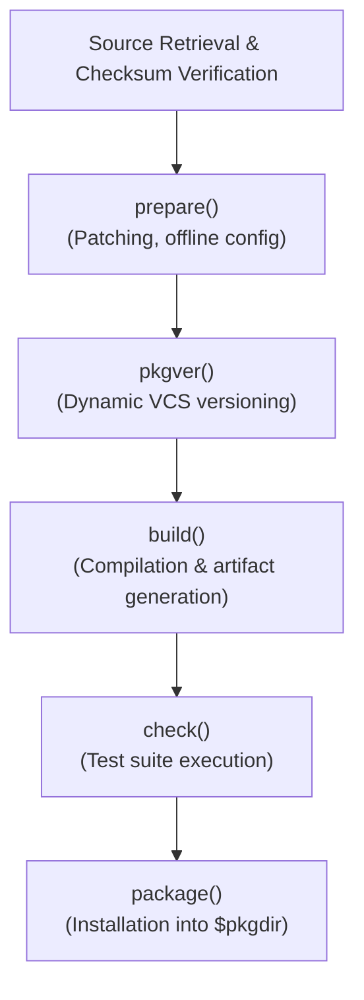

# PKGBUILD Specification & Engineering Reference

## 1. Scope

This document provides the authoritative technical reference for writing, reviewing, and maintaining Arch Linux `PKGBUILD` build scripts. A `PKGBUILD` is a Bash script sourced by `makepkg` that contains metadata and build instructions for creating binary Arch packages (`.pkg.tar.zst`).

---

## 2. Variables & Metadata Reference

### 2.1 Identification & Versioning

| Variable | Type | Mandatory? | Specification & Semantics |
|:---|:---:|:---:|:---|
| `pkgbase` | String | Conditional | Base name for split packages. Defaults to `pkgname` for single-target builds. Required when `pkgname` is an array. |
| `pkgname` | Array/String | **Yes** | The package name(s). Must contain lowercase letters, numbers, and hyphens (`[a-z0-9-]+`). Split packages declare an array: `pkgname=('foo' 'libfoo')`. |
| `pkgver` | String | **Yes** | Upstream version. Contains only alphanumerics, dots (`.`), and underscores (`_`). Hyphens (`-`) are strictly forbidden. |
| `pkgrel` | Integer | **Yes** | Package release count. Starts at `1`; incremented on rebuilds or packaging changes; reset to `1` when `pkgver` increments. |
| `epoch` | Integer | No | Forcing version precedence override. Unsigned integer. Must only be used when upstream versioning changes non-monotonically. |
| `pkgdesc` | String | **Yes** | Package description. Concise summary under 80 characters, no trailing period, no repetition of `pkgname`. |
| `arch` | Array | **Yes** | Architectures supported: `('x86_64')` for compiled/native code, `('any')` for arch-independent files (Python, shell, fonts). |
| `url` | String | **Yes** | Official upstream project homepage URL. |
| `license` | Array | **Yes** | SPDX license identifier(s): `('Apache-2.0')`, `('GPL-3.0-or-later')`, `('MIT')`, `('LicenseRef-Custom')`. |
| `groups` | Array | No | Metagroups the package belongs to (e.g., `groups=('base-devel')`, `groups=('gnome')`). Rarely used in modern AUR/repo packaging. |

### 2.2 Dependency Arrays

Arch Linux strictly distinguishes between 4 classes of dependencies:

| Variable | Class | When Evaluated / Required | Examples |
|:---|:---|:---|:---|
| `depends` | **Runtime** | Required for normal operation of installed binaries. Tested by pacman during install/upgrade. | `depends=('glibc' 'openssl' 'sqlite')` |
| `makedepends` | **Build-time** | Required strictly to compile and stage the package. Not needed by end-user runtime. | `makedepends=('meson' 'ninja' 'cmake' 'rust')` |
| `checkdepends` | **Test-time** | Required exclusively for executing the test suite in `check()`. Ignored if `--nocheck` is passed. | `checkdepends=('python-pytest' 'gtest')` |
| `optdepends` | **Optional** | Optional integrations enhancing functionality. Must format as `'package: explanation'`. | `optdepends=('ffmpeg: for video decoding support')` |

*Architecture-specific arrays*: Arch supports appending `_arch` (e.g., `depends_x86_64=()`, `makedepends_x86_64=()`) when dependencies vary across hardware architectures.

### 2.3 Package Relations

| Variable | Type | Semantics & Rules |
|:---|:---:|:---|
| `provides` | Array | Virtual provisions or library sonames provided by this package. Format: `provides=('foo=1.2.0' 'libbar.so=2-64')`. Allows alternative packages to satisfy dependencies. |
| `conflicts` | Array | Packages that cannot be installed simultaneously due to file or namespace collision. Always include the conflicting package name, and optionally version constraints: `conflicts=('foo')`. |
| `replaces` | Array | Declares that this package obsoletes and replaces another package during `pacman -Syu`. **Caution**: Use strictly when authorized or coordinating official repository transitions; do NOT use in AUR packages to replace official packages. |
| `backup` | Array | Array of configuration files without leading slashes that pacman must preserve across upgrades as `.pacsave` or `.pacnew`. Example: `backup=('etc/mydaemon/config.conf')`. |

### 2.4 Build Options (`options`)

Overrides default `makepkg.conf` behaviors. Prefix with `!` to invert:
- `strip` / `!strip`: Strips debug symbols from binaries and libraries.
- `docs` / `!docs`: Keeps or removes documentation directories (`/usr/share/doc`, `/usr/share/info`).
- `libtool` / `!libtool`: Retains or removes `.la` libtool archive files from `$pkgdir` (Arch defaults to removing them).
- `emptydirs` / `!emptydirs`: Keeps or removes empty directories in package.
- `zipman` / `!zipman`: Compresses man and info pages with gzip.
- `purge` / `!purge`: Removes files specified in `PURGE_TARGETS` in `makepkg.conf`.
- `debug` / `!debug`: Generates a detached `-debug` package containing DWARF debug symbols.
- `lto` / `!lto`: Enables or disables Link-Time Optimization during compilation.
- `buildflags` / `!buildflags`: Enables or disables default compiler flags from `makepkg.conf` (`CFLAGS`, `CXXFLAGS`, `LDFLAGS`).
- `makeflags` / `!makeflags`: Enables or disables parallelism flags (`MAKEFLAGS`).

### 2.5 Sources and Checksums

```bash
source=(
  "$pkgname-$pkgver.tar.gz::$url/archive/v$pkgver.tar.gz"
  "0001-fix-build-path.patch"
  "$pkgname.service"
)
sha256sums=(
  'e3b0c44298fc1c149afbf4c8996fb92427ae41e4649b934ca495991b7852b855'
  'a25e68c8b...patch_hash...'
  '19c62b48e...service_hash...'
)
validpgpkeys=('E29F8D22F05CEE3742140D63FCBFF223E67089E5')
```

- **Source Renaming**: Always rename remote generic tarballs (such as GitHub `v$pkgver.tar.gz`) using the `custom_filename::url` syntax. Otherwise, downloads from different packages collide in the shared `$SRCDEST` download directory.
- **Checksums**: SHA-256 (`sha256sums`) or BLAKE2b (`b2sums`) are standard. MD5 and SHA-1 are cryptographically broken and must not be used.
- **`validpgpkeys`**: Array of 40-character maintainer OpenPGP public key fingerprints without spaces used to verify detached `.sig` signatures.

---

## 3. Reserved Environment Variables

| Variable | Description |
|:---|:---|
| `$srcdir` | Path to the directory where sources are downloaded and extracted (e.g., `/path/to/src`). `makepkg` enters this directory before executing `prepare()`, `build()`, and `package()`. |
| `$pkgdir` | Path to the staging root directory where files to be packaged must be installed (e.g., `/path/to/pkg/pkgname`). Treated as `/` during package compression. |
| `$startdir` | Path containing the `PKGBUILD`. **Strict Invariant**: Scripts must never write to `$startdir` or reference files directly via `$startdir`. |

---

## 4. Lifecycle Functions



### 4.1 `prepare()`
- Executes after sources are downloaded, verified, and extracted into `$srcdir`.
- Purpose: Applying patches (`patch -Np1 -i ...`), adjusting build configuration files, generating offline lockfiles.
- **Invariant**: Must NEVER initiate network access. All remote files must be declared in `source=()`.

### 4.2 `pkgver()`
- Purpose: Dynamically generates `pkgver` for VCS packages (`-git`, `-svn`).
- Executes after `prepare()` and source checkout.
- Standard Git format:
  ```bash
  pkgver() {
    cd "$pkgname"
    git describe --long --tags --abbrev=7 | sed 's/\([^-]*-g\)/r\1/;s/-/./g'
  }
  ```

### 4.3 `build()`
- Purpose: Compiles the source tree into binaries and libraries.
- Standard tools: `cmake --build`, `meson compile`, `cargo build --release`, `make`.
- Must honor system compiler flags (`CFLAGS`, `CXXFLAGS`, `LDFLAGS`).
- Must NOT install files into `$pkgdir`.

### 4.4 `check()`
- Purpose: Runs upstream unit and regression tests (`ctest`, `meson test`, `cargo test`, `make check`).
- Must report test failures honestly. If upstream tests fail, the package build must fail.
- Can be bypassed by the user via `makepkg --nocheck` or `pkgctl build --nocheck`.

### 4.5 `package()` (and Split Package Functions)
- Purpose: Installs build artifacts from `$srcdir` into `$pkgdir`.
- For single-package builds: `package()`.
- For split packages: define individual functions `package_<subpkgname>()` where each subpackage populates its specific `$pkgdir`:
  ```bash
  pkgbase=myproject
  pkgname=('myproject' 'libmyproject')

  package_myproject() {
    pkgdesc="CLI interface for myproject"
    depends=('libmyproject' 'glibc')
    cd "$pkgbase-$pkgver"
    install -Dm755 build/myproject "$pkgdir/usr/bin/myproject"
  }

  package_libmyproject() {
    pkgdesc="Core library for myproject"
    depends=('glibc')
    cd "$pkgbase-$pkgver"
    install -Dm755 build/libmyproject.so "$pkgdir/usr/lib/libmyproject.so"
  }
  ```

---

## 5. Engineering Invariants & Red Lines

1. **Never mutate outside `$pkgdir`**: A `package()` function must never write to `/`, `/home`, `/etc`, or `$startdir`.
2. **Never download during build**: `prepare()`, `build()`, and `package()` must operate completely offline in sandboxed environments.
3. **No interactive prompts**: Scripts must run non-interactively without prompting for input.
4. **Exit on error**: Shell commands must propagate exit codes. In Bash scripts run under `set -e`, failed commands automatically abort the build.
5. **No hardcoded paths**: Avoid hardcoded architecture paths; use standard `/usr/bin`, `/usr/lib`, `/usr/share`.

---

## 6. Authoritative References

- [PKGBUILD(5) Manual](https://man.archlinux.org/man/PKGBUILD.5)
- [makepkg(8) Manual](https://man.archlinux.org/man/makepkg.8)
- [Arch Creating packages Guidelines](https://wiki.archlinux.org/title/Creating_packages)
