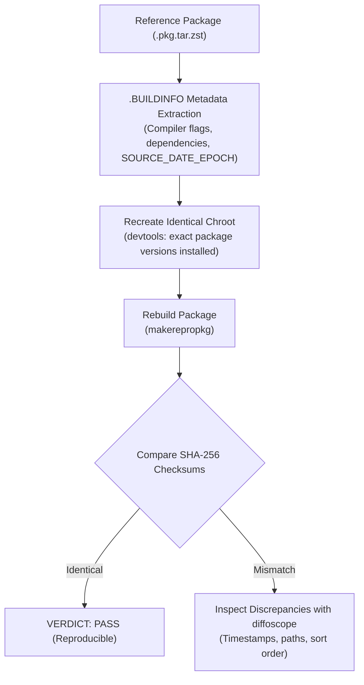

# Reproducible Builds Engineering Reference

## 1. Scope

This document details the architecture, standards, and diagnostic procedures for achieving and verifying bit-for-bit reproducible builds in Arch Linux packaging.

---

## 2. Reproducibility Architecture in Arch Linux

A package is **reproducible** when independent rebuilds from the same source code and packaging recipe yield identical binary packages (`.pkg.tar.zst`).



---

## 3. The `.BUILDINFO` Specification

Every built Arch Linux package includes a `.BUILDINFO` file at its root recording the exact environment state at build time:

```text
format = 2
pkgname = ripgrep
pkgver = 14.1.0-1
pkgarch = x86_64
pkgbuild_sha256sum = a4b8c...
builddate = 1715000000
builddir = /build/ripgrep/src
packager = Arch Linux Maintainer <maintainer@archlinux.org>
options = strip docs !libtool !emptydirs zipman purge !debug lto
installed = glibc-2.39-1-x86_64
installed = gcc-libs-14.1.0-1-x86_64
installed = cargo-1.78.0-1-x86_64
```

Pacman and `makerepropkg` use `.BUILDINFO` to reconstruct the exact toolchain and dependencies used in the original build.

---

## 4. Root Causes of Non-Deterministic Builds

When two builds of the same package differ, the cause usually falls into one of these categories:

| Source of Variance | Mechanism | Remediation in Arch Packaging |
|:---|:---|:---|
| **Timestamps** | Compilers or scripts embedding `__DATE__`, `__TIME__`, or archive file mtimes. | `makepkg` exports `SOURCE_DATE_EPOCH` (set to the mtime of the `PKGBUILD` or last git commit). Build tools must respect `SOURCE_DATE_EPOCH`. |
| **Build Directory Paths** | Compilers embedding absolute paths (`/home/user/src/...`) in debug sections. | `makepkg` injects `-ffile-prefix-map=$PWD=/usr/src/debug` in `CFLAGS`/`CXXFLAGS`. In Go, use `-trimpath`. |
| **Filesystem Traversal Order** | Build tools archiving files in filesystem directory order (`readdir()`), which is non-deterministic. | Explicitly sort file lists before archiving: `find . -type f \| LC_ALL=C sort \| tar ...` |
| **Randomized Seeds** | Linkers or code generators using unseeded PRNGs or randomized hash seeds. | Pass deterministic seed flags (e.g., `-Wl,--hash-style=gnu`, `PYTHONHASHSEED=0`). |
| **Locale & Timezone** | Compilers sorting symbols according to active `LANG` or emitting localized date strings. | `makepkg` forces `LC_ALL=C` and `TZ=UTC`. |

---

## 5. Verification Tooling: `makerepropkg`

Arch Linux provides `makerepropkg` (in `devtools`) to test reproducibility:

```bash
# 1. Rebuild and verify package against official repository package
makerepropkg ripgrep-14.1.0-1-x86_64.pkg.tar.zst

# 2. Or rebuild a locally built package
makerepropkg --chroot-dir /var/lib/archbuild/extra-x86_64 ./ripgrep-14.1.0-1-x86_64.pkg.tar.zst
```

### Investigating Divergence with `diffoscope`
If checksums mismatch, run `diffoscope` to perform deep recursive inspection:
```bash
diffoscope original.pkg.tar.zst rebuilt.pkg.tar.zst
```
`diffoscope` inspects differences inside compressed archives, tar file headers, ELF sections, debuginfo DWARF trees, and timestamps.

---

## 6. Authoritative References

- [ArchWiki: Reproducible builds](https://wiki.archlinux.org/title/Reproducible_builds)
- [makerepropkg(1) Manual](https://man.archlinux.org/man/extra/devtools/makerepropkg.1.en)
- [Reproducible Builds Specification](https://reproducible-builds.org/specs/source-date-epoch/)
