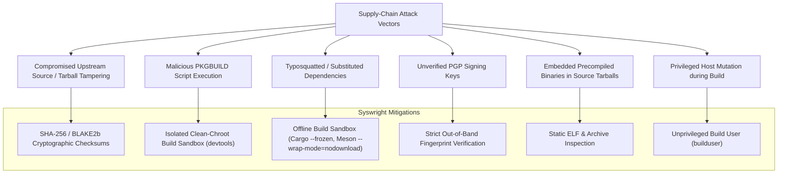

# Package Security & Supply-Chain Integrity Reference

## 1. Scope

This document defines the supply-chain security architecture, source integrity verification procedures, cryptographic key management rules, and threat mitigation strategies for Arch Linux packaging.

---

## 2. The Packaging Threat Model

Packaging sits at the junction between upstream software and downstream user operating systems. Compromised packaging can compromise every system installing the package:



---

## 3. Cryptographic Source Integrity

### 3.1 Checksum Requirements
- Every remote and local file declared in `source=()` must have an accompanying cryptographic hash.
- **Accepted Algorithms**:
  - `sha256sums` (Standard in Arch repositories)
  - `b2sums` (BLAKE2b, faster and highly collision-resistant)
- **Forbidden Algorithms**: `md5sums` and `sha1sums` are cryptographically broken and strictly forbidden.

### 3.2 The `SKIP` Invariant
- **Rule**: `SKIP` is strictly forbidden for any static release archive, source tarball, patch, or service file.
- **Allowed Exception**: `SKIP` is permitted *only* for dynamic VCS sources (e.g., `git+https://...`) where the commit hash or tag cannot be known in advance, provided that commit signature verification or explicit branch pinning is configured.
- Never use `SKIP` as a shortcut to bypass a failed checksum download! A failed checksum indicates either a corrupted download, an upstream retagging event, or a man-in-the-middle attack.

### 3.3 Checksum Provenance & Limitations
- Downloading a checksum from the same unauthenticated web server or compromised CDN as the source tarball does not independently establish authenticity.
- Whenever available, compare checksums against upstream signed release notes, announcement emails on official mailing lists, or independent mirrors.

---

## 4. OpenPGP / GPG Signature Verification

Arch Linux packages support detached PGP signature verification for sources.

### 4.1 Declaring Signatures & Keys in `PKGBUILD`
```bash
source=(
  "$pkgname-$pkgver.tar.gz::https://example.org/releases/v$pkgver.tar.gz"
  "https://example.org/releases/v$pkgver.tar.gz.asc"
)
sha256sums=(
  'e3b0c44298fc1c149afbf4c8996fb92427ae41e4649b934ca495991b7852b855'
  'SKIP'  # PGP signature files use SKIP in sha256sums because makepkg verifies the signature itself
)
validpgpkeys=(
  '44869609740AE61A21704C408F73607422E5824A' # Maintainer Full 40-Char Hex Fingerprint
)
```

### 4.2 Strict Key Management Rules
1. **Never Import Keys Automatically**:
   - An AI agent must **NEVER** run `gpg --recv-keys <keyid>` blindly merely because a build failed with `"unknown public key"`.
   - Importing an unverified key from a public keyserver creates a false sense of security; an attacker who compromises a source server can easily publish their own public key to keyservers.
2. **Out-of-Band Fingerprint Verification**:
   - The key fingerprint listed in `validpgpkeys` must be verified against at least two independent upstream trust anchors:
     - Upstream project security page / `SECURITY.md`.
     - Maintainer's published Web Key Directory (WKD) or personal verified website.
     - Upstream git repository signed tags.
3. **Fingerprint Format**:
   - Must be the complete **40-character hexadecimal fingerprint** without spaces.
   - Never use 8-character (short) or 16-character (long) key IDs, as 32-bit and 64-bit key IDs can be trivial to forge with modern collision generators.

---

## 5. Build Environment Isolation & Execution Risks

A `PKGBUILD` is not a declarative manifest; it is an executable Bash script:
- Sourcing a `PKGBUILD` executes any code at global scope.
- `prepare()`, `build()`, `check()`, and `package()` execute upstream-controlled build tools (`make`, `cmake`, `python setup.py`, `build.rs`).
- **Rust `build.rs` Risks**: Cargo execute `build.rs` scripts during compilation with the permissions of the calling user. A malicious crate can execute malware during `cargo build`.
- **Mitigation**:
  - Always build in an isolated unprivileged container or clean chroot.
  - Never execute builds as `root`.
  - Enforce offline flags (`--frozen`, `--wrap-mode=nodownload`) to prevent build scripts from phoning home or exfiltrating environment credentials.

---

## 6. Binary & Package Signing

### 6.1 Package Signing (`makepkg --sign`)
- Package maintainers sign binary packages with a trusted GPG key:
  ```bash
  makepkg --sign
  ```
  Produces `$pkgname-$pkgver-$pkgrel-x86_64.pkg.tar.zst.sig`.

### 6.2 Repository Database Signing (`repo-add --sign`)
- When creating or updating a custom distribution repository, sign the repository database:
  ```bash
  repo-add --sign --key "$GPGKEY" /srv/repo/custom.db.tar.zst /srv/repo/*.pkg.tar.zst
  ```
- Clients verify database and package signatures via `pacman.conf` `SigLevel = Required DatabaseOptional`.

---

## 7. Authoritative References

- [Arch package guidelines: Signatures](https://wiki.archlinux.org/title/Arch_package_guidelines#Package_sources)
- [makepkg(8) Manual: Signature Checking](https://man.archlinux.org/man/makepkg.8#SIGNATURE_CHECKING)
- [Pacman Package Signing Guidelines](https://wiki.archlinux.org/title/Pacman-key)
