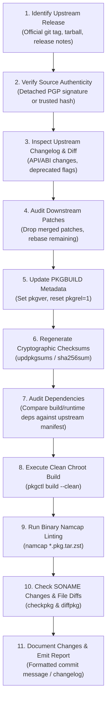

# Package Version Update & Maintenance Reference

## 1. Scope

This document details the step-by-step engineering procedure for upgrading Arch Linux packages to new upstream releases. Blind version bumps without code review or dependency verification are strictly forbidden.

---

## 2. The 11-Step Upgrade Workflow



---

## 3. Detailed Upgrade Execution

### Step 1: Upstream Release Identification
- Locate the official release tag or release archive on the authoritative upstream repository (e.g., GitHub, GitLab, kernel.org).
- Never source from third-party repackagers or unverified mirrors.

### Step 2: Source Authenticity Verification
- Check whether upstream publishes detached PGP signatures (`.asc`, `.sig`).
- If signed: verify the signature against verified fingerprints in `validpgpkeys`.
- If unsigned: compare hashes across independent mirrors or release announcements.

### Step 3: Upstream Changelog & Source Diff Inspection
Before touching the `PKGBUILD`, inspect the upstream git diff between the old and new version tags:
```bash
git diff v1.3.0..v1.4.0 -- CMakeLists.txt Cargo.toml pyproject.toml meson.build
```
Key elements to inspect:
1. Were any configure options added, renamed, or removed?
2. Were new shared libraries introduced or SONAMEs bumped?
3. Did minimum compiler or toolchain versions change?

### Step 4: Audit Downstream Patches
- For every patch in `source=()`:
  - Check whether upstream incorporated the patch in the new version.
  - If merged upstream: remove the patch from `source=()`, remove its checksum, and delete the patch file from the repository.
  - If still required: rebase the patch against the new release and verify clean application (`patch -Np1 --dry-run`).

### Step 5: Update PKGBUILD Metadata
- Update `pkgver` to match upstream.
- **Mandatory**: Reset `pkgrel=1`. Leaving `pkgrel` at a value > 1 when bumping `pkgver` is an error.
- If upstream version scheme changed non-monotonically, evaluate if `epoch` is required via `vercmp`.

### Step 6: Regenerate Cryptographic Checksums
Use `updpkgsums` (from `pacman-contrib`) or compute SHA-256 manually:
```bash
updpkgsums
```
Verify that only legitimate source tarball checksums changed.

### Step 7: Audit Dependencies
- Reconcile `depends`, `makedepends`, and `checkdepends` against new upstream dependencies discovered in Step 3.
- Remove obsolete dependencies.

### Step 8: Clean-Chroot Rebuild
Build cleanly in an isolated chroot:
```bash
pkgctl build --clean
```

### Step 9: Post-Build Linting with `namcap`
```bash
namcap "$pkgname-$pkgver-1-x86_64.pkg.tar.zst"
```

### Step 10: SONAME and File Difference Analysis
```bash
# Check if libraries broke ABI for reverse dependencies
checkpkg

# Compare file hierarchy with previous release
diffpkg
```

### Step 11: Document and Report
Format the packaging commit according to standard Arch conventions:
```text
upgpkg: ripgrep 14.1.0-1: upstream release

- Drop 0001-fix-gcc-warning.patch (merged upstream)
- Add optdepends for bash-completion
```

---

## 4. VCS Package Updates (`-git`)

For VCS packages tracking Git `master`/`main`:
1. `pkgver` in the PKGBUILD represents the version when the PKGBUILD was last edited.
2. The `pkgver()` function updates the version dynamically during `makepkg`:
   ```bash
   pkgver() {
     cd "$pkgname"
     git describe --long --tags --abbrev=7 | sed 's/\([^-]*-g\)/r\1/;s/-/./g'
   }
   ```
3. To update a `-git` package on the AUR, regenerate `.SRCINFO` with the latest generated `pkgver`:
   ```bash
   makepkg --nodeps --nobuild
   makepkg --printsrcinfo > .SRCINFO
   ```

---

## 5. Authoritative References

- [Arch package guidelines: Upgrading packages](https://wiki.archlinux.org/title/Arch_package_guidelines)
- [checkpkg(1) Manual](https://man.archlinux.org/man/extra/devtools/checkpkg.1.en)
- [diffpkg(1) Manual](https://man.archlinux.org/man/extra/devtools/diffpkg.1.en)
- [updpkgsums(8) Manual](https://man.archlinux.org/man/extra/pacman-contrib/updpkgsums.8.en)
