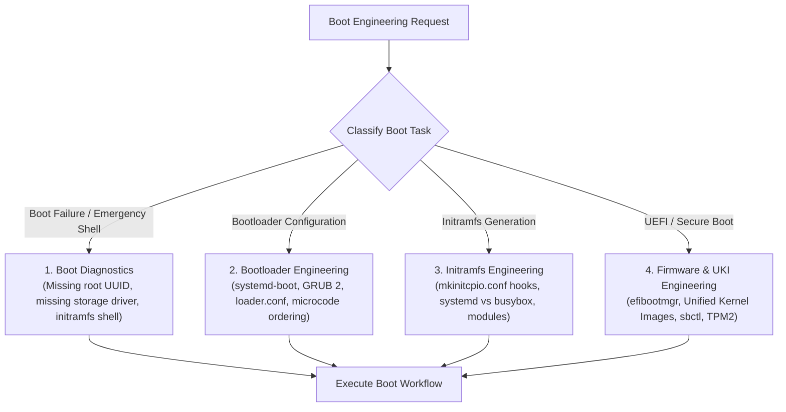

# Linux Boot Engineering

The `boot-engineering` skill provides specialist capabilities for analyzing and configuring the Linux boot chain: UEFI firmware, NVRAM variables, bootloaders (systemd-boot, GRUB), initramfs early userspace generators (`mkinitcpio`), Unified Kernel Images (UKI), and emergency recovery.

---

## 1. Operating Principles & Safety Invariants

1. **Preserve Fallback Bootability**: Never overwrite or delete a working bootloader configuration without ensuring a verified fallback entry (`initramfs-linux-fallback.img`) exists.
2. **Never Mix Initramfs Hook Architectures**: Never combine `systemd` / `sd-*` hooks with `udev` / legacy hooks in `mkinitcpio.conf`.
3. **Microcode Precedence Invariant**: CPU microcode (`intel-ucode.img` or `amd-ucode.img`) must always be loaded as the first `initrd` image in the bootloader.
4. **Safety Tier Gating**: Writing NVRAM boot variables (`efibootmgr`), regenerating production initramfs images (`mkinitcpio -P`), and enrolling Secure Boot keys are Tier 3 operations requiring explicit human authorization.

---

## 2. Intent Classification & Workflow Routing

---

## 3. The 5-Step Boot Failure Diagnostic Workflow

1. **Identify Failure Stage**: Determine whether failure occurs in Firmware (no bootloader), Bootloader (file missing), Early Kernel (freeze), or Initramfs (drop to rootfs shell).
2. **Verify Block Device Identifiers**: Query `blkid` to match actual filesystem UUIDs against kernel command line `root=UUID=...`.
3. **Audit Initramfs Hooks**: Check `/etc/mkinitcpio.conf` for missing storage (`block`), crypto (`sd-encrypt`/`encrypt`), or LVM (`sd-lvm2`/`lvm2`) hooks.
4. **Inspect Microcode Ordering**: Verify that `intel-ucode.img` or `amd-ucode.img` precedes the main initramfs in bootloader entries.
5. **Formulate Safe Rollback**: Provide non-destructive recovery commands via `arch-chroot` or fallback boot entries.

---

## 4. Cross-Specialist Coordination

| Task | Coordinating Specialists | Interaction |
|:---|:---|:---|
| Encrypted root volume boot | `boot-engineering` + `linux-storage` | `linux-storage` sets up LUKS/Btrfs; `boot-engineering` configures `sd-encrypt` and cmdline. |
| Early kernel boot crash | `boot-engineering` + `kernel-engineering` | `boot-engineering` isolates cmdline/microcode; `kernel-engineering` decodes kernel panic trace. |

---

## 5. Authoritative References Directory

- [UEFI Firmware & ESP Management](references/firmware-uefi.md)
- [Bootloaders (systemd-boot & GRUB)](references/bootloaders.md)
- [Linux Boot Sequence](references/linux-boot-process.md)
- [Initramfs & mkinitcpio Engineering](references/initramfs.md)
- [Unified Kernel Images & Secure Boot](references/unified-kernel-images.md)
- [Boot Diagnostics & Troubleshooting](references/boot-debugging.md)
- [Safety Policy](../../references/safety-policy.md)
