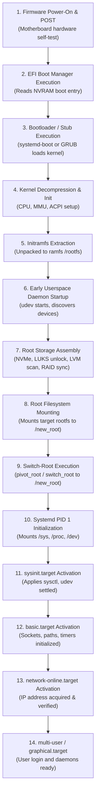

# Linux Boot Sequence & Early Userspace Reference

## 1. Scope

This document details the complete end-to-end boot chain from firmware initialization to systemd target activation, isolating failure boundaries at each stage.

---

## 2. The 14-Stage Boot Chain

---

## 3. Failure Boundary Isolation

| Boot Stage | Observable Failure Symptom | Responsible Component | Diagnostic Tool |
|:---|:---|:---|:---|
| **Firmware / NVRAM** | System reboots into BIOS settings or "No bootable device found". | UEFI NVRAM variable missing or corrupt EFI System Partition. | `efibootmgr -v`, check `/efi/EFI/` |
| **Bootloader** | Error loading kernel or initrd; system hangs before kernel prints output. | Missing `vmlinuz-linux`, corrupted initramfs, or bad ESP path. | Bootloader menu, EFI shell |
| **Early Kernel** | Immediate freeze with black screen, or early kernel panic. | ACPI incompatibility, missing microcode, bad kernel cmdline (`nomodeset`). | `earlycon=`, `earlyprintk=` |
| **Early Userspace** | Drop to emergency rootfs shell (`can't find UUID=...`). | Missing storage controller module, missing LUKS/LVM hook in initramfs. | `blkid`, `ls -l /dev/disk/by-uuid/` |
| **Switch-Root** | `Failed to switch root: Specified switch root path '/new_root' does not seem to be an OS tree`. | `/sbin/init` or `/usr/lib/systemd/systemd` missing on root filesystem. | Mount `/new_root` and inspect |
| **Systemd Startup** | Emergency mode (`systemd: Welcome to emergency mode!`). | A filesystem in `/etc/fstab` failed to mount (corrupted superblock, missing disk). | `journalctl -xb` |

---

## 4. Authoritative References

- [ArchWiki: Arch boot process](https://wiki.archlinux.org/title/Arch_boot_process)
- [Linux Kernel Boot Parameters](https://docs.kernel.org/admin-guide/kernel-parameters.html)
- [systemd Boot Process](https://man.archlinux.org/man/bootup.7)
