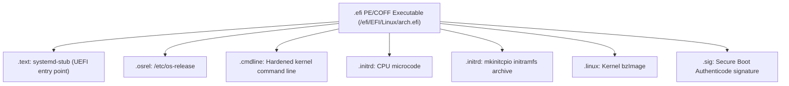

# Unified Kernel Images (UKI) & Secure Boot Reference

## 1. Scope

This document details Unified Kernel Images (UKI), `systemd-stub` PE composition, Secure Boot signing with `sbctl`, and TPM2 PCR enrollment.

---

## 2. Unified Kernel Image (UKI) Architecture

A Unified Kernel Image bundles all components required to boot Linux into a single signed UEFI executable:



### 2.1 Benefits of UKI
1. **Tamper-Proof Boot**: The kernel command line and initramfs cannot be altered without breaking the Authenticode signature.
2. **Eliminates Bootloader Vulnerabilities**: Firmware directly launches the signed `.efi` binary.
3. **Deterministic TPM2 Measurements**: PCR 8 and 9 reliably measure the exact immutable kernel and initramfs.

---

## 3. Secure Boot Tooling: `sbctl`

`sbctl` manages custom Secure Boot keys and signing on Arch Linux:

```bash
# 1. Check current Secure Boot status
sbctl status

# 2. Generate custom platform keys (Setup Mode required)
sbctl create-keys

# 3. Enroll keys into UEFI NVRAM
sbctl enroll-keys

# 4. Sign UKI executable
sbctl sign -s /efi/EFI/Linux/arch.efi

# 5. Verify all signed EFI binaries
sbctl verify
```

- **Safety Invariant**: Never manipulate host Secure Boot keys without explicit human approval.

---

## 4. Authoritative References

- [systemd-stub(7) Manual](https://man.archlinux.org/man/systemd-stub.7)
- [ArchWiki: Unified Kernel Image](https://wiki.archlinux.org/title/Unified_kernel_image)
- [ArchWiki: Unified Extensible Firmware Interface/Secure Boot](https://wiki.archlinux.org/title/Unified_Extensible_Firmware_Interface/Secure_Boot)
