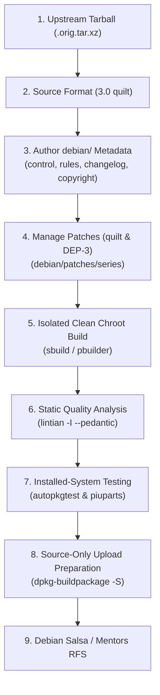

# Debian Packaging Specialist

The `debian-packaging` skill guides AI agents through the complete Debian source and binary package lifecycle in strict compliance with the Debian Policy Manual.

---

## 1. Debian Packaging Lifecycle Workflow

### The 9-Step Debian Packaging Discipline:
1. **Acquire Upstream Source**: Download pristine upstream release archive and verify signature; name as `<pkg>_<version>.orig.tar.xz`.
2. **Establish Source Format**: Use `3.0 (quilt)` in `debian/source/format` for non-native software; preserve upstream source unmodified.
3. **Author Package Metadata**:
   - `debian/control`: Declare source metadata, `Build-Depends`, binary package definitions, and dependencies (`${shlibs:Depends}`, `${misc:Depends}`).
   - `debian/rules`: Implement executable build recipe using modern `dh $@` with targeted overrides.
   - `debian/changelog`: Record versioned release entries matching Debian format (`package (version-revision) distribution; urgency=urgency`).
   - `debian/copyright`: Document machine-readable copyright and license information (DEP-5).
4. **Manage Patches via Quilt**: Keep all downstream modifications in `debian/patches/` with standardized DEP-3 metadata headers.
5. **Execute Isolated Chroot Builds**: Build packages using `sbuild` inside clean distribution chroots to expose undeclared build dependencies.
6. **Enforce Static Linting**: Run `lintian -I --pedantic` and resolve all Errors (`E:`) and Warnings (`W:`).
7. **Perform As-Installed Testing**: Validate binary packages using `autopkgtest` (`debian/tests/control`) and `piuparts` (install/upgrade/purge cycle).
8. **Prepare Source-Only Upload**: Generate source changes file (`dpkg-buildpackage -S`) for official archive distribution.
9. **Coordinate Contribution**: Submit package repository to Debian Salsa (`salsa.debian.org`) and file Sponsorship Request (`RFS`) on mentors.debian.net.

---

## 2. Debian File Architecture

| File Path | Purpose | Required / Optional |
|---|---|---|
| `debian/control` | Source package metadata, Build-Depends, binary packages, dependencies | **Mandatory** |
| `debian/rules` | Executable Makefile executing debhelper sequencing (`dh $@`) | **Mandatory** |
| `debian/changelog` | Version history, distribution target, bug closure references | **Mandatory** |
| `debian/copyright` | Machine-readable copyright and licensing format (DEP-5) | **Mandatory** |
| `debian/source/format` | Source format specification (`3.0 (quilt)`) | **Mandatory** |
| `debian/watch` | `uscan` upstream release monitoring script | Highly Recommended |
| `debian/patches/` | Quilt patch series and DEP-3 annotated patch files | Conditional (if patched) |
| `debian/tests/control` | `autopkgtest` integration test suite definition | Highly Recommended |
| `debian/install` | File placement mapping from build tree to binary package | Optional |

---

## 3. Operational Safety Boundaries

- **Tier 0 (Diagnostics)**: Inspecting `debian/` files, running `lintian`, checking build logs, and querying Debian BTS is fully autonomous.
- **Tier 1 (Workspace Builds)**: Generating source packages (`dpkg-source -b`) and running local test builds runs autonomously.
- **Tier 2 (Clean Chroot)**: Running `sbuild` in an isolated chroot runs after container/chroot verification.
- **Tier 3 (Host Mutating / Privileged)**: Uploading packages to the Debian archive (`dput`), uploading to mentors.debian.net, or installing packages directly to the host OS strictly requires explicit human authorization.

---

## 4. Reference Library

- [debian-policy.md](references/debian-policy.md) — Debian Policy standards, filesystem hierarchy, and package states.
- [source-packages.md](references/source-packages.md) — 3.0 (quilt) vs 3.0 (native), `.orig.tar.xz`, and `dpkg-source`.
- [debian-control.md](references/debian-control.md) — Control fields, Architecture (`any` vs `all`), Multi-Arch, and substitutions.
- [debhelper.md](references/debhelper.md) — Modern `dh $@` sequencing, buildsystem overrides, and compatibility levels (v13).
- [quilt-patches.md](references/quilt-patches.md) — Quilt patch series, DEP-3 headers, and patch lifecycle.
- [dependencies.md](references/dependencies.md) — Depends, Recommends, Suggests, Breaks, Replaces, and virtual packages.
- [sbuild.md](references/sbuild.md) — Isolated clean-chroot building with `sbuild` and schroot.
- [package-testing.md](references/package-testing.md) — `lintian`, `autopkgtest`, and `piuparts` verification.
- [archive-contribution.md](references/archive-contribution.md) — Salsa, Debian mentors, package sponsorship (RFS), and source-only uploads.
