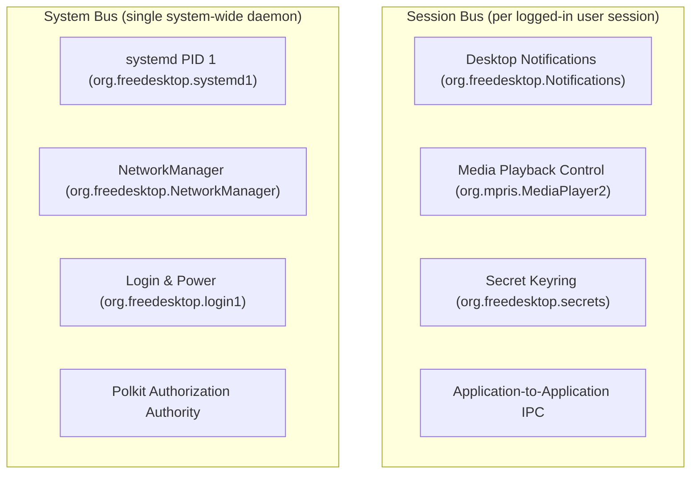

# D-Bus IPC Architecture & Security Specification

## 1. Scope & D-Bus Fundamentals

D-Bus is the standard message bus system for Linux desktop and system services. It provides a typed, binary remote procedure call (RPC) mechanism, property synchronization, and asynchronous broadcast signals.

---

## 2. Bus Architecture: Session Bus vs System Bus



### Invariant:
- **Session Bus**: Runs per user session; addressed via `$DBUS_SESSION_BUS_ADDRESS`. Used for desktop UI events, single-instance activation, and user services.
- **System Bus**: Runs system-wide; socket at `/run/dbus/system_bus_socket`. Used for core OS services, networking, hardware power states, and privileged tasks.

---

## 3. Addressing & Naming Conventions

D-Bus adheres to hierarchical reverse-domain naming:
- **Bus Name (Service)**: Well-known name identifying the service owner (e.g. `org.example.AppDaemon`).
- **Object Path**: Hierarchical path representing an object instance inside the service (e.g. `/org/example/AppDaemon/device0`).
- **Interface**: Named contract grouping methods, properties, and signals (e.g. `org.example.AppDaemon.DeviceInterface`).

---

## 4. Security & System Bus Access Control

On the system bus, unauthenticated clients must NOT be allowed to invoke privileged methods:
1. **D-Bus Policy XML**: Define permissions in `/usr/share/dbus-1/system.d/<service>.conf`:
   ```xml
   <!DOCTYPE busconfig PUBLIC "-//freedesktop//DTD D-BUS Bus Configuration 1.0//EN"
    "http://www.freedesktop.org/standards/dbus/1.0/busconfig.dtd">
   <busconfig>
     <policy user="root">
       <allow own="org.example.AppDaemon"/>
     </policy>
     <policy context="default">
       <allow send_destination="org.example.AppDaemon"
              send_interface="org.example.AppDaemon.Query"/>
       <!-- Privileged mutate method blocked by default policy -->
     </policy>
   </busconfig>
   ```
2. **Polkit Authorization**:
   For methods altering host configuration or hardware state, check authorization via **polkit** (`polkit_authority_check_authorization()`) using the caller's D-Bus unique name before executing the action.
