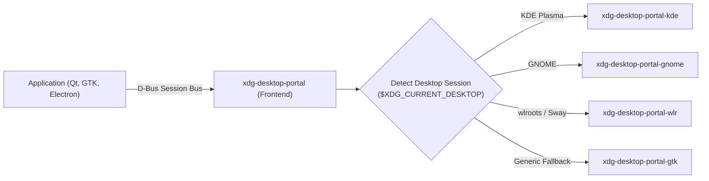

# XDG Desktop Portals Architecture & Permission Mediation

## 1. Scope & The Portal Security Model

The **XDG Desktop Portal** (`org.freedesktop.portal.*`) provides a standardized, secure bridge between application processes (both unconfined host applications and sandboxed Flatpak/Snap containers) and the host desktop environment.

### Why Portals Are Essential:
- **Under Wayland**: Native clients cannot capture global screens, snoop global keystrokes, or query foreign windows. Portals mediate these actions via user confirmation dialogs.
- **Under Sandboxing (Flatpak/Bubblewrap)**: Applications run inside isolated mount and network namespaces with no direct access to host home directories or hardware devices. Portals allow the user to select specific files or grant camera access interactively.

---

## 2. Core Portal Interfaces

| Portal Interface | Functionality | User Interaction |
|---|---|---|
| **`org.freedesktop.portal.FileChooser`** | Opens native file dialogs; grants sandbox access only to the selected files | User chooses file in desktop picker |
| **`org.freedesktop.portal.OpenURI`** | Opens URLs or files in the user's default web browser or desktop handler | Dispatched safely via host browser |
| **`org.freedesktop.portal.ScreenCast`** | Video capture of display monitors or windows via PipeWire streams | User explicitly selects window/screen |
| **`org.freedesktop.portal.Screenshot`** | Interactive or background screenshot capture | User grants permission |
| **`org.freedesktop.portal.Inhibit`** | Inhibits system suspend, idle sleep, or screen lock during playback | Automatic session lock inhibitor |
| **`org.freedesktop.portal.GlobalShortcuts`** | Registers global shortcuts working across both Wayland and X11 | User confirms shortcut mapping |
| **`org.freedesktop.portal.Settings`** | Queries desktop theme, dark/light mode preference, accent colors | Read-only setting retrieval |

---

## 3. How Desktop Portals Route to Backends

### Invariant:
Never bypass portals by attempting direct filesystem modifications or invoking non-standard compositor tools. Applications utilizing Qt (`QFileDialog`) and GTK 4 (`GtkFileChooserNative`) automatically use XDG Portals out of the box when appropriate backends are installed.
