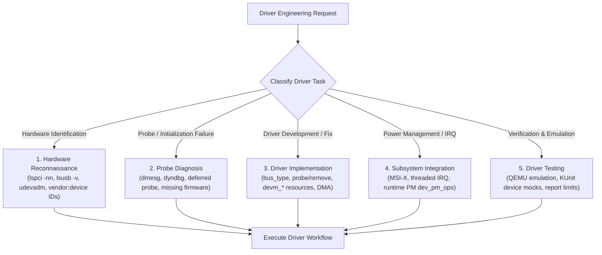

# Linux Device Driver Engineering

The `driver-engineering` skill provides specialist capabilities for analyzing hardware devices, implementing Linux kernel drivers across standard buses (PCI, USB, I2C, SPI, Platform), managing DMA and hardware interrupts, diagnosing probe failures, and verifying drivers safely.

---

## 1. Operating Principles & Invariants

1. **Reuse Before Writing**: Never recommend authoring a new kernel driver when an existing subsystem driver or generic framework (e.g. `uio`, `vfio`, `industrialio`) supports the hardware via ID addition or quirk handling.
2. **Differentiate Missing Firmware from Driver Bugs**: An initialization failure reporting `-2` (`-ENOENT`) frequently indicates a missing binary microcode file in `/usr/lib/firmware/`, not broken C code.
3. **No Unverified Silicon Claims**: Clearly distinguish between QEMU virtual device emulation and physical hardware validation. Never claim hardware compatibility based on compilation alone.
4. **Safety Tier Gating**: Never load unverified kernel modules (`insmod`/`modprobe`) on the host system without explicit human authorization. Use isolated VMs for device testing.

---

## 2. Intent Classification & Workflow Routing

---

## 3. The 6-Step Driver Development Workflow

1. **Hardware Reconnaissance**: Extract exact numeric PCI Vendor:Device IDs (`lspci -nn`) or USB Vendor:Product IDs (`lsusb -v`).
2. **Subsystem Search**: Query kernel source for existing support in `drivers/<subsystem>/`. Check if adding an entry to `pci_device_id` or `usb_device_id` table suffices.
3. **Firmware Verification**: Check if the hardware controller requires binary firmware images from `/usr/lib/firmware/`.
4. **Driver Implementation**: Use managed allocations (`devm_kzalloc`, `devm_request_threaded_irq`) to guarantee leak-free cleanup upon removal.
5. **Bus & Power Integration**: Implement `dev_pm_ops` for runtime power management and system sleep.
6. **Isolated Testing**: Test driver registration, probe, and transfer operations in QEMU before considering physical hardware.

---

## 4. Cross-Specialist Coordination

| Task | Coordinating Specialists | Interaction |
|:---|:---|:---|
| Out-of-tree DKMS package | `driver-engineering` + `arch-packaging` | `driver-engineering` authors the driver; `arch-packaging` produces DKMS PKGBUILD. |
| Network interface driver failure | `driver-engineering` + `linux-networking` | `driver-engineering` debugs PCI/DMA; `linux-networking` verifies carrier state and ethtool. |
| NVMe controller failure | `driver-engineering` + `linux-storage` | `driver-engineering` diagnoses PCIe link/BARs; `linux-storage` diagnoses blk-mq queue state. |

---

## 5. Authoritative References Directory

- [Device Model & Driver Lifecycle](references/device-model.md)
- [PCI/PCIe & USB Subsystems](references/pci-usb.md)
- [I2C, SPI & Platform Buses](references/i2c-spi.md)
- [DMA & Hardware Interrupts](references/dma-interrupts.md)
- [Driver Power Management](references/power-management.md)
- [Driver Debugging & Diagnostics](references/driver-debugging.md)
- [Driver Testing & Validation](references/driver-testing.md)
- [Safety Policy](../../references/safety-policy.md)
