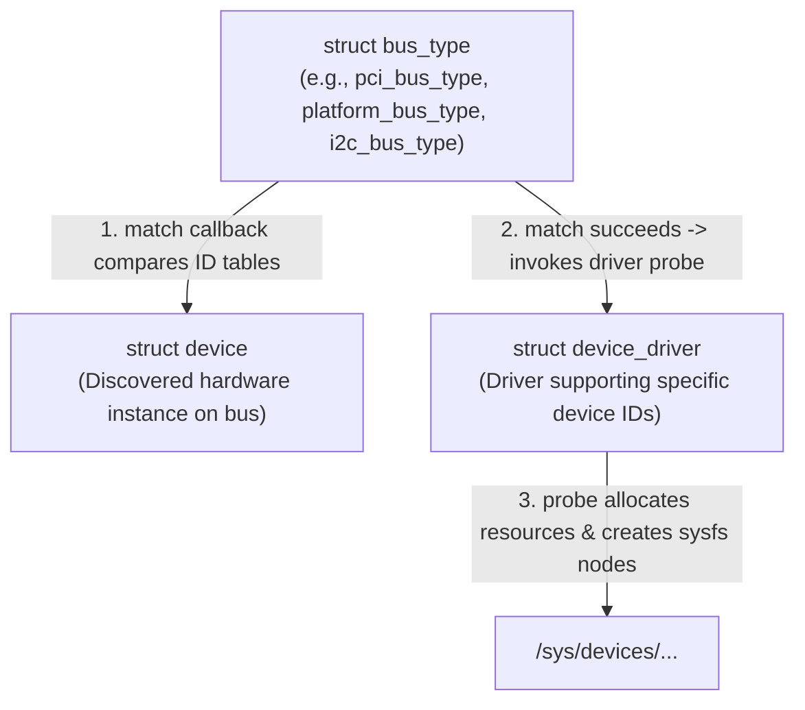

# Linux Device Model & Driver Lifecycle Reference

## 1. Scope

This document details the Linux device model, bus architecture, driver registration, probe and remove semantics, firmware loading, and deferred probing.

---

## 2. Core Device Model Architecture

The Linux device model represents all hardware devices and drivers in a unified object hierarchy:



### 2.1 Core Structures (`include/linux/device.h`)
- **`struct bus_type`**: Represents a physical or virtual communication bus (PCI, USB, I2C, Platform). Defines `.match()`, `.probe()`, `.remove()`, and `.shutdown()`.
- **`struct device`**: Represents an individual hardware instance attached to a bus. Contains parent device pointer, driver pointer, private driver data (`dev_get_drvdata()`), and sysfs kobject.
- **`struct device_driver`**: Represents the driver code capable of controlling one or more devices on a bus. Contains ID tables (`of_match_table`, `acpi_match_table`, `id_table`), `.probe()`, and `.remove()`.

---

## 3. The Driver Lifecycle: Probe & Remove

### 3.1 The `probe()` Function
Called by the bus when a matching hardware device is discovered:
```c
static int my_driver_probe(struct platform_device *pdev)
{
    struct device *dev = &pdev->dev;
    struct my_priv_data *priv;
    int ret;

    priv = devm_kzalloc(dev, sizeof(*priv), GFP_KERNEL);
    if (!priv)
        return -ENOMEM;

    platform_set_drvdata(pdev, priv);

    // Request managed memory, IRQs, clocks, and regulators
    // (devm_* functions automatically clean up on probe failure or device removal)
    return 0;
}
```

### 3.2 Resource Management: The `devm_*` Family
Modern drivers prioritize device-managed resources (`devm_kzalloc()`, `devm_request_irq()`, `devm_platform_ioremap_resource()`). Managed resources are automatically released if `probe()` fails or when the device is removed, preventing resource leaks.

### 3.3 Deferred Probing (`-EPROBE_DEFER`)
- Occurs when a driver needs another subsystem (e.g., a GPIO expander, clock controller, or power regulator) that has not yet completed its own `probe()`.
- **Handling**: If a resource lookup returns `-EPROBE_DEFER`, return `-EPROBE_DEFER` immediately. The kernel driver core places the device in the deferred probe list and retries probing after other drivers initialize.
- Debugging: Inspect `/sys/kernel/debug/devices_deferred` to view waiting devices.

---

## 4. Firmware Loading

Drivers requiring binary microcode from userspace use the kernel firmware API:
```c
#include <linux/firmware.h>

const struct firmware *fw;
int ret = request_firmware(&fw, "vendor/mydevice.bin", dev);
if (ret) {
    dev_err(dev, "Failed to load firmware: %d\n", ret);
    return ret;
}

// Upload fw->data of size fw->size to device memory
release_firmware(fw);
```
- Firmware resides in `/lib/firmware/` (or `/usr/lib/firmware/`).
- Distinguish between driver probe failures (code logic error) and missing firmware (`-ENOENT`, return code -2).

---

## 5. Authoritative References

- [The Linux Driver Model](https://docs.kernel.org/driver-api/driver-model/index.html)
- [Deferred Driver Probing](https://docs.kernel.org/driver-api/driver-model/driver.html#deferred-probing)
- [Linux Firmware API](https://docs.kernel.org/driver-api/firmware/index.html)
