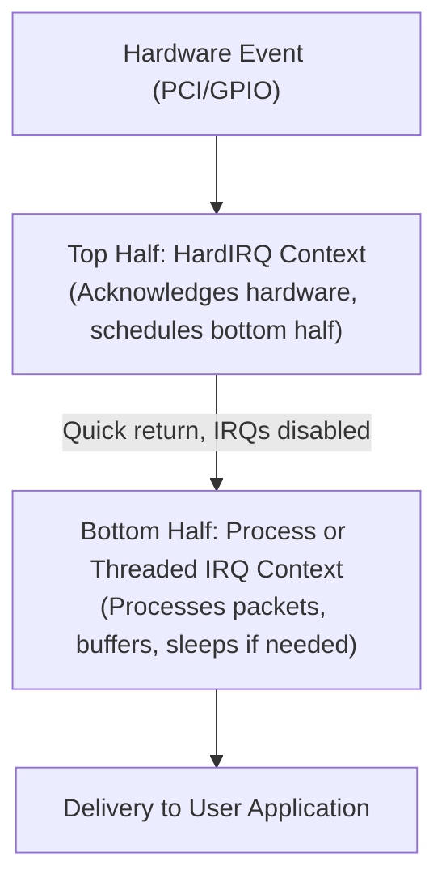

# DMA and Interrupt Handling in Linux Drivers

## 1. Scope

This document details hardware interrupt handling (top/bottom halves, threaded IRQs, MSI/MSI-X) and Direct Memory Access (coherent vs streaming DMA) in Linux device drivers.

---

## 2. Hardware Interrupt Architecture



### 2.1 Top Half vs Threaded Interrupts
- **HardIRQ Handlers** (`request_irq`):
  - Must execute in microseconds.
  - Cannot sleep, cannot allocate memory with `GFP_KERNEL`, cannot acquire mutexes.
- **Threaded IRQ Handlers** (`request_threaded_irq`):
  - Standard for modern drivers. HardIRQ handler validates the interrupt and returns `IRQ_WAKE_THREAD`.
  - Threaded handler executes in a dedicated kernel thread (`irq/<num>-<name>`), where it is permitted to sleep, use mutexes, and allocate memory.

```c
static irqreturn_t my_hardirq_handler(int irq, void *dev_id)
{
    u32 status = readl(regs + STATUS_REG);
    if (!(status & INT_PENDING))
        return IRQ_NONE;

    writel(status, regs + ACK_REG);
    return IRQ_WAKE_THREAD;
}

static irqreturn_t my_threaded_handler(int irq, void *dev_id)
{
    process_hardware_buffers();
    return IRQ_HANDLED;
}

ret = devm_request_threaded_irq(dev, irq, my_hardirq_handler, my_threaded_handler,
                                IRQF_SHARED, "my_device", priv);
```

### 2.2 MSI and MSI-X
- Legacy line-based IRQs share interrupt lines, causing spurious interrupts and performance degradation.
- **MSI (Message Signaled Interrupts)**: Writes a distinct 32-bit value to a host memory address, delivering up to 32 discrete vectors.
- **MSI-X**: Supports up to 2048 independent interrupt vectors per device, essential for multi-queue network and NVMe controllers.

---

## 3. Direct Memory Access (DMA)

### 3.1 Coherent (Consistent) DMA
Used for hardware descriptors, ring buffers, and communication queues that both the CPU and device access simultaneously without explicit cache flushes:
```c
dma_addr_t dma_handle;
void *cpu_addr = dma_alloc_coherent(dev, size, &dma_handle, GFP_KERNEL);
// cpu_addr is used by kernel; dma_handle is written to device hardware registers
dma_free_coherent(dev, size, cpu_addr, dma_handle);
```

### 3.2 Streaming DMA
Used for one-time packet or data transfers (e.g., network frames, block storage buffers). Requires explicit cache synchronization:
```c
dma_addr_t dma_handle = dma_map_single(dev, buffer, size, DMA_TO_DEVICE);
if (dma_mapping_error(dev, dma_handle))
    return -EIO;

// Instruct hardware to read from dma_handle...
// Wait for hardware transfer completion...

dma_unmap_single(dev, dma_handle, size, DMA_TO_DEVICE);
```

---

## 4. Authoritative References

- [Generic Interrupt Subsystem](https://docs.kernel.org/core-api/genericirq.html)
- [Dynamic DMA mapping Guide](https://docs.kernel.org/core-api/dma-api.html)
- [DMA-API-HOWTO](https://docs.kernel.org/core-api/dma-api-howto.html)
