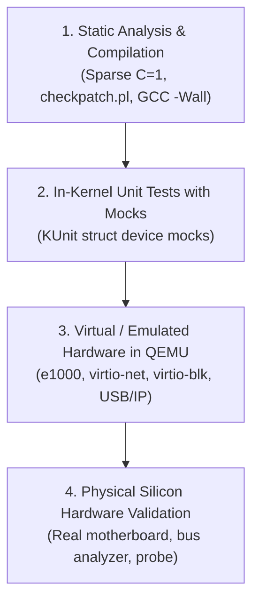

# Driver Testing & Hardware Validation Reference

## 1. Scope

This document details virtual device simulation, QEMU-based driver testing, KUnit hardware mocks, and physical hardware validation limitations.

---

## 2. Testing Levels in Driver Engineering



---

## 3. Emulated Driver Testing in QEMU

QEMU allows testing PCI, network, and storage drivers without physical hardware:

```bash
# Launch minimal Linux kernel testing the e1000 network driver
qemu-system-x86_64 \
  -kernel arch/x86/boot/bzImage \
  -append "console=ttyS0 root=/dev/ram0 earlyprintk=serial" \
  -initrd rootfs.cpio.gz \
  -device e1000,netdev=net0 \
  -netdev user,id=net0 \
  -nographic
```

---

## 4. Physical Hardware Boundary Invariant

- **Strict Mandate**: Never claim a driver is verified on physical hardware when testing was performed solely via QEMU, KUnit, or static compilation.
- If physical silicon is required to verify electrical signaling, DMA coherency under cache contention, or proprietary firmware initialization, explicitly document the limitation:
  > "Verified via QEMU emulation. Physical hardware testing deferred due to lack of target silicon."

---

## 5. Authoritative References

- [KUnit Driver Testing Guidelines](https://docs.kernel.org/dev-tools/kunit/index.html)
- [QEMU System Emulation](https://www.qemu.org/docs/master/system/index.html)
