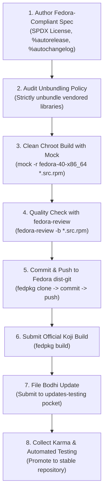

# Fedora Packaging Specialist

The `fedora-packaging` skill guides AI agents through Fedora and Extra Packages for Enterprise Linux (EPEL) package maintenance, adhering to official Fedora Packaging Guidelines, Koji build infrastructure, and Bodhi release updates.

---

## 1. Fedora Packaging Lifecycle Workflow

### The 8-Step Fedora Packaging Discipline:
1. **Adhere to Fedora Guidelines**: Use valid SPDX license identifiers, enforce `%autorelease` and `%autochangelog`, and use approved directory macros.
2. **Strictly Unbundle Dependencies**: Fedora policy strictly prohibits bundling third-party static libraries. Unbundle all vendored libraries and link dynamically against Fedora system packages.
3. **Execute Clean Mock Builds**: Always build the package using `mock -r fedora-<version>-x86_64` to verify missing `BuildRequires` in an isolated chroot.
4. **Audit with `fedora-review`**: Run `fedora-review` to check license files, compiler hardening flags, directory ownership, and macro usage.
5. **Manage dist-git via `fedpkg`**: Track package branches (`rawhide`, `f40`, `f39`, `epel9`) using `fedpkg`.
6. **Submit Official Koji Builds**: Build packages on the official Koji build farm (`fedpkg build`).
7. **File Bodhi Updates**: Submit successful Koji builds to Bodhi for distribution to `updates-testing`.
8. **EPEL Compatibility Auditing**: When targeting Enterprise Linux / EPEL, verify older toolchain constraints (CMake/GCC versions, Python runtimes) and missing dependencies.

---

## 2. Fedora vs Standard RPM Distinctions

| Feature / Convention | Standard Generic RPM | Fedora Packaging Policy |
|---|---|---|
| **Release Field** | `1%{?dist}` | `%autorelease` (managed by rpmautospec) |
| **Changelog Section** | Manual changelog entries | `%autochangelog` (generated from git log) |
| **Licensing** | Free-form license strings | **Strict SPDX License Identifiers Only** |
| **Bundled Libraries** | Permitted if packaged cleanly | **STRICTLY PROHIBITED** (must unbundle) |
| **Isolated Build Tool** | Raw `rpmbuild` in user directory | `mock` isolated chroot |
| **Official Build Farm** | N/A | Koji (`koji.fedoraproject.org`) |
| **Update Management** | Direct repository upload | Bodhi karma & testing gating system |

---

## 3. Operational Safety Boundaries

- **Tier 0 (Diagnostics)**: Querying Koji build status (`koji buildinfo`), checking Bodhi updates, running `fedora-review`, and inspecting dist-git is fully autonomous.
- **Tier 1 (Workspace Builds)**: Generating SRPMs and building inside local `mock` chroots runs autonomously.
- **Tier 3 (Host Mutating / Privileged)**: Submitting official Koji builds (`fedpkg build`), pushing to Fedora dist-git, creating Bodhi updates, or modifying host `/etc/yum.repos.d/` strictly requires explicit human authorization.

---

## 4. Reference Library

- [fedora-policy.md](references/fedora-policy.md) — Fedora Packaging Guidelines, SPDX licensing, and unbundling mandates.
- [fedora-spec-conventions.md](references/fedora-spec-conventions.md) — `%autorelease`, `%autochangelog`, and rpmautospec.
- [mock.md](references/mock.md) — Isolated clean-chroot building with `mock`.
- [fedpkg.md](references/fedpkg.md) — Working with Fedora dist-git, sources, and branches.
- [koji.md](references/koji.md) — Koji build system, side tags, and build troubleshooting.
- [bodhi.md](references/bodhi.md) — Bodhi update creation, karma thresholds, and gating tests.
- [epel.md](references/epel.md) — Packaging for Extra Packages for Enterprise Linux (EPEL 8/9/10).
