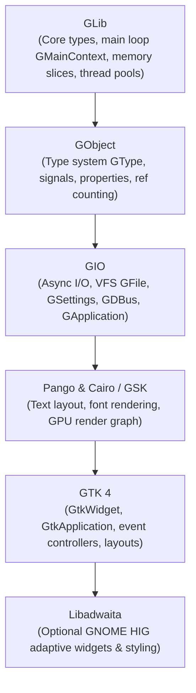

# GTK 4 Architecture & Subsystem Foundations

## 1. Scope & The GTK 4 Revolution

GTK 4 represents a clean break from legacy GTK 2 and GTK 3 architectures:
- **Scene Graph Rendering (GSK)**: GTK 4 renders UI via the **GTK Scene Kit (GSK)** using modern Vulkan and OpenGL render nodes (`GskRenderNode`), fully offloading compositing to the GPU.
- **Widgets are Visible by Default**: Calling `gtk_widget_show()` is removed. Newly constructed widgets are visible as soon as their parent container is visible. To hide a widget, call `gtk_widget_set_visible(widget, FALSE)`.
- **Event Controllers Replace Virtual Event Methods**: Virtual methods like `button_press_event` and `key_press_event` are gone. Input is captured by attaching dedicated `GtkEventController` instances (`GtkGestureClick`, `GtkEventControllerKey`) to widgets.
- **No More `GtkContainer`**: In GTK 4, all widgets can hold child widgets directly via modern layout managers (`GtkLayoutManager`).

---

## 2. The GNOME / GTK Stack Hierarchy



---

## 3. Event Handling with Event Controllers

In GTK 4, to handle user clicks, keypresses, or focus transitions:
```c
/* Handling button clicks in GTK 4 */
GtkGesture *click = gtk_gesture_click_new();
gtk_gesture_single_set_button(GTK_GESTURE_SINGLE(click), GDK_BUTTON_PRIMARY);

g_signal_connect(click, "pressed", G_CALLBACK(on_button_clicked), user_data);
gtk_widget_add_controller(my_widget, GTK_EVENT_CONTROLLER(click));

/* Handling keyboard shortcuts */
GtkEventController *key_ctrl = gtk_event_controller_key_new();
g_signal_connect(key_ctrl, "key-pressed", G_CALLBACK(on_key_pressed), user_data);
gtk_widget_add_controller(my_widget, key_ctrl);
```

### Advantages:
- Decouples input handling logic from widget rendering subclasses.
- Allows multiple independent controllers to observe input on the same widget.
- Supports propagation control cleanly: `GDK_EVENT_STOP` vs `GDK_EVENT_PROPAGATE`.
