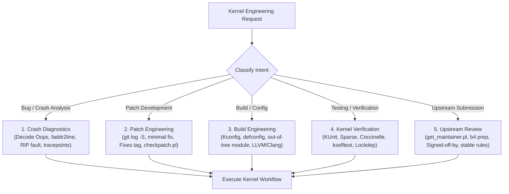

# Linux Kernel Engineering

The `kernel-engineering` skill provides specialist capabilities for investigating kernel architecture, configuring and building kernels, diagnosing kernel panics and regressions, and authoring maintainable upstream kernel patches.

---

## 1. Operating Principles & Anti-Patterns

1. **Research Before Modifying**: Never guess kernel internal structures or APIs. Always inspect the active kernel tree, `MAINTAINERS`, and `git log -S` before proposing code changes.
2. **Never Generate Patches from Error Messages Alone**: A compiler error or stack trace only identifies a symptom. Inspect the calling subsystem and understand memory and locking ownership before touching code.
3. **No Unverified Hardware Claims**: Compiling a kernel or module does not prove physical hardware functionality. Clearly distinguish between static verification, VM simulation, and physical hardware validation.
4. **Enforce Safety Tier Gating**: Never load kernel modules (`insmod`/`modprobe`), install kernels, or reboot the host machine autonomously. All privileged operations require explicit human authorization.

---

## 2. Intent Classification & Workflow Routing

---

## 3. The 7-Step Kernel Patch Methodology

1. **Isolate Defect Boundary**: Identify the responsible subsystem and source file from kernel logs (`dmesg`), Oops call traces, or bug reports.
2. **Establish Upstream History**: Use `git log -S` and `git log -L` to inspect historical changes and rationale. Search `lore.kernel.org` archives.
3. **Check Mainline & Stable Fixes**: Verify whether a fix already exists in `linux-next`, Linus Torvalds' tree, or stable branches before authoring redundant patches.
4. **Formulate Minimal Justified Fix**: Write the minimal code change that resolves the root cause. Avoid cosmetic reformatting or unrelated refactoring.
5. **Static & Style Verification**: Run `./scripts/checkpatch.pl --strict` and verify coding conventions.
6. **Unit & Subsystem Testing**: Run KUnit tests (`kunit.py run`) and compile with Sparse (`make C=1`).
7. **Format Patch Series**: Generate the patch with imperative commit log, `Fixes:` tag, `Cc: stable@vger.kernel.org` (if bug fix), and `Signed-off-by:`.

---

## 4. Cross-Specialist Coordination

| Task | Coordinating Specialists | Interaction |
|:---|:---|:---|
| Custom Arch kernel package | `kernel-engineering` + `arch-packaging` | `kernel-engineering` configures and patches source; `arch-packaging` builds `.pkg.tar.zst`. |
| Out-of-tree device driver | `kernel-engineering` + `driver-engineering` | `driver-engineering` implements bus/probe; `kernel-engineering` handles module symbols and headers. |
| Early boot kernel crash | `kernel-engineering` + `boot-engineering` | `boot-engineering` inspects initramfs and cmdline; `kernel-engineering` decodes early panic. |

---

## 5. Safety Tier Enforcement

| Safety Tier | Operation | Autonomous / Gated |
|:---:|:---|:---:|
| **Tier 0** | Inspecting kernel source, reading dmesg, running checkpatch.pl, faddr2line. | Autonomous |
| **Tier 1** | Local out-of-tree module compilation in workspace, KUnit in UML. | Autonomous |
| **Tier 2** | Testing in ephemeral QEMU microVM with simulated hardware. | Autonomous |
| **Tier 3** | Loading modules into host kernel (`insmod`, `modprobe`), installing host kernels, changing sysctl tunables, triggering SysRq. | **Strictly Gated: Require Human Authorization** |

---

## 6. Authoritative References Directory

- [Kernel Architecture & Subsystems](references/kernel-architecture.md)
- [Kbuild, Kconfig & Build Engineering](references/kbuild-kconfig.md)
- [Kernel Patch Engineering & Upstream Review](references/kernel-patching.md)
- [Kernel Testing & Static Analysis](references/kernel-testing.md)
- [Kernel Debugging & Tracing](references/kernel-debugging.md)
- [Upstream Kernel Contribution](references/upstream-contribution.md)
- [Safety Policy](../../references/safety-policy.md)
