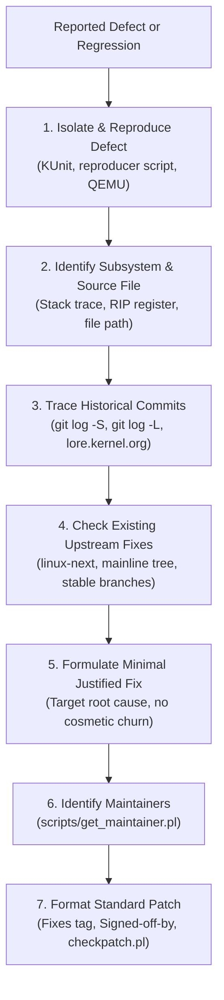

# Kernel Patch Engineering & Upstream Review Reference

## 1. Scope

This document establishes the research-first methodology for diagnosing kernel defects, navigating upstream git history, identifying subsystem maintainers, and authoring minimal, standards-compliant kernel patches.

---

## 2. Research-First Patch Development Methodology



---

## 3. Investigating Upstream Git History

Before modifying code, understand why the code was written this way:

```bash
# 1. Search for commits touching a specific symbol or function
git log -S "symbol_name" --oneline path/to/file.c

# 2. View evolution of a specific line range or function
git log -L :function_name:path/to/file.c

# 3. Search public-inbox kernel mailing list archives
# Use lore.kernel.org/all/?q=... to find discussions and patch reviews
```

---

## 4. Identifying Subsystem Maintainers

Kernel development is organized by subsystems tracked in `MAINTAINERS`. Use the official script:

```bash
./scripts/get_maintainer.pl 0001-fix-null-dereference.patch
```

Sample Output:
```text
Alice Maintainer <alice@kernel.org> (maintainer:NETWORK DRIVERS)
Bob Co-Maintainer <bob@kernel.org> (maintainer:NETWORK DRIVERS)
netdev@vger.kernel.org (open list:NETWORKING DRIVERS)
linux-kernel@vger.kernel.org (open list)
```

---

## 5. Standard Kernel Commit & Patch Formatting

Kernel commits must be imperatively phrased and technically explicit:

```text
subsystem: driver: concise imperative description under 72 chars

Explain the context and the defect:
When performing operation X, function foo() fails to check the return value
of bar(), leading to a NULL pointer dereference when bar() fails:

[   14.281902] BUG: kernel NULL pointer dereference, address: 0000000000000000
[   14.282103] RIP: 0010:foo+0x24/0x80 [mydriver]
[   14.282500] Call Trace:
[   14.282600]  <TASK>
[   14.282700]  probe_callback+0x45/0x90 [mydriver]

Fix this by checking bar()'s return pointer with IS_ERR_OR_NULL() and
propagating the error code before dereferencing.

Fixes: 1da177e4c3f4 ("Linux-2.6.12-rc2")
Cc: stable@vger.kernel.org
Signed-off-by: Author Name <author@example.com>
```

### Mandatory Tags:
- `Fixes: <12-char commit-hash> ("Commit Title")`: Documents which commit introduced the bug. Required for stable tree automated backports.
- `Cc: stable@vger.kernel.org`: Requests stable tree inclusion for bug fixes.
- `Signed-off-by: Real Name <email>`: Certifies compliance with the Developer's Certificate of Origin (DCO).

---

## 6. Authoritative References

- [Submitting Patches: the Essential Guide to Getting Your Code into the Kernel](https://docs.kernel.org/process/submitting-patches.html)
- [How to get your code into the Linux Kernel](https://docs.kernel.org/process/howto.html)
