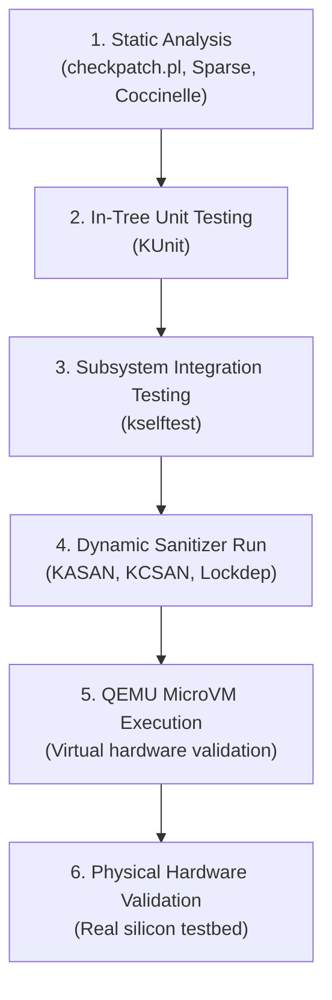

# Kernel Testing & Static Analysis Reference

## 1. Scope

This document details the test frameworks, static analyzers, dynamic sanitizers, and verification levels used in Linux kernel engineering.

---

## 2. The Verification Hierarchy



---

## 3. Static Analysis Tools

### 3.1 `checkpatch.pl`
Validates patch formatting, style, and common programming errors:
```bash
./scripts/checkpatch.pl --strict 0001-my-fix.patch
```
- Flags missing `Signed-off-by`, lines > 100 chars, incorrect pointer spacing (`void *ptr`, not `void* ptr`), and obsolete functions (`init_timer`, `bcopy`).

### 3.2 Sparse (Semantic Parser)
Performs address space checking (user pointer `__user` vs kernel pointer, big-endian `__be32` vs CPU order):
```bash
make C=1 drivers/net/ethernet/intel/e1000e/
```

### 3.3 Coccinelle (Semantic Patching)
Detects structural bugs, unreleased locks, and API misuse across the codebase:
```bash
make coccicheck MODE=report M=drivers/net/
```

---

## 4. In-Tree Test Frameworks

### 4.1 KUnit (Kernel Unit Testing Framework)
Lightweight unit testing executing entirely inside kernel space:
```bash
# Run unit test suite using User Mode Linux (UML) or QEMU
./tools/testing/kunit/kunit.py run --kunitconfig drivers/base/test/.kunitconfig
```
- Tests individual functions without requiring full userland initialization.

### 4.2 kselftest (Kernel Self-Tests)
Integration tests validating kernel interfaces from userspace:
```bash
# Run selftests for memory management
make -C tools/testing/selftests TARGETS=vm run_tests
```

---

## 5. Dynamic Sanitizers & Runtime Verifiers

- **KASAN (KernelAddressSanitizer)**: Detects out-of-bounds memory accesses and use-after-free bugs.
- **Lockdep (Lock Dependency Validator)**: Dynamically checks locking hierarchies at runtime; detects deadlocks, circular lock acquisitions, and sleeping in atomic context.
- **KCSAN (Kernel Concurrency Sanitizer)**: Detects data races between concurrent threads accessing shared memory without proper locking.
- **UBSAN (Undefined Behavior Sanitizer)**: Detects integer overflows, out-of-bounds array indexing, and alignment faults.

---

## 6. Authoritative References

- [KUnit - Linux Kernel Unit Testing](https://docs.kernel.org/dev-tools/kunit/index.html)
- [Linux Kernel Self-Tests](https://docs.kernel.org/dev-tools/kselftest.html)
- [The Kernel Address Sanitizer (KASAN)](https://docs.kernel.org/dev-tools/kasan.html)
- [Runtime Locking Correctness Validator (Lockdep)](https://docs.kernel.org/locking/lockdep-design.html)
