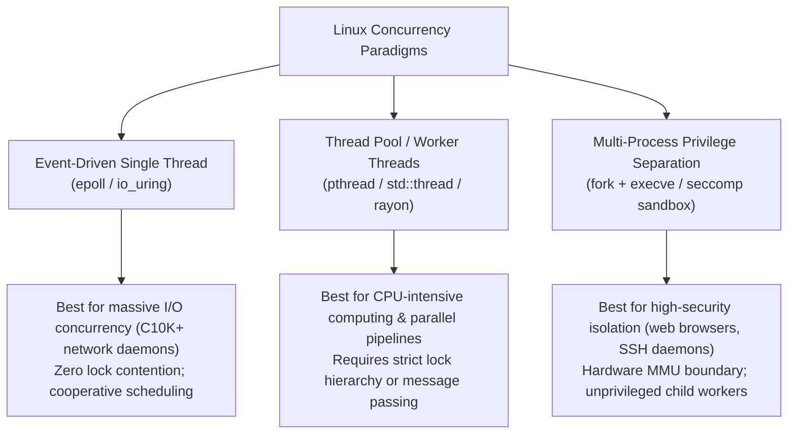

# Linux Application Architecture & Systems Design

## 1. Scope & Architectural Principles

Native Linux application engineering requires choosing structural patterns aligned with the operating system's process model, memory management, and asynchronous I/O primitives. Architecture must be dictated by verifiable domain constraints rather than dogma:
- **Avoid Premature Distribution**: Prefer modular in-process monoliths over distributed microservices on a single host. In-process function calls cost nanoseconds; IPC via Unix domain sockets costs microseconds; local TCP stacks add protocol overhead and serialization penalties.
- **Explicit Concurrency & Resource Boundaries**: Isolate CPU-bound processing, blocking disk I/O, and event-driven network processing into dedicated execution contexts.
- **Fail Fast & Graceful Degradation**: Structure subsystems to handle transient errors, isolate failures, and perform clean teardown upon receiving termination signals.

---

## 2. Process & Concurrency Models

Linux provides three foundational execution paradigms for native applications:

### 2.1 Event-Driven Asynchronous I/O (`epoll` & `io_uring`)
- **Use Case**: Network proxies, high-throughput daemons, and reactive UI event loops.
- **Mechanics**: A single event loop manages non-blocking file descriptors using edge-triggered `epoll` (`EPOLLET`) or submission/completion queue rings in `io_uring`.
- **Constraint**: Never invoke blocking syscalls (e.g., synchronous file read/write, DNS lookup `getaddrinfo`) directly within the event loop thread; offload blocking operations to a background thread pool.

### 2.2 Worker Thread Pools & Pipeline Concurrency
- **Use Case**: Compilers, video encoders, data analyzers, and batch processors.
- **Design Rules**:
  - Prefer channel-based message passing (e.g., Rust `crossbeam-channel`, C++ thread-safe queue) over fine-grained shared mutable state.
  - When shared memory is necessary, maintain a strict lock hierarchy (e.g., always acquire Lock A before Lock B) to prevent deadlocks.
  - Dimension worker threads relative to available hardware concurrency: `std::thread::hardware_concurrency()` or `sched_getaffinity(2)`.

### 2.3 Multi-Process Privilege Separation
- **Use Case**: High-security daemons handling untrusted network input (e.g., OpenSSH, Chromium).
- **Design Rules**:
  - Root supervisor process opens privileged sockets/files, drops privileges (`setuid`/`setgid`), and spawns unprivileged worker processes.
  - Worker processes run under restrictive `seccomp-bpf` filters and communicate with the supervisor solely over bidirectional `socketpair(AF_UNIX, SOCK_SEQPACKET, 0)`.

---

## 3. Inter-Process Communication (IPC) Selection Matrix

When an application requires inter-process communication, select the mechanism that matches latency, security, and payload requirements:

| IPC Mechanism | Latency / Overhead | Semantics | Security & Access Control | Ideal Use Case |
|---|---|---|---|---|
| **Unix Domain Sockets (`AF_UNIX`)** | Very Low (kernel copy) | Stream (`SOCK_STREAM`) or Datagram (`SOCK_SEQPACKET`) | Filesystem permissions (`0600`/`0660`), `SO_PEERCRED` credential checking, FD passing (`SCM_RIGHTS`) | Primary IPC for local daemons, CLI-to-daemon control |
| **D-Bus (Session / System Bus)** | Medium (message broker) | Typed RPC methods, properties, and broadcast signals | Polkit authorization, AppArmor/SELinux labels, D-Bus policy XML | Desktop interoperability, system service control |
| **Shared Memory (`shm_open` / `memfd_create`)** | Zero-copy (MMU mapping) | Raw memory buffer | File descriptor permissions, `F_ADD_SEALS` (memfd sealing) | High-frame-rate video frames, bulk shared data buffers |
| **Anonymous Pipes (`pipe2`)** | Very Low | Unidirectional byte stream | Inherited file descriptors across `fork` | Parent-child CLI pipelines, worker control |
| **POSIX Message Queues (`mq_open`)** | Low | Priority-ordered messages | Filesystem-like permissions in `/dev/mqueue` | Real-time signaling between cooperating processes |

> [!IMPORTANT]
> Never use local TCP loopback (`127.0.0.1`) for local-only IPC. Local TCP exposes internal application interfaces to all unprivileged users on the host, bypasses Unix permission models, lacks file descriptor passing, and incurs full IP stack serialization overhead. Use Unix domain sockets (`AF_UNIX`).

---

## 4. Subsystem Modularity & Plugin Architectures

When designing extensible native applications:
1. **Dynamic Library Plugins (`dlopen(3)`)**:
   - Expose an explicit, versioned C ABI (`extern "C"` struct containing function pointers and an API version integer).
   - Never expose raw C++ classes or unstable Rust ABIs across shared library boundaries.
   - Guard against plugin crashes: if third-party plugins must run untrusted, isolate them into out-of-process workers communicating via Unix sockets.
2. **Configuration & Data Separation**:
   - Separate code logic from static assets and mutable state.
   - Read-only shared assets: `/usr/share/<app>/`.
   - User configuration: `$XDG_CONFIG_HOME/<app>/` (default `~/.config/<app>/`).
   - User persistent data: `$XDG_DATA_HOME/<app>/` (default `~/.local/share/<app>/`).
   - User cache: `$XDG_CACHE_HOME/<app>/` (default `~/.cache/<app>/`).

---

## 5. Graceful Teardown & Observability

- **Signal Masking & Handling**: Mask asynchronous signals (`SIGTERM`, `SIGINT`, `SIGHUP`) using `pthread_sigmask(3)` / `sigprocmask(2)` across worker threads; dedicate a single thread to synchronous signal handling via `sigwaitinfo(2)` or `signalfd(2)`.
- **Drain & Flush Sequences**: Upon receiving `SIGTERM`:
  1. Stop accepting new inbound connections or CLI requests.
  2. Allow in-flight operations a bounded grace period (e.g., 5 seconds) to complete.
  3. Flush memory-mapped files (`msync`), commit database transactions, and call `fsync(2)` on critical files.
  4. Release lockfiles (`flock(2)` or `/run/<app>.pid`) and unlink temporary resources.
- **Structured Observability**:
  - Direct logs to `stderr` using structured key-value pairs (or JSON when `--log-format=json` is requested).
  - When running under systemd, emit syslog priority prefixes (e.g., `<3>` for Error, `<6>` for Info) to enable native `journalctl -p` filtering.
