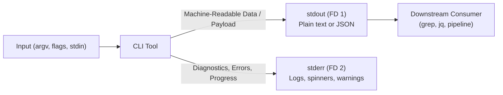

# Professional Linux CLI Application Engineering

## 1. Scope & Core Tenets

A professional Linux command-line interface (CLI) is an interactive tool for human operators and a reliable component in automated pipelines and scripts. A well-engineered CLI must adhere to Unix design principles:
- **Separation of Streams**: Emit data on `stdout`; emit diagnostic, status, and error logs on `stderr`.
- **Pipeline Predictability**: Never emit decorative ANSI colors, progress bars, or prompts when `stdout` is redirected to a pipe or file.
- **Strict Exit Codes**: Return `0` on success and specific non-zero codes on failure, aligned with `sysexits.h` conventions.

---

## 2. Standard Streams & Pipeline Formatting



### Stream Rules:
1. **Machine-Readable Standard Output (`stdout`)**:
   - When a user runs `mytool list | jq .`, only valid JSON must arrive on `stdout`.
   - Never print "Connecting to server..." or "Found 5 items:" on `stdout`. Those belong on `stderr`.
2. **Terminal Capability Detection (`isatty`)**:
   - Check `isatty(STDOUT_FILENO)` (C) or `stdout().is_terminal()` (Rust) before outputting terminal escape codes:
     - If `true` (interactive terminal): ANSI colors, interactive paging, and rich formatting are permitted (unless disabled by `NO_COLOR`).
     - If `false` (pipeline or file redirect): Suppress all ANSI escape sequences, spinners, and interactive prompts.
3. **Respecting the `NO_COLOR` Standard**:
   - If the `NO_COLOR` environment variable is set (regardless of value), disable color output unconditionally (per https://no-color.org).

---

## 3. Exit Code Discipline

Use standard POSIX and BSD `sysexits.h` exit codes:

| Code | Constant | Meaning | Example |
|---|---|---|---|
| **0** | `EXIT_SUCCESS` | Command completed successfully | Target generated, query resolved |
| **1** | `EXIT_FAILURE` | Generic operational failure | Runtime error, network timeout |
| **2** | CLI Syntax / Usage | Misused shell syntax or invalid flag | Unknown `--bad-flag`, missing argument |
| **64** | `EX_USAGE` | Command line usage error | Argument validation failure |
| **65** | `EX_DATAERR` | Input data format error | Malformed JSON in input file |
| **66** | `EX_NOINPUT` | Input file missing or unreadable | File not found or permission denied |
| **70** | `EX_SOFTWARE` | Internal software bug | Unhandled panic or assertion |
| **74** | `EX_IOERR` | Critical filesystem I/O error | Disk full during write |
| **77** | `EX_NOPERM` | Insufficient permissions | Operation requires specific capability |
| **130** | `128 + SIGINT` | Terminated by `SIGINT` (Ctrl+C) | User interrupted execution |

---

## 4. Signal Handling in CLI Tools

1. **`SIGINT` (Ctrl+C) & `SIGTERM`**:
   - When a long-running CLI tool (e.g., file scanner or network downloader) receives `SIGINT`, do not crash or abort mid-write.
   - Clean up temporary files, reset terminal cursor visibility (`\033[?25h`), and exit with code `130`.
2. **`SIGPIPE`**:
   - When a CLI output is piped to a tool that exits early (e.g., `mytool list | head -n 1`), the kernel delivers `SIGPIPE` when `mytool` next writes to the closed pipe.
   - Default behavior is process termination. In languages that ignore `SIGPIPE` (like Rust), handle `std::io::ErrorKind::BrokenPipe` by cleanly exiting with code `0`, rather than printing a noisy panic backtrace to `stderr`.

---

## 5. Structured Output & Shell Completion

- **`--format` Flag**: Support `--format=text` (default) and `--format=json` (for programmatic consumption). Ensure `--format=json` outputs valid, newline-delimited or indented JSON on `stdout`.
- **Shell Completions**: Provide automatic generation of completion scripts for Bash, Zsh, and Fish:
  ```bash
  mytool completions bash > /usr/share/bash-completion/completions/mytool
  ```
- **Man Pages**: Every system CLI utility must be accompanied by a manual page in Section 1 (`/usr/share/man/man1/<tool>.1.gz`) detailing synopses, options, environment variables, exit codes, and examples.
