# Linux Daemon & Background Service Engineering

## 1. Modern Linux Service Architecture

Historically, Unix daemons performed double-forking, detached from controlling terminals, called `setsid()`, and redirected standard file descriptors to `/dev/null`. On modern Linux distributions governed by **systemd**, traditional double-fork daemonization is an **anti-pattern**.

```mermaid
flowchart TD
    subgraph LEGACY["Legacy Double-Fork Anti-Pattern"]
        L1["main()"] --> L2["fork() & exit parent"]
        L2 --> L3["setsid() & fork() second child"]
        L3 --> L4["chdir('/') & umask(0)"]
        L4 --> L5["Close FDs 0,1,2 -> redirect /dev/null"]
        L5 --> L6["Loss of PID tracking, cgroup leakage, uncaptured logs"]
    end

    subgraph MODERN["Modern systemd-Native Architecture"]
        M1["systemd PID 1 spawns daemon"] --> M2["Execute in foreground (PID retained)"]
        M2 --> M3["systemd places process in dedicated cgroup"]
        M3 --> M4["Logs sent to stdout/stderr -> captured by journald"]
        M4 --> M5["Signal readiness via sd_notify('READY=1')"]
    end
```



---

## 2. Readiness Notification (`sd_notify`)

To eliminate startup races between interdependent services, modern Linux services use `Type=notify` with `sd_notify(3)`:

### 2.1 The Notification Protocol
1. systemd creates a Unix datagram socket in `/run/systemd/notify` and passes its path to the service in the environment variable `$NOTIFY_SOCKET`.
2. The service performs initialization (parsing configuration, binding network sockets, initializing worker threads, connecting to local databases).
3. Once fully operational and ready to serve traffic, the service sends a datagram message containing `READY=1\n` to `$NOTIFY_SOCKET`.
4. systemd receives the datagram and transitions the unit state from `activating` to `active (running)`.

### 2.2 Implementation in C
```c
#include <systemd/sd-daemon.h>

int main(void) {
    /* 1. Perform initialization */
    if (service_init() < 0) {
        sd_notify(0, "ERRNO=1\nSTATUS=Initialization failed");
        return 1;
    }

    /* 2. Notify systemd that service is ready */
    sd_notify(0, "READY=1\nSTATUS=Listening for client requests");

    /* 3. Run main event loop */
    service_run();

    /* 4. Notify stopping during shutdown */
    sd_notify(0, "STOPPING=1");
    return 0;
}
```

### 2.3 Implementation in Rust
Use the zero-overhead `libsystemd` crate:
```rust
fn main() -> Result<(), Box<dyn std::error::Error>> {
    init_service()?;
    
    // Notify readiness
    libsystemd::daemon::notify(false, &[libsystemd::daemon::NotifyState::Ready])?;
    
    run_event_loop()?;
    
    libsystemd::daemon::notify(false, &[libsystemd::daemon::NotifyState::Stopping])?;
    Ok(())
}
```

---

## 3. Signal Handling & Lifecycle State Machine

A background service must implement clean signal semantics:
- **`SIGTERM` / `SIGINT` (Graceful Shutdown)**:
  - Cease accepting new incoming requests.
  - Signal worker threads to finish in-flight transactions.
  - Flush state caches and write queues to disk (`fsync`).
  - Terminate within `TimeoutStopSec` (default 90s in systemd) before systemd sends `SIGKILL`.
- **`SIGHUP` (Configuration Reload)**:
  - Re-read configuration files from `/etc/<app>/<app>.conf` or `/etc/<app>/conf.d/`.
  - Validate the new configuration syntax in memory first.
  - If valid: atomically apply changes without terminating active client connections.
  - If invalid: log the error to `stderr` and continue running under the previous configuration.
  - Report reload completion to systemd: `sd_notify(0, "RELOADING=1\n...");` followed by `sd_notify(0, "READY=1");`.
- **`SIGCHLD` (Child Process Reaper)**:
  - When spawning external helper processes or worker pools, handle `SIGCHLD` and call `waitpid(-1, &status, WNOHANG)` in a loop to prevent zombie process accumulation.

---

## 4. Watchdog Support (`WATCHDOG=1`)

To detect deadlocks or frozen event loops, systemd supports an active hardware/software watchdog:
1. Configure `WatchdogSec=30s` in the service unit file.
2. systemd exports `$WATCHDOG_USEC` containing the heartbeat interval in microseconds (e.g. 30,000,000 $\mu$s).
3. The daemon must send `WATCHDOG=1` to `$NOTIFY_SOCKET` at least once every half-interval (e.g., every 15s):
   ```c
   sd_notify(0, "WATCHDOG=1");
   ```
4. If the daemon freezes due to a thread deadlock or infinite loop, systemd detects the missed heartbeat and automatically restarts the process.
