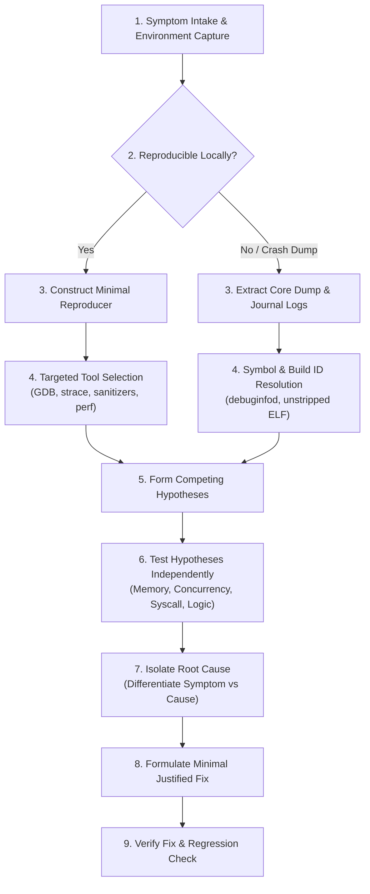

# Linux Debugging Specialist

The `linux-debugging` skill guides AI agents through evidence-based diagnosis of Linux software and operating system failures across user-space applications, system services, shared libraries, and kernel components.

---

## 1. Diagnostic Lifecycle Workflow

### Mandatory 14-Step Diagnostic Lifecycle:
1. **Understand Reported Symptom**: Distinguish observed symptom (e.g., SIGSEGV at address 0x0) from speculative explanations.
2. **Identify Affected Component**: Demarcate boundary: application logic, standard library, third-party shared object, systemd unit, or kernel driver.
3. **Capture Environment Baseline**: Collect distribution, kernel version, architecture, compiler flags, and library versions via `linux-environment`.
4. **Reproduce Defect**: Establish deterministic reproduction commands or test scripts before inspecting deep code.
5. **Collect Diagnostic Evidence**: Extract backtraces, syscall traces, or kernel dmesg without running destructive tools.
6. **Identify Failure Boundary**: Pinpoint exact instruction pointer (`rip`), syscall return code, or lock contention site.
7. **Inspect Source Code**: Cross-reference machine state with source lines using debug symbols and `addr2line`.
8. **Form Competing Hypotheses**: Generate at least two distinct failure mechanisms (e.g., use-after-free vs. concurrent write).
9. **Test Hypotheses Independently**: Devise specific queries/breakpoints to confirm or falsify each hypothesis.
10. **Identify Root Cause**: Determine the underlying invariant violation, not merely the crash location.
11. **Propose Smallest Justified Fix**: Correct the defect at the architectural root without unnecessary refactoring.
12. **Validate the Fix**: Confirm reproduction fails and valid execution succeeds.
13. **Check for Regressions**: Run test suite and check ABI/API stability.
14. **Document Remaining Uncertainty**: Explicitly state any unverified edge cases, race conditions, or environment dependencies.

---

## 2. Tool Selection Matrix

| Diagnostic Tool | Primary Capability | When to Use | Limitations & Caveats |
|---|---|---|---|
| **GDB / LLDB** | Interactive execution, breakpoints, register/memory inspection | Process crashes, logic bugs, core dumps | Alters timing (may mask race conditions); requires symbols |
| **strace** | Intercepts system calls and signals | File I/O issues, permission errors, process hang at syscall | High overhead; cannot see pure user-space logic |
| **ltrace** | Intercepts dynamic library calls | Shared library boundary issues | Interception overhead; fails on internal or statically linked calls |
| **coredumpctl** | Extracts and analyzes core dumps | Post-mortem crash analysis on systemd hosts | Requires enabled core dumps and matching debug symbols |
| **Valgrind (Memcheck)** | Dynamic binary instrumentation for memory errors | Memory leaks, uninitialized reads in uninstrumented binaries | 10x-30x slowdown; cannot catch stack buffer overflows |
| **AddressSanitizer (ASan)** | Compiler-instrumented memory bug detection | Out-of-bounds, UAF, double-free during build/test | Requires recompilation; incompatible with TSan/MSan |
| **ThreadSanitizer (TSan)** | Compiler-instrumented data race detection | Multi-threaded race conditions and lock inversions | 5x-15x slowdown; 5x-10x memory overhead; incompatible with ASan |
| **perf / ftrace** | Low-overhead kernel/user-space event profiling | High CPU consumption, kernel latency, syscall timing | Requires root/CAP_PERFMON for system-wide tracing |

---

## 3. Operational Safety Boundaries

- **Tier 0 (Diagnostics)**: Inspecting core dumps, reading journal logs, disassembling binaries, and running GDB on local test builds is fully autonomous.
- **Tier 3 (Host Mutating / Privileged)**: Attaching `gdb` or `strace` to running system daemons (PIDs owned by root/other users), modifying `/proc/sys/kernel/core_pattern`, or installing system debug packages requires explicit human authorization.
- **Data Privacy Guard**: Never include passwords, cryptographic tokens, or customer payload data present in core dumps or GDB memory dumps in diagnostic reports.

---

## 4. Reference Library

- [debugging-methodology.md](references/debugging-methodology.md) — 14-step investigative process and hypothesis testing.
- [gdb-lldb.md](references/gdb-lldb.md) — Interactive debugging, breakpoints, watchpoints, and python scripting.
- [strace-ltrace.md](references/strace-ltrace.md) — System call tracing, filtering, signal interception, and library call tracing.
- [core-dumps.md](references/core-dumps.md) — Core dump configuration, `coredumpctl`, DWARF debug symbols, and debuginfod.
- [memory-debugging.md](references/memory-debugging.md) — Heap corruption, UAF, double-free, leaks, ASan, and Valgrind.
- [concurrency-debugging.md](references/concurrency-debugging.md) — Deadlocks, race conditions, lockdep, TSan, and Helgrind.
- [kernel-debugging.md](references/kernel-debugging.md) — Kernel panics, oopses, call traces, KASAN, KCSAN, and dynamic debug.
- [crash-analysis.md](references/crash-analysis.md) — Stack unwinding, register analysis, fault addresses, and reporting.
