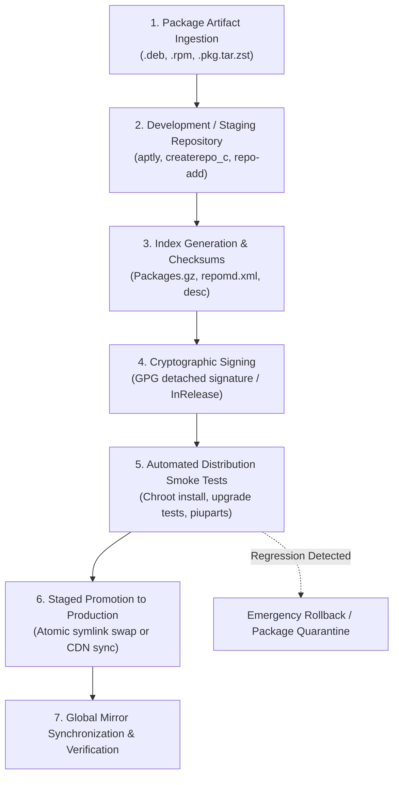

# Linux Distribution Engineering Specialist

The `linux-distribution-engineering` skill guides AI agents through repository architecture, package index generation, repository cryptographic signing, staged promotion pipelines, image composition, and emergency distribution rollback strategies across enterprise and community Linux distributions.

---

## 1. Distribution Repository Architecture Pipeline

### The 8-Step Distribution Engineering Discipline:
1. **Define Repository Topology**: Establish distinct repository environments (e.g., `experimental`, `testing`, `stable`) with clear promotion criteria.
2. **Standardize Artifact Ingestion**: Validate package checksums, digital signatures, and architecture tags prior to importing into repository pools.
3. **Generate Authoritative Metadata**: Build valid repository indices using native tooling (`aptly`/`reprepro` for APT, `createrepo_c` for RPM, `repo-add` for Pacman).
4. **Enforce Cryptographic Integrity**: Sign repository metadata (InRelease, repomd.xml.asc) using offline master keys and dedicated subkeys with strict expiration schedules.
5. **Execute Automated Promotion Gates**: Verify package installability, upgrade paths, and ABI co-installability in isolated environments before promoting to stable pools.
6. **Ensure Atomic Repository Updates**: Update repository metadata via atomic file/symlink swaps to prevent race conditions during client package manager syncs.
7. **Compose Base System Images**: Build reproducible root filesystem images, cloud images, and bootable ISOs from verified repository snapshots.
8. **Plan for Disaster Recovery**: Maintain snapshot rollback capabilities and immediate package revocation procedures for tainted or vulnerable releases.

---

## 2. Multi-Distribution Repository Indexing Reference

| Distribution Family | Index Generation Tool | Primary Metadata Files | Signature Files |
|---|---|---|---|
| **Debian / Ubuntu (APT)** | `aptly`, `reprepro`, `dpkg-scanpackages` | `Packages`, `Packages.xz`, `Release` | `InRelease` (inline), `Release.gpg` |
| **Fedora / RHEL (DNF)** | `createrepo_c`, `modifyrepo_c` | `repodata/repomd.xml`, primary.xml.gz | `repodata/repomd.xml.asc` |
| **openSUSE (Zypper)** | `createrepo_c`, OBS publisher | `repodata/repomd.xml`, patterns | `repodata/repomd.xml.asc`, content |
| **Arch Linux (Pacman)** | `repo-add` | `<reponame>.db.tar.zst`, files.tar.zst | `<reponame>.db.sig` |

---

## 3. Operational Safety Boundaries

- **Tier 0 (Diagnostics)**: Inspecting repository metadata (`repomd.xml`, `InRelease`), checking GPG signature validity (`gpg --verify`), and auditing package lists is fully autonomous.
- **Tier 1 (Workspace Staging)**: Running index generation (`createrepo_c`, `repo-add`) on local workspace directories or mock staging repos runs autonomously.
- **Tier 3 (Host Mutating / Production)**: Publishing new indices to public production repositories, rotating repository signing keys, or executing repository revocations strictly requires explicit human authorization.

---

## 4. Reference Library

- [distribution-architecture.md](references/distribution-architecture.md) — Multi-tier repository topologies, mirror architectures, and CDN caching.
- [repository-design.md](references/repository-design.md) — Directory layouts and index structures for APT, DNF repomd, Zypper, and Pacman.
- [repository-signing.md](references/repository-signing.md) — GPG signing workflows, master key security, subkey rotation, and secure keyrings.
- [package-promotion.md](references/package-promotion.md) — Staged release pipelines (dev -> staging -> stable), release gates, and freezing rules.
- [release-composition.md](references/release-composition.md) — Composable OS package sets, manifest pinning, and solver resolution checking.
- [image-engineering.md](references/image-engineering.md) — Cloud images, appliance rootfs, mkosi, kiwi, and live media generation.
- [rollback-and-recovery.md](references/rollback-and-recovery.md) — Atomic repository rollback, package pinning, and contaminated release handling.