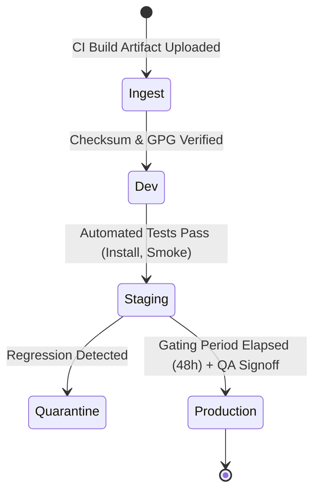

# Package Promotion Pipelines & Release Freezes

A software package must pass rigorous automated and manual validation gates before it is promoted into a production distribution channel.

---

## 1. Staged Promotion Pipeline



### Staging Gates:
1. **Linting and Packaging Standards**:
   - `lintian` (Debian/Ubuntu), `rpmlint` (Fedora/openSUSE), `namcap` (Arch).
2. **Clean Container / Chroot Install**:
   - Test installation in a minimal clean rootfs without pre-existing dependencies.
3. **Upgrade Path Validation**:
   - Install the *current* stable package, then execute `apt-get dist-upgrade` or `dnf upgrade` to the candidate package. Verify exit codes, config file preservation (`/etc/myapp.conf`), and daemon restart status.
4. **Co-Installability & Solver Checks**:
   - Run dependency SAT solvers (`dose3` or `dnf repoquery --unsolved`) across the entire repository to ensure the new package does not break existing packages or produce uninstallable leaves.

---

## 2. Release Freezes

During major distribution or internal release cycles, repositories transition through formal freeze states:

| Freeze State | Permitted Changes | Rejected Changes |
|---|---|---|
| **Transition Freeze** | Bug fixes and targeted library transitions | Upgrading major versions of foundation libraries (e.g., Python, OpenSSL) |
| **Soft Freeze** | Bug fixes, documentation updates, translations | New packages or feature additions |
| **Hard Freeze / Release Candidate** | Critical CVE fixes and release-blocking regressions only | All other changes |
| **Full Freeze** | Zero changes; final ISO/image generation and signing | Everything |

---

## 3. Metadata Locking & Fast Rollout

When promoting packages from `staging` to `production`:
1. Use hard links or atomic copy within the pool storage to prevent copying delays.
2. Regenerate metadata in a temporary directory:
   ```bash
   createrepo_c --tempdir /tmp/repo_tmp /srv/repo/production/
   ```
3. Atomically replace the active metadata directory via rename (`mv /tmp/repo_tmp/repodata /srv/repo/production/repodata`), ensuring clients never observe partially written metadata.