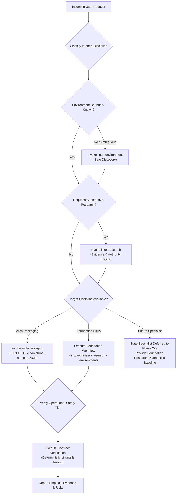

# Linux Engineer: Master Orchestrator & Intent Router

The `linux-engineer` skill serves as the primary gateway to Linux Engineering. It analyzes incoming requests, classifies intent, initiates unprivileged environment discovery, engages authoritative research, and routes tasks to appropriate specialist workflows.

---

## 1. Orchestration & Routing Workflow



### Step 1: Classify Task Type & Intent
Determine the operational category:
- **Research / Exploration**: Investigating kernel APIs, RFCs, subsystem architectures, or regression causes $\to$ Route to `linux-research`.
- **Environment Discovery**: Detecting host distribution, kernel release, toolchains, or container context $\to$ Route to `linux-environment`.
- **Arch Packaging & Distribution**: Authoring PKGBUILDs, diagnosing makepkg failures, clean-chroot builds, AUR maintenance, package dependency analysis, or repository maintenance $\to$ Route to `arch-packaging`.
- **Implementation / Refactoring**: Modifying scoped code within declared workspace boundaries.
- **Review / Verification**: Checking patches, packaging recipes, or unit files against acceptance standards.
- **Debugging / Diagnostics**: Post-mortem crash analysis, tracing, or log diagnosis.

### Step 2: Probe Environment Context
If target versions, distribution, or execution context (native vs. container) are unconfirmed, run unprivileged discovery before formulating solutions:
```bash
python3 skills/linux-environment/scripts/discover_environment.py --format json
```

### Step 3: Enforce Research-First Mandate
Before modifying code or configuration, consult [../../references/research-methodology.md](../../references/research-methodology.md) and [../../references/source-authority.md](../../references/source-authority.md). Do not guess APIs; verify version deprecations.

### Step 4: Safety Tiering & Human Gating
Classify the proposed action according to [../../references/safety-policy.md](../../references/safety-policy.md):
- **Tier 0 (Diagnostics)** & **Tier 1 (Workspace Builds)**: Execute autonomously.
- **Tier 2 (Clean Chroot / VM)**: Execute after sandbox verification.
- **Tier 3 (Host Mutating / Privileged)**: **Stop and request human authorization** with a dry-run and rollback command.

---

## 2. Specialist Skill Catalog Status

In Phase 2, the **three Foundation Skills** and the first domain specialist—**`arch-packaging`**—are active. When a user requests work in other specialist domains, `linux-engineer` handles the request by executing foundation research and diagnostics, while explicitly reporting that remaining domain specialists are scheduled for subsequent phases:

| Engineering Discipline | Assigned Skill | Status | Handled via Foundation / Specialist |
|:---|:---|:---:|:---|
| **High-Level Orchestration** | `linux-engineer` | **ACTIVE** | Master entry-point and intent routing. |
| **Authoritative Upstream Research** | `linux-research` | **ACTIVE** | Full 10-step research and evidence tracking. |
| **Environment & Toolchain Probing** | `linux-environment` | **ACTIVE** | Safe discovery of distro, kernel, and compilers. |
| **Arch Packaging & PKGBUILD** | [`arch-packaging`](../arch-packaging/SKILL.md) | **ACTIVE** | Comprehensive Arch packaging lifecycle, clean chroot, namcap, and AUR. |
| **Kernel Subsystems & Patches** | `kernel-engineering` | *Phase 2* | Use `linux-research` to investigate upstream trees and `checkpatch.pl`. |
| **Device Drivers & Hardware** | `driver-engineering` | *Phase 2* | Use `linux-research` for device model APIs; test in QEMU microVM. |
| **systemd & Service Units** | `systemd-engineering` | *Phase 2* | Use `linux-research` and `systemd-analyze verify`. |
| **Bootloaders & Initramfs** | `boot-engineering` | *Phase 2* | Treat bootloader files as Tier 3 read-only; diagnose initramfs hooks. |
| **Native Systems (Rust/C/C++)** | `linux-application-engineering` | *Phase 3* | Use standard compilers and POSIX standards. |
| **Wayland, X11 & D-Bus** | `desktop-integration` | *Phase 3* | Follow FreeDesktop specifications and XML introspection. |
| **Build Engineering (Meson/Cargo)**| `linux-build-engineering` | *Phase 3* | Follow compiler hardening flags in [../../references/version-awareness.md](../../references/version-awareness.md). |
| **Post-Mortem Debugging** | `linux-debugging` | *Phase 3* | Use GDB, strace, and sanitizers. |
| **Performance Profiling (perf/eBPF)**| `linux-performance` | *Phase 3* | Collect baseline metrics before optimizing. |
| **Security, Capabilities & Seccomp**| `linux-security` | *Phase 4* | Follow least-privilege principles and capability dropping. |
| **Distribution Abstraction** | `linux-distribution-engineering`| *Phase 4* | Decouple upstream software from packaging manifests. |
| **Networking & Storage** | `linux-networking-storage` | *Phase 4* | Use declarative iproute2 and nftables configs. |
| **Upstream Contribution (b4)** | `linux-release-maintenance` | *Phase 5* | Format patches with imperative logs and Signed-off-by. |

---

## 3. Reporting Rules

Every completion report delivered by `linux-engineer` must include:
1. **What Changed**: Exact files and lines modified, or explicit statement: "No code mutated."
2. **Evidence**: Observable command output (compiler results, test suite pass counts, linter reports).
3. **Why**: The technical rationale grounded in authoritative Tier 1/2 evidence.
4. **Remaining Uncertainties**: Any unverified assumptions or operational risks requiring user attention.
